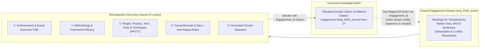

# Conversation Retrospective: Disjoint Universal Knowledge Fabric, Engagement-as-Dataset & The Elevation Technique

- **Date:** 2026-10-27
- **Topic:** How the Universal Knowledge Layer and isolated Engagement boundaries operate as disjoint infrastructures, how `okf-wiki/` and `pgvector` work together via Small-to-Big recall, and how the "Elevation Technique" turns closed engagements into cited datasets.

---

## 1. Correcting a Fundamental Misconception: What the Universal Knowledge Layer Actually Is

During our early design discussion, I initially framed the Universal Knowledge Vault (`chotu-vault`) as a place where project knowledge accumulates. You immediately corrected that framing and articulated the true relationship between **Universal Knowledge** and **Project/Engagement Knowledge**:

> *"Universal knowledge is not an accumulation of project knowledge. The universal knowledge I'm talking about is purely knowledge, maybe organized within domains. The knowledge layer will be the fabric of 'everything we know' that we could tap into. If I gave Chotu something to research or asked it to save a URL or I added a note, it keeps track of everything and in the background derives meaning and relationships between all the data it has received and gathered (through its own research). Project knowledge is isolated to itself within its own boundary. But the fact that Chotu knows so much (universal knowledge) allows for Chotu to execute projects better and smarter with better tools as we go. So when Chotu is doing a project, it's delivering, but at the same time learning by using projects to learn new facts. If the project needs to do anything, Chotu can then effectively look into the universal knowledge layer and do it. THIS is the whole purpose of Chotu."*

And later you reinforced *why* the Universal Knowledge Layer must be a **disjoint infrastructure** with Chotu as the CEO managing it:

> *"The knowledge coming from the knowledge layer once discovered and 'selected' should be ingested to keep the scope within the engagement. This is another reason why I wanted to have the knowledge layer as a disjoint infrastructure with Chotu as the CEO managing it, and another reason why I did not want Chotu to be looking at every bit of knowledge every time. The universal knowledge layer exists as a queryable reference layer if and only if we cannot find our own answers. With a good knowledge layer, Chotu within a project can say 'what do we know about X topic?' or 'have we done X engagement in the past?' or 'how did we do a block diagram before?'—which essentially queries the knowledge layer (fast retrieval) instead of always doing web researches or expensive greps."*

---

## 2. The Rules of Engagement Scope vs. Disjoint Universal Knowledge

This conversation established four foundational rules governing how knowledge flows:

### Rule 1: Engagement Scope is Closed-World First
When Chotu is executing work inside an engagement (`eng_<slug>`), subagents query **only that engagement's local scope** (`okf-wiki/` + the engagement's `pgvector` schema). Chotu does **not** scan the Universal Knowledge Layer on every turn.

### Rule 2: Universal Knowledge is Queried On-Demand When Local Scope Cannot Answer
Only when an engagement encounters a knowledge gap, an architectural conflict, or an explicit reference question—such as:
- *"What do we know about topic X?"*
- *"Have we done an X engagement in the past?"*
- *"How did we structure a block diagram before?"*
- *"What industry standards or reference architectures help resolve this client conflict?"*

—does Chotu dispatch a query to the **Universal Knowledge Layer** via its custodial Knowledge Department (`knowledge.librarian`). Because the Universal Knowledge Layer is indexed in `pgvector` and organized by domains, Chotu gets a fast, high-precision answer from your institutional memory instead of defaulting to slow, generic web searches or filesystem greps.

### Rule 3: "Discover $\rightarrow$ Select $\rightarrow$ Ingest into Engagement Scope"
When the Universal Knowledge Layer returns candidate standards, prior patterns, or research, Chotu does not leave the engagement dependent on an external floating pointer.
- Instead, the relevant knowledge is **discovered, selected, and ingested directly into the current engagement's local scope** (stamped with `scope: reference` or `scope: prior-project` and provenance pointing to the universal source).
- **Why this matters**: It keeps the engagement **100% self-contained, auditable, and reproducible**. Everything that influenced an engagement's decisions and deliverables lives inside that engagement's boundary.

### Rule 4: Custodial Warehouse Governance ("Vault Employees")
No external department or project subagent ever reads or writes the Universal Knowledge Layer's files or tables directly. The Universal Knowledge Layer is operated exclusively by specialized subagents confined to knowledge-layer capabilities:
- **Intake & Extractor**: Ingests articles, PDFs, URLs, and research notes you send Chotu across Telegram, Slack, Obsidian, or the Portal.
- **Archivist & Relationship Synthesizer**: Continuously derives meaning, extracts claims/facts, and weaves cross-domain relationships in the background.
- **Librarian (`context_retrieval_agent`)**: Serves fast recall queries and tracks **Closed-Loop Retrieval Telemetry** (`RetrievalTrace`) so Chotu learns *how* to retrieve the right knowledge more effectively over time.
- **Sanitation Auditor**: Enforces Chotu's First Principles of knowledge hygiene (provenance, consolidation over duplication, pruning stale/unused claims).

---

## 3. Solving the Unfinished `okf-wiki/` $\leftrightarrow$ `pgvector` Problem

When we reviewed `dsa-companion-config`'s `csa-persist-facts` design, you pointed out a key nuance:

> *"The `okf-wiki` is the knowledge which captures all facts/claims/concepts and is organized that way. The `pgvector` exists so these facts/claims/concepts etc. could be loaded into `pgvector` and serve the recall/retrieval architecture instead of having to grep everything from a filesystem. I have personally not solved this yet. Maybe we need to solve that problem here instead of copying it from the `dsa-companion-config` as is."*

### Why the `dsa-companion-config` Approach Was Incomplete
In `dsa-companion-config`, `csa-persist-facts` tapped a temporary scratch file (`/tmp/csa_knowledge.json`) during extraction, while `csa-context` and `csa-ask` still grepped Markdown files on disk. If `okf-wiki/` was edited, synthesized, or imported, `pgvector` drifted out of sync, and nothing actually used `pgvector` for recall.

### How We Solved It for Chotu: Canonical `okf-wiki/` + Derived `pgvector` Recall Engine

1. **`okf-wiki/` is the Canonical Write-Master**:
   - Every source concept (`okf-wiki/<type>/concept-*.md`), every atomic fact/claim (`^f-id`), every verbatim citation, every `scope:` / `perspective:` tag, and every regenerated BAITS synthesis view (`okf-wiki/synthesis/baits-<pillar>.md`) lives canonically in `okf-wiki/` Markdown.
2. **The OKF-to-`pgvector` Projector (Driven by Content Hashes & Hooks)**:
   - Rather than tapping a temporary extraction scratch file, a dedicated **OKF Indexer** parses `okf-wiki/` Markdown files directly into Postgres + `pgvector` (triggered by the `on_facts_persisted` hook and verified by SHA-256 file hashes).
   - Because `okf-wiki/` is deterministic and self-contained, `pgvector` is a **100% recomputable read projection**—you can rebuild or migrate the entire vector and graph index from `okf-wiki/` at any time.
3. **"Small-to-Big" Two-Tier Recall (Fact + Pillar Section Matching $\rightarrow$ Parent Block Hydration)**:
   - We compared Fact-First retrieval (high precision for specific numbers/names, but loses narrative context) vs. Concept-First retrieval (preserves narrative, but blurs multi-pillar files into one diluted vector and bloats prompts).
   - We locked in **Small-to-Big Retrieval**:
     - **Index Two Granularities in `pgvector`**:
       1. Every atomic **Fact/Claim** (`^f-id`) with its 768-dim embedding, `pillar`, `framework`, `scope`, and `perspective`.
       2. Every **Pillar Section** (both per-source `## <Pillar>` blocks in `concept-*.md` and synthesized blocks in `okf-wiki/synthesis/baits-<pillar>.md`).
     - **Match Small, Hydrate Big**:
       - When a subagent queries the Librarian, `pgvector` finds the highest-scoring atomic facts and pillar sections in milliseconds (never grepping the filesystem).
       - The Librarian then groups those winning facts under their **parent Concept's `## <Pillar>` section + matching `baits-<pillar>.md` synthesis block** with verbatim citations attached, returning a coherent, token-efficient `ContextPacket`.

---

## 4. The "Elevation Technique": Engagement-as-Dataset & Retrospective Discovery

When I asked how Chotu should extract reusable patterns from an engagement over a 6-to-12-month horizon without leaking raw client files into Universal Knowledge, you laid out the **Elevation Technique**:

> *"When an engagement closes we can ask retrospective discovery-based questions and queue up tasks which answer questions like: 'What did we achieve in this engagement and how did we need to do it?', 'What methods we learnt work with this engagement and what did not?', 'What people, process, technology, tools, techniques worked or did not work for us in this engagement?', 'Knowing what we know today, how would we approach differently and if another engagement comes this way, what should we factor in so our mistakes don't repeat?', 'What research we collected?' and so on. Once we know these, we take the 'knowledge' with the engagement itself as the citation into the universal knowledge (elevation technique). This way if we needed to go deeper at a later point in time, we use the engagement id as the correlation which gives us the engagement-specific discovery to understand the reality. So every engagement becomes a dataset of some kind."*

### How Elevation & Correlation Work Together
1. **Every Engagement Is Preserved as an Empirical Dataset (`eng_<engagement_id>`)**:
   - The engagement's `okf-wiki/`, Master Data, multi-perspective timelines, and deliverables remain intact inside its engagement schema/workspace.
2. **Automated Retrospective Discovery Queue at Milestone / Closure**:
   - Closing an engagement (or completing a phase) enqueues a structured series of discovery tasks across your five retrospective lenses (Achievements/Path, Methodology Efficacy, PPTTT, Counterfactuals/Anti-Repeat Rules, and Collected Research).
3. **Elevation with `engagement_id` as the Citation Correlation Key**:
   - The distilled insights are written into the **Universal Knowledge Fabric** under their corresponding domain and BAITS pillar, citing `engagement://<engagement_id>#^<retro_fact_id>`.
   - A year later, when starting a similar engagement, Chotu queries Universal Knowledge and immediately recalls: *"For this class of migration, factor X in on Day 1 because approach Y failed under constraint Z [cite: engagement://eng_2026_acme#^retro-07]."*
   - And if you or Chotu want to inspect the ground-truth reality behind that lesson ("show me what actually happened in `eng_2026_acme` around that decision"), Chotu uses the `engagement_id` correlation key to run a targeted drill-down query against `eng_2026_acme`'s dataset.
