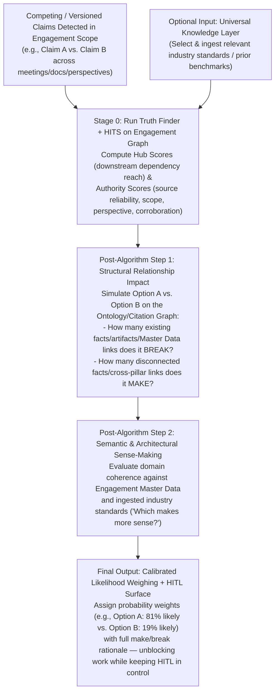

# Conversation Retrospective: Versioned Knowledge, Multi-Perspective Reality & The Truth Finder + HITS Engine

- **Date:** 2026-10-27
- **Topic:** Managing versioned knowledge, multi-perspective claims across daily meetings, and resolving mid-engagement conflicts using an active Truth Finder + HITS + Two-Step Relationship & Plausibility Weighing engine.

---

## 1. The Real-World Complication: Versioned Knowledge & Mid-Engagement Conflicts

During our discussion of engagement data, you introduced one of the hardest real-world complications in consulting:

> *"Let me tell you one other complication (real) is versioned knowledge and information... Where does unversioned knowledge hurt the most right now? Creating conflicts and therefore causing blockers. This lives inside the scope of the engagement that we are currently in. So Chotu needs to know which scope it's working on. The knowledge layer for example could provide previous research about some industry standards which can help resolve this current engagement's conflicts or help provide input to the truth finder algorithm."*

In a real engagement where you attend **10 meetings a day across at least 3 different perspectives** (client-stated, internal delivery team, personal observations/research) and read **20+ documents a day**, information is constantly evolving and contradicting earlier statements:
- What a stakeholder said in Discovery Week 1 is contradicted by an Architecture Review in Week 3.
- What the client's VP of Business believes about their platform differs from what the client's Principal Engineer states in a technical deep-dive on the very same day.
- Diagrams, architectures, and designs iterate from `v0.1` $\rightarrow$ `v0.2` $\rightarrow$ `v1.0` as understanding matures.

If knowledge is unversioned and flat, every difference between two sources registers as a **hard conflict (`⚠ conflict`)**, stalling synthesis and creating blockers across your deliverables.

---

## 2. Rejecting Naive Auto-Supersession: Why Timestamp Alone Is Not Truth

When I asked whether Chotu should automatically supersede an older fact whenever a newer source contradicts it, you immediately rejected forced auto-resolution:

> *"No, I think the Truth Finder and HITS should both be active. Auto conflict resolution should not be forced. Only two steps after executing the algorithm: which option makes/breaks existing/new relationships, and which would make more 'sense'. Then weigh the options to understand which one is more likely."*

### Why Forced Auto-Resolution Fails in Consulting
In consulting engagements, **"newer" does not automatically mean "truer"**:
- A casual remark in a Week 5 status call might contradict a formally signed Week 2 Architecture Decision Record (ADR) or Statement of Work (SOW).
- If an agent blindly overwrites or auto-supersedes the Week 2 ADR because the Week 5 transcript has a newer timestamp, it corrupts the engagement's Master Data and silently breaks downstream architecture artifacts.
- Conversely, if the agent refuses to evaluate the conflict at all, everything stalls waiting for manual triage.

---

## 3. The Active Truth Finder + HITS + Two-Step Weighing Architecture

Instead of forced auto-resolution or passive blocking, Chotu keeps competing claims **active and versioned in the engagement's epistemic graph** and runs an active **Truth Finder + HITS + Two-Step Weighing Pipeline**:

### Detailed Walkthrough of the Pipeline

#### Stage 0: Active Truth Finder + HITS (Hubs & Authorities) + Bitemporal Versioning
Every claim/fact and source in the engagement schema (`eng_<slug>`) carries:
- **Bitemporal & Version Metadata**: `version`, `observed_at` (when it was stated in reality), `ingested_at` (when Chotu recorded it), and `lineage_parent_id`.
- **6-Value `scope:`**: `engagement` (SOW/charter) · `client` · `internal` · `reference` · `prior-project` · `deliverable`.
- **Multi-Perspective Axis (`perspective:`)**: `client_stated` (and sub-role/department) · `internal_team` · `personal_take` · `work_research` · `personal_rd`.
- **HITS & Truth Finder Scores**:
  - **Authority Score**: Derived from source authority (SOW/signed spec > technical workshop > ad-hoc chat), corroboration across independent sources, and alignment with verified reference standards pulled from the Universal Knowledge Layer.
  - **Hub Score**: Derived from how centrally the concept/claim connects across BAITS pillars, Engagement Master Data entities, and synthesis views.

#### Post-Algorithm Step 1: Structural Impact Analysis ("Makes vs. Breaks Relationships")
Before judging which competing claim is more likely, Chotu evaluates the **graph topology impact** of each candidate option:
1. **What Relationships Does Option $i$ BREAK?**
   - Traces all edges in the engagement's citation and ontology graph (`fact_citation`, `entity_relation`, `baits-<pillar>.md` synthesis anchors, and artifact dependencies).
   - Counts and lists which corroborated facts, Master Data records, or cross-pillar constraints would be contradicted or orphaned if Option $i$ were accepted as truth.
2. **What Relationships Does Option $i$ MAKE?**
   - Identifies whether accepting Option $i$ resolves open questions, bridges previously disconnected facts across BAITS pillars (e.g., connecting a Business KPI constraint to a Technology infrastructure limit), or aligns with newly ingested discovery.

#### Post-Algorithm Step 2: Plausibility & Sense-Making ("Which Makes More Sense?")
Next, Chotu evaluates **architectural and domain coherence**:
- If the engagement's local facts are insufficient to judge which option makes more sense, Chotu queries the **Universal Knowledge Layer** for relevant industry standards, reference architectures, or prior-project benchmarks and ingests the selected reference into the engagement scope.
- It then evaluates which option is more technically, organizationally, and logically coherent given the client's constraints, team size, budget, and technology stack.

#### Final Weighing & Non-Blocking Execution (With HITL Active)
Finally, Chotu combines:
$$\text{Likelihood}(O_i) = f\big(\text{HITS Authority/Hub}, \Delta\text{Relationships (Made vs. Broken)}, \text{Domain Coherence}\big)$$
- **No Forced Overwrite**: Both versions/claims remain preserved in the ledger with their computed likelihood weights and make/break impact report.
- **Unblocked Delivery + Active HITL**: Architects and synthesis views can proceed using the leading weighed hypothesis (explicitly annotated with its confidence weight and fallback impact), while surfacing the structured 2-option comparison card in the Portal/Telegram so you can lock in the definitive decision (or ask the client a surgical clarifying question in the next meeting).
