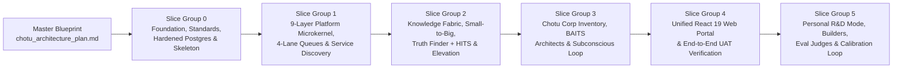

# Chotu (`dsa-agent`) — Master Slice Group Queue & Planning Index

When you are building a system as ambitious as Chotu — an autonomous consulting and personal R&D company ("Chotu Corp") designed to handle ~10 multi-perspective meetings and ~20 complex documents every single day — trying to hold the entire implementation in a single monolithic plan is a recipe for drift. If a plan is just a giant wall of tasks, nobody reads it before writing code. On the other hand, if you jump straight into writing low-level code checklists without first agreeing on how a vertical slice fits together, you lose sight of the architectural guardrails we worked so hard to establish during brainstorming.

To keep our planning human-readable, practical, and easy to pick up across sessions, we organize everything in `docs/planning/` across two distinct tiers.

---

## How Our Two-Tier Planning Works

### Tier 1: Overall Architectural & Slice Group Plans (`docs/planning/slice-00-*.md` through `slice-05-*.md`)

Before we touch code for a major phase of the system, we need a clear, conversational narrative that explains the big picture of that phase. Our **Tier 1 Slice Group Plans** sit right between the master architectural blueprint ([`chotu_architecture_plan.md`](file:///home/nox/Developer/ds2/dsa-agent/docs/planning/chotu_architecture_plan.md)) and our day-to-day coding tasks.

Each Slice Group Plan is written so that you (or any agent session picking up work weeks later) can read it in ten minutes and immediately understand:
- **Why this slice group exists and why it comes at this exact point in the sequence** — what foundation it relies on from earlier slices, and what downstream capabilities it unlocks next.
- **What we are harvesting vs. building fresh** — which proven patterns, schemas, agents, or UI components we are adapting from our read-only sibling repositories in `/home/nox/Developer/ds2/` (`dsa-prj`, `dsa-companion-config`, `okf-kb-manager`, `dsappz-dsrag-prj`, `classifier-training`, `substrate`, `dsapps-journal`, and `dsapps-checkin`), and how we reshape them to fit our hexagonal ports and adapters.
- **How the moving parts fit together in practice** — grounded in real consulting and personal R&D scenarios rather than abstract spec-speak.
- **What "Done" looks like** — concrete, verifiable checks that prove the slice group actually works end-to-end before we move on to the next one.

### Tier 2: Granular Literate TDD Execution Plans (`docs/planning/tdd-plans/`)

While Tier 1 gives us architectural clarity and human understanding, actually writing the code requires disciplined, step-by-step execution. Right before we begin coding a specific Slice Group (or a sub-workstream inside it), we enter the `writing-plans` phase and produce a **Tier 2 Literate TDD Execution Plan** inside `docs/planning/tdd-plans/`.

Written through `narrative-writer` in **Literate TDD Plan Mode**, those Tier 2 files combine natural, plain-English explanations of *why* each interface and boundary is shaped the way it is with exact, zero-placeholder technical precision: exact file paths to create or modify, full Python/TypeScript/SQL type signatures, complete failing `pytest`/`vitest` tests to run first, the implementation details to make them pass, and the exact verification and commit commands. Separating Tier 1 (overall slice comprehension and design alignment) from Tier 2 (red-green-refactor execution checklists) keeps our architectural plans easy to read and keeps our coding plans razor-sharp.

---

## The Ordered Slice Group Queue

We build Chotu from the ground up in six ordered Slice Groups (`Slice Group 0` $\rightarrow$ `Slice Group 5`). Each slice group follows the additive slice-delivery discipline harvested from [`slice-delivery.md`](file:///home/nox/Developer/ds2/dsa-prj/docs/standards/slice-delivery.md): we lay down the contracts and tests first, verify every seam with port-contract suites, and never build higher-level agent workflows on top of unverified infrastructure.

### Master Blueprint & Brainstorming Lineage
- **[`chotu_architecture_plan.md`](file:///home/nox/Developer/ds2/dsa-agent/docs/planning/chotu_architecture_plan.md)** — **Master Architecture & Implementation Blueprint**: The single-page synthesis of Chotu's system topology, the 9-layer `platform/` chassis vs. `inventory/` separation, the authoritative harvest matrix across `/home/nox/Developer/ds2/`, and our core architectural pillars.
- **[`brain-logs/README.md`](file:///home/nox/Developer/ds2/dsa-agent/brain-logs/README.md)** — **Topic-Level Brainstorming Retrospectives**: The seven foundational design retrospectives that capture *why* every architectural invariant exists, which naive assumptions we rejected along the way, and how the operator's daily consulting scale shaped the design.

---

### 1. [`slice-00-foundation-standards-and-skeleton.md`](file:///home/nox/Developer/ds2/dsa-agent/docs/planning/slice-00-foundation-standards-and-skeleton.md)
**Slice Group 0: Governance, Doc-Chain, Standards, Hardened Postgres Infrastructure & Hexagonal Skeleton**
- **Literate TDD Execution Plan**: [`docs/planning/tdd-plans/slice-00-tdd-plan.md`](file:///home/nox/Developer/ds2/dsa-agent/docs/planning/tdd-plans/slice-00-tdd-plan.md)
- **Why It Comes First**: If we start writing platform engines or importing agents before locking in our directory boundaries, linter rules, documentation chain, and database schemas, architectural drift is guaranteed. Slice Group 0 establishes the rules of the road and the physical chassis so every line of code in Slices 1–5 lands in a strictly verified structure.
- **What It Delivers**:
  - Harvested engineering standards (`docs/standards/`) from [`dsa-prj`](file:///home/nox/Developer/ds2/dsa-prj/docs/standards/code-structure.md) and the complete root documentation chain (`PRD.md`, `ARCHITECTURE.md`, `HARVEST.md`, `RULES.md`, `BACKLOG.md`, and ADRs `0001`–`0008`).
  - The 9-layer Fractal Hexagonal `backend/platform/` and `backend/inventory/` skeleton, `tests/` mirror tree, strict `pyproject.toml` (`ruff`, `mypy --strict`, `pytest`), and automated CI boundary checks enforcing zero vendor SDK imports in `domain/` and zero `inventory/` imports in `platform/`.
  - Tier-0 hardened PostgreSQL 16 + `pgvector` HNSW Docker Compose infrastructure and multi-schema bootstrap (`core.*`, `universal.*`, `personal.*`, and the per-engagement `eng_<slug>.*` schema template).

### 2. [`slice-01-platform-microkernel-queues-and-discovery.md`](file:///home/nox/Developer/ds2/dsa-agent/docs/planning/slice-01-platform-microkernel-queues-and-discovery.md)
**Slice Group 1: The 9-Layer `platform/` Microkernel, 4-Lane Priority Master Queue & Service Discovery**
- **Literate TDD Execution Plan**: [`docs/planning/tdd-plans/slice-01-tdd-plan.md`](file:///home/nox/Developer/ds2/dsa-agent/docs/planning/tdd-plans/slice-01-tdd-plan.md)
- **Why It Comes Second**: Once the skeleton and Postgres cluster are running, Chotu needs its domain-agnostic operating system (`backend/platform/`) before any specialist agents or knowledge pipelines can run safely.
- **What It Delivers**:
  - The `core.*` tables, transactional outbox, 4-Lane Priority Master Task Queue (`P0 interactive`, `P1 workflow_dag`, `P2 outbox_hooks`, `P3 subconscious_bulk` via `FOR UPDATE SKIP LOCKED`), and atomic Per-Node DAG State Machine (`WorkflowRun` + `WorkflowNodeRun`).
  - Constructor Dependency Injection at `bootstrap.py` for core infrastructure ports alongside the runtime `ServiceDiscoveryPort` and `ServiceLocatorPort` (`chotu://<kind>/<namespace>/<name>@<version>`) with Hybrid Pull + Push registration and the 3-Stage Zero-LLM Resolution Pipeline.
  - The two sovereign runtime chokepoints (`AgentRuntime.invoke()` and `ToolRegistry.invoke()`), `WorkspaceJail` path isolation, the dual-mode `HookRegistryPort` with origin-tagged recursion fencing, `WorkClassifierPort`, `DynamicWorkflowComposer` (with probationary burn-in), and the strict **Subagents-Only Dispatcher**.

### 3. [`slice-02-knowledge-fabric-truth-finder-and-elevation.md`](file:///home/nox/Developer/ds2/dsa-agent/docs/planning/slice-02-knowledge-fabric-truth-finder-and-elevation.md)
**Slice Group 2: Disjoint Knowledge Fabric, Small-to-Big Recall, Multi-Perspective Truth Finder + HITS & The Elevation Technique**
- **Literate TDD Execution Plan**: [`docs/planning/tdd-plans/slice-02-tdd-plan.md`](file:///home/nox/Developer/ds2/dsa-agent/docs/planning/tdd-plans/slice-02-tdd-plan.md)
- **Why It Comes Third**: Consulting agents are only as good as the epistemic engine underneath them. Before we wire up the BAITS architects and Lead Orchestrator in Slice 3, the platform must know how to isolate client engagements (`eng_<slug>`), project canonical `okf-wiki/` files into `pgvector` without silent skips, weigh competing claims across perspectives, and elevate sanitized learnings at milestone closure.
- **What It Delivers**:
  - Per-engagement (`eng_<slug>.*`), Universal Knowledge (`universal.*`), and Personal R&D (`personal.*`) schemas, including first-class **Engagement Master Data** tables (Accounts, Stakeholders, Systems, Capabilities, Decisions, Metrics, Deliverables, SOW Milestones, RAID).
  - The durable `OKFIndexer` (`okf-wiki/` $\rightarrow$ `pgvector` HNSW atomic facts + BAITS pillar sections) and the **Small-to-Big Librarian** (`context_retrieval_agent` machinery) with verbatim `[[concept#^fact]]` citation hydration.
  - Bitemporal versioning, 6-value `scope:` firewalls, 5-perspective tagging (`client_stated`, `internal_team`, `personal_take`, `work_research`, `personal_rd`), and the active **Truth Finder + HITS 2-Step Weighing Engine** (Step 1: Structural Relationship Make/Break Impact; Step 2: Contextual Plausibility Weighing).
  - The **Discover $\rightarrow$ Select $\rightarrow$ Ingest** bridge from Universal Knowledge into engagement scope, plus the **5-Lens Retrospective Elevation Engine** citing `engagement://<engagement_id>#^<anchor>`.

### 4. [`slice-03-chotu-corp-inventory-and-subconscious-loop.md`](file:///home/nox/Developer/ds2/dsa-agent/docs/planning/slice-03-chotu-corp-inventory-and-subconscious-loop.md)
**Slice Group 3: "Chotu Corp" Inventory — Lead Orchestrator, BAITS Architects, Capability-Bundles & Subconscious Mind**
- **Literate TDD Execution Plan**: [`docs/planning/tdd-plans/slice-03-tdd-plan.md`](file:///home/nox/Developer/ds2/dsa-agent/docs/planning/tdd-plans/slice-03-tdd-plan.md)
- **Why It Comes Fourth**: With the 9-layer chassis, service discovery, task queues, and knowledge fabric tested and ready, we populate the company (`backend/inventory/`) by harvesting and upgrading our proven agents, skills, parsers, and capability bundles.
- **What It Delivers**:
  - `lead/chotu` (Conscious Orchestrator & Subconscious Reflector enforcing the Subagents-Only invariant), the 8 CSA/BAITS specialist agents (`business`, `application`, `information`, `technology`, `security`, `researcher`, `reviewer`, `scribe`), and the `csa-*` operationalized `SKILL.md` playbooks and `bvf`/`raid` capability bundles harvested from [`dsa-companion-config`](file:///home/nox/Developer/ds2/dsa-companion-config).
  - The custodial KB department (`csa-ingest`, `csa-extract`, `csa-concept-writer`, `okf-indexer`, `csa-synthesize`, `truth_finder_agent`, `retro_elevator_agent`, `vault_hygiene`), self-extending builder agents (`agent_builder`, `tool_builder`, `skill_builder`, `app_onboarding`), and document/transcript extractors harvested from [`dsappz-dsrag-prj`](file:///home/nox/Developer/ds2/dsappz-dsrag-prj).
  - The 3-tier Subconscious background daemon (continuous ingestion, knowledge maintenance, and Daily Executive Briefing preparation) plus inbound/outbound communication adapters (`CLI`, `FastAPI REST/WS`, `ObsidianWatcher`, `TelegramBot`, and external app bridges for `dsapps-journal` and `dsapps-checkin`).

### 5. [`slice-04-unified-web-portal-and-verification.md`](file:///home/nox/Developer/ds2/dsa-agent/docs/planning/slice-04-unified-web-portal-and-verification.md)
**Slice Group 4: Unified Chotu Web Portal (`frontend/`) & End-to-End Verification**
- **Literate TDD Execution Plan**: [`docs/planning/tdd-plans/slice-04-tdd-plan.md`](file:///home/nox/Developer/ds2/dsa-agent/docs/planning/tdd-plans/slice-04-tdd-plan.md)
- **Why It Comes Fifth**: Once every backend capability is proven over API and CLI contracts, we unify the operator's daily cockpit into a single React 19 + TypeScript + Vite + Tailwind v4 + `shadcn/ui` portal and run full end-to-end acceptance suites.
- **What It Delivers**:
  - The consolidated `frontend/` application combining the [`dsa-prj`](file:///home/nox/Developer/ds2/dsa-prj) shell (`AppShell`, `ResizablePanes`, `CommandPalette`, `TraceDrawer`, `ApprovalCard`, `PolicyEditor`), the [`okf-kb-manager`](file:///home/nox/Developer/ds2/okf-kb-manager) studio and project workspaces (`ProjectPage`, `StudioShelfPage`, `ConceptTree`, `FactExplorerTab`, `CitationGraphView`, `EvalsPage`), and executive productivity panels from [`dsapps-journal`](file:///home/nox/Developer/ds2/dsapps-journal) and [`dsapps-checkin`](file:///home/nox/Developer/ds2/dsapps-checkin).
  - Purpose-built operator views for the **4-Lane Master Queue Monitor**, **Engagement Master Data Explorer**, **Multi-Perspective Truth Finder + HITS Side-by-Side Diff Cards**, and **5-Lens Retrospective Elevation Review**.
  - Full-system verification across unit, port-contract, multi-schema integration, and Playwright end-to-end UAT checklists.

### 6. [`slice-05-personal-rd-builders-evals-and-learning-loop.md`](file:///home/nox/Developer/ds2/dsa-agent/docs/planning/slice-05-personal-rd-builders-evals-and-learning-loop.md)
**Slice Group 5: Personal R&D Mode, Technique Learning, Self-Extension Builders, Evaluation Judges & Continuous Learning Loop**
- **Literate TDD Execution Plan**: [`docs/planning/tdd-plans/slice-05-tdd-plan.md`](file:///home/nox/Developer/ds2/dsa-agent/docs/planning/tdd-plans/slice-05-tdd-plan.md)
- **Why It Comes Sixth**: With Work Mode, the Knowledge Fabric, Chotu Corp Inventory, and the Web Portal operating end-to-end, Slice Group 5 gives first-class architecture to the operator's **Personal R&D Mode** (*"learn techniques that 'might' help me with work, design tools for myself and so on"*) and closes Chotu's continuous self-improvement and calibration loops.
- **What It Delivers**:
  - Dedicated **Personal Technique Learning & Study Notebooks** (`personal.*` schema + `workspaces/personal_rd/`, tagged `perspective: personal_rd`) with a structured readiness lifecycle (`EXPLORING -> PROTOTYPING -> VALIDATED -> PROMOTED_TO_UNIVERSAL`) that never pollutes active client engagements (`eng_<slug>.*`).
  - The governed **Self-Extension Builder Workbench** (`tool_builder`, `skill_builder`, `agent_builder`, `app_onboarding`) executing inside isolated sandbox worktrees with automated `ruff`, `mypy --strict`, boundary check, and `pytest` gates prior to `ApprovalBus` graduation into `~/.chotu/` and `ServiceDiscoveryPort`.
  - **Epistemic & Retrieval Evaluation Judges** harvested from [`okf-kb-manager`](file:///home/nox/Developer/ds2/okf-kb-manager/CLAUDE.md) (Deterministic Citation & Scope Firewall Verifier, `FaithfulnessJudgePort`, `CompletenessJudgePort`) wired into `core.retrieval_traces` so capability and concept ranking weights continuously improve.
  - **Classifier Calibration & Active Distillation Flywheel** harvested from [`classifier-training`](file:///home/nox/Developer/ds2/classifier-training/CLAUDE.md) (YAML taxonomies, Laya encoder checkpoints, confidence-threshold gating, and golden-set promotion from operator corrections), plus the **`TechniquePromoter` bridge** that elevates validated personal techniques and tools into Universal Knowledge (`universal.*`) for Work Mode discovery.
