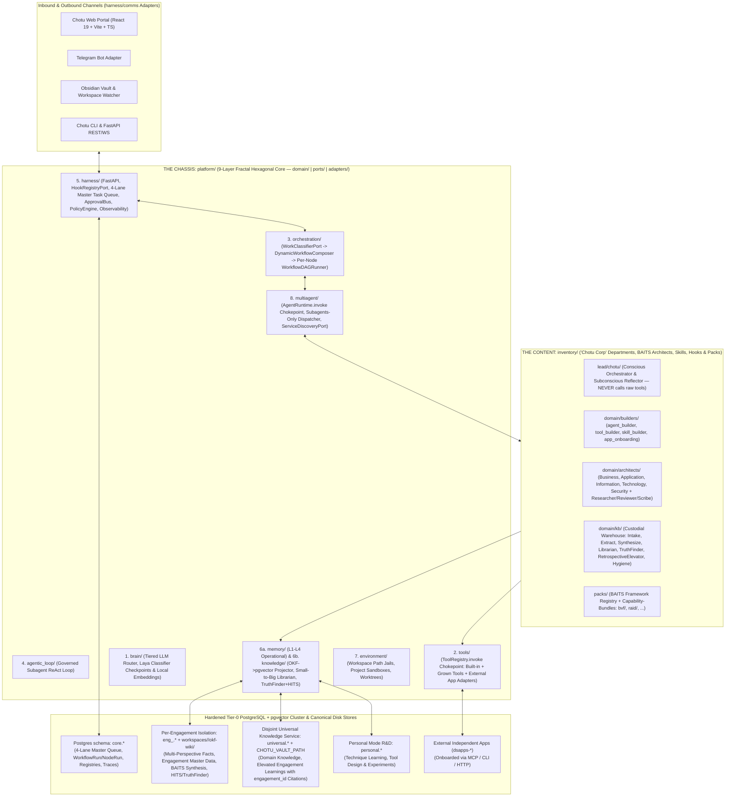

# Chotu (`dsa-agent`) — Architecture & Implementation Blueprint

> [!IMPORTANT]
> **Core Thesis**: **Chotu** is a self-extending, capability-driven autonomous enterprise ("Chotu Corp") built on the **Microkernel + Fractal Hexagonal Architecture** established in [`dsa-prj`](file:///home/nox/Developer/ds2/dsa-prj/docs/standards/code-structure.md) (`platform/` chassis + `inventory/` plugins, where every subsystem repeats `domain/ | ports/ | adapters/`), fused with the **CSA / BAITS Consulting & Capability-Bundle Engine** from [`dsa-companion-config`](file:///home/nox/Developer/ds2/dsa-companion-config/README.md), the **Sources $\rightarrow$ Facts $\rightarrow$ Concepts** epistemic engine from [`okf-kb-manager`](file:///home/nox/Developer/ds2/okf-kb-manager/CLAUDE.md) and [`substrate`](file:///home/nox/Developer/ds2/substrate/CLAUDE.md), and a hardened **PostgreSQL 16+ / `pgvector` HNSW + 4-Lane Priority Master Task Queue** designed for high-volume daily consulting and personal R&D.

For the full narrative reasoning behind every concept in this blueprint, see the topic-level retrospectives in [`brain-logs/README.md`](file:///home/nox/Developer/ds2/dsa-agent/brain-logs/README.md).

---

## 1. System Topology: Microkernel Chassis (`platform/`) + Chotu Corp (`inventory/`)



---

## 2. Core Architectural Pillars

### 2.1 Microkernel + Fractal Hexagonal Rules (from [`dsa-prj`](file:///home/nox/Developer/ds2/dsa-prj/docs/standards/hexagonal.md))
1. **Two Trees (`platform/` vs. `inventory/`)**:
   - `platform/` is **the chassis** (the 9 mechanism layers). `platform/` **never** imports `inventory/`.
   - `inventory/` is **the content** (Chotu's departments, BAITS architects, extractors, workflows, hooks, tools, `SKILL.md` sets, and capability-bundle `packs/`). Shipped inventory registers through the exact same registries as runtime-grown capabilities under `~/.chotu/`.
2. **Fractal Modularity (`domain/ | ports/ | adapters/`)**:
   - Every layer under `platform/` repeats `domain/`, `ports/` (`<Thing>Port`), and `adapters/` (`<Vendor><Thing>Adapter`).
   - **Zero vendor SDKs in `domain/`** (enforced by CI grep). Every new port method ships with a **port-contract test** in the same change.
3. **Two Debugging Chokepoints & Workspace Jailing**:
   - `AgentRuntime.invoke()` and `ToolRegistry.invoke()` are the only cross-module execution seams, emitting OpenTelemetry trace spans (`turn -> workflow_node -> subagent -> tool`).
   - Subagents invoking `python`, `bash`, `grep`, or `file_ops` execute inside a **Workspace Jail** (`platform/environment/`) restricted to their active `workspaces/<slug>/` folder, preventing any filesystem bypass around the Knowledge Librarian or across client engagements.

### 2.2 Service Locator & Service Discovery Architecture (`CapabilityRegistry`)
1. **Strict DI vs. Runtime Locator Boundary**:
   - Core platform infrastructure Ports (`LLMPort`, `WorkflowStorePort`, `TaskQueuePort`, `KnowledgeIndexPort`, `ObservabilityPort`) are wired via **Constructor Dependency Injection** at the Composition Root (`harness/bootstrap.py`).
   - `ServiceLocatorPort` & `ServiceDiscoveryPort` operate strictly at the **Runtime Capability Plane** behind `AgentRuntime.invoke` and `ToolRegistry.invoke`.
2. **Canonical Capability URI (`chotu://<kind>/<namespace>/<name>@<version>`)**:
   - Unifies subagents, skills, internal tools, capability-bundles, sidecars, and external apps (`dsapps-*`) with typed JSON I/O contracts, BAITS pillar/department tags, `lifecycle_policy` (`always_on` | `lazy_start` | `external_managed`), and `fallback_uri`.
3. **Hybrid Pull + Push Registration & 3-Stage Zero-LLM Resolution**:
   - **Pull** (file-watcher discovery of `manifest.yaml` / `SKILL.md` in `inventory/` and `~/.chotu/`) + **Push** (`POST /api/v1/registry/register` & `/heartbeat` for external apps and sidecars).
   - **3-Stage Resolution**: $O(1)$ Exact URI/Trigger Locator $\rightarrow$ Faceted Filter (Health + Allowlist/Policy + Department/BAITS Pillar + I/O Contract) $\rightarrow$ Hybrid BM25 + `pgvector` Embedding + Historical Reliability Ranking (logging to the **Capability-Miss Ledger** if below threshold).

### 2.3 Classifier-First Routing, Subagents-Only Invariant, Dynamic Workflow DAGs & Lifecycle Hooks
1. **Upfront Classifier Gate + Strict "Subagents-Only" Invariant (`WorkClassifierPort`)**:
   - Every inbound request, file drop, or scheduled event is classified first (using Laya checkpoint patterns from [`classifier-training`](file:///home/nox/Developer/ds2/classifier-training/CLAUDE.md), rules, and embeddings) into `WorkClassification(intent, mode, engagement_slug, departments[], baits_pillars[], scope, perspective, complexity, risk_level)`.
   - **Hard Invariant**: **The Lead Orchestrator (`lead/chotu`) NEVER executes raw tools or mutates state directly.** It only composes and dispatches to scoped **Subagents (`chotu://agent/...`)**.
2. **Dynamic Workflow DAG Composition & Probationary Crystallization**:
   - Checks `WorkflowRegistry` for an `ESTABLISHED` DAG matching the classification signature (zero LLM planning overhead).
   - For novel tasks, queries `ServiceDiscoveryPort` and composes a typed Subagent DAG (supporting sequential chains, parallel fan-out/fan-in across BAITS pillars, and approval gates), splices in Builder/Researcher subagents on mid-flight capability misses, and records new DAGs as `CANDIDATE`—graduating to `ESTABLISHED` only after **3 consecutive verified successes** or explicit human promotion.
3. **Dual-Mode Lifecycle Hook Engine (`HookRegistryPort` + Origin-Tagged Fence)**:
   - **Blocking Interceptor Hooks (`pre_*` / `post_*`)**: Auto-inject scoped `ContextPacket`s and BAITS skills before subagent dispatch; enforce Policy, Workspace Jail, 6-value `scope:` citeability firewalls, and `[[concept#^fact]]` citation verification before node completion.
   - **Async Background Observer Hooks (`on_facts_persisted`, `on_workflow_complete`, `on_capability_miss`)**: Enqueued to the `P2 outbox_hooks` lane to trigger `okf-wiki/` $\rightarrow$ `pgvector` indexing, mark `.csa/synthesis-status.md` stale, update `RetrievalTrace` weights, and evaluate DAG crystallization.
   - **Origin-Tagged Recursion Fence**: Workflows carry `origin: USER | HOOK | SUBCONSCIOUS` and `hop_depth`. Observer hooks only spawn follow-up workflows when `origin == USER` and `hop_depth == 0`.

### 2.4 Disjoint Universal Knowledge Fabric, Engagement-as-Dataset, Small-to-Big Recall & Truth Finder + HITS
1. **Engagement-First (Closed-World) vs. Disjoint Universal Knowledge Service**:
   - Inside an engagement (`eng_<slug>`), subagents query **only that engagement's local scope first**.
   - The **Universal Knowledge Layer (`universal.*` + `CHOTU_VAULT_PATH`)** is a disjoint fast-recall reference service managed by Chotu as CEO. It is queried **only when the engagement cannot answer locally** (e.g., *"What do we know about X?"*, *"Have we done X engagement before?"*, *"How did we build a block diagram previously?"*, or *"What industry standards help resolve this conflict?"*).
   - **Discover $\rightarrow$ Select $\rightarrow$ Ingest into Engagement Scope**: Selected universal knowledge is ingested directly into the current engagement (`scope: reference` or `prior-project`), keeping every engagement dataset 100% self-contained.
2. **Canonical `okf-wiki/` + Derived `pgvector` Projection & Small-to-Big Retrieval**:
   - `okf-wiki/` Markdown is the canonical source of truth. The **OKF Indexer** parses `okf-wiki/` (tracked via SHA-256 content hashes and durable outbox hooks) into `pgvector` HNSW + FTS tables.
   - **Small-to-Big Retrieval**: `pgvector` searches both atomic **Facts/Claims (`^f-id`)** and **Pillar Sections** (`## <Pillar>` and `baits-<pillar>.md`), and the Librarian hydrates the winning facts inside their parent Concept's `## <Pillar>` block + synthesis block with verbatim citations.
3. **Versioned Knowledge, Multi-Perspective Reality & Active Truth Finder + HITS Weighing**:
   - Every claim carries `version`, bitemporal timestamps (`observed_at`, `ingested_at`), 6-value **`scope:`** (`engagement` · `client` · `internal` · `reference` · `prior-project` · `deliverable`), and **`perspective:`** (`client_stated` · `internal_team` · `personal_take` · `work_research` · `personal_rd`).
   - **No Forced Auto-Conflict Resolution**: When claims conflict inside an engagement, both stay active and Chotu runs **Truth Finder + HITS (Hub & Authority Scores)** followed by two explicit steps:
     1. *Structural Relationship Impact*: Simulates which existing/new relationships across the ontology, BAITS synthesis, and **Engagement Master Data** (Stakeholders, Systems, Capabilities, Decisions, Metrics, RAID) each option **makes** vs. **breaks**.
     2. *Plausibility & Sense-Making Weighing*: Evaluates domain coherence (using reference standards ingested from Universal Knowledge) to assign each option a calibrated **Likelihood Score** and rationale, keeping delivery unblocked while surfacing the weighed options for HITL confirmation.
4. **Engagement Closure Retrospectives & The Elevation Technique**:
   - Every engagement is an empirical dataset (`eng_<engagement_id>`). At milestone or closure, Chotu queues a **Retrospective Discovery Workflow** across 5 lenses: (1) Achievements & Path Taken, (2) Methodology Efficacy, (3) People, Process, Tech, Tools & Techniques (PPTTT), (4) Counterfactuals & Day-1 Anti-Repeat Rules, and (5) Harvested Research.
   - Distilled learnings are **elevated** into the Universal Knowledge Fabric citing `engagement://<engagement_id>#^<anchor>`, enabling two-stage drill-down into the underlying engagement dataset 6–12+ months later.

### 2.5 Hardened Tier-0 Postgres Infrastructure, Per-Node DAG State & 4-Lane Master Task Queue
Built for a real daily workload of **~10 multi-perspective meetings/day + ~20 dense documents/day + continuous artifact iteration across Work and Personal modes**:
1. **Hardened PostgreSQL 16+ (`pgvector` HNSW + `tsvector`/`pg_trgm`)**:
   - Schema-isolated across `core.*` (platform state & queues), `universal.*` (Universal Knowledge index), `personal.*` (Personal R&D mode), and `eng_<slug>.*` (per-engagement facts, vectors, HITS graph, and Engagement Master Data).
   - **Zero Silent Skips**: Managed via a transactional outbox and durable sync ledger with exponential backoff and dead-letter alerting.
2. **Per-Node DAG State Machine (`WorkflowRun` + `WorkflowNodeRun`)**:
   - Replaces shared mutable state dicts with atomic per-node rows (`PENDING -> READY -> QUEUED -> RUNNING -> AWAITING_APPROVAL -> COMPLETED | FAILED`) and immutable `NodeOutput` records.
3. **4-Lane Priority Master Task Queue (`FOR UPDATE SKIP LOCKED`)**:
   - **P0 (`interactive`)**: Live user turns & approval resumes (reserved worker slots, `<50ms` pickup).
   - **P1 (`workflow_dag`)**: Ready subagent nodes for active engagement workflows.
   - **P2 (`outbox_hooks`)**: Near-real-time `okf-wiki/` $\rightarrow$ `pgvector` projection, HITS/Truth-Finder updates, and staleness flags.
   - **P3 (`subconscious_bulk`)**: Bulk document parsing, Subconscious pattern recognition, Engagement Closure Retrospectives, and Universal Knowledge research (budget-throttled, yields to P0/P1).

---

## 3. Repository Layout (`/home/nox/Developer/ds2/dsa-agent`)

```text
dsa-agent/
├── PRD.md                             # Product vision, Chotu Corp + CSA/BAITS model & decision log
├── ARCHITECTURE.md                    # Authoritative C1-C4 & Fractal Hexagonal blueprint
├── HARVEST.md                         # Read-only copy/adapt ledger from -prj & config repos
├── RULES.md                           # Non-negotiable engineering, hexagonal & citeability rules
├── BACKLOG.md                         # Phased epics and task cards
├── brain-logs/                        # Formal topic-level brainstorming & architectural retrospectives
│   ├── README.md
│   └── conversation-retrospectives/
├── docs/
│   ├── planning/                      # Architecture & implementation plans
│   ├── adr/                           # Architecture Decision Records (0001-...)
│   └── standards/                     # Adopted from dsa-prj/docs/standards/
├── backend/
│   ├── platform/                      # THE CHASSIS (9 layers; each has domain/ ports/ adapters/)
│   │   ├── brain/                     # Tiered LLM router, Laya classifier checkpoints & embeddings
│   │   ├── tools/                     # ToolRegistry.invoke chokepoint, jailed runner, ExternalAppAdapter
│   │   ├── orchestration/             # WorkClassifierPort, DynamicWorkflowComposer, Per-Node WorkflowDAGRunner, PolicyEngine
│   │   ├── agentic_loop/              # Governed Subagent ReAct Executor & context compaction
│   │   ├── harness/                   # FastAPI, HookRegistryPort, 4-Lane Master Queue, Subconscious Scheduler, ApprovalBus, Comms, Observability
│   │   ├── memory/                    # L1-L4 operational state & RetrievalTrace effectiveness ledger
│   │   ├── knowledge/                 # OKF->pgvector Projector, Small-to-Big Librarian, TruthFinder+HITS, Engagement Master Data
│   │   ├── environment/               # Workspace path jails, project sandboxes, worktrees
│   │   └── multiagent/                # AgentRuntime.invoke chokepoint, Subagents-Only Dispatcher, ServiceDiscoveryPort
│   ├── inventory/                     # THE CONTENT (Shipped Chotu Corp Departments, Agents, Skills, Hooks, Workflows, Packs)
│   │   ├── agents/
│   │   │   ├── lead/chotu/            # Lead Orchestrator (Classifier -> Dynamic DAG Composer; NEVER calls tools directly)
│   │   │   ├── domain/
│   │   │   │   ├── architects/        # business, application, information, technology, security, researcher, reviewer, scribe
│   │   │   │   ├── builders/          # agent_builder, tool_builder, skill_builder, app_onboarding
│   │   │   │   ├── ingestion/         # csa-ingest, csa-extract, csa-concept-writer, okf-indexer
│   │   │   │   └── kb/                # context_retrieval_agent (Librarian), csa-synthesize, truth_finder_agent, retro_elevator_agent, vault_hygiene
│   │   │   └── internal/
│   │   │       ├── extractors/        # parse-pdf, parse-office, parse-transcript, parse-html, parse-image, parse-local
│   │   │       └── classifiers/       # Work/Intent classifier, 6-value scope + perspective classifier & BAITS pillar classifier
│   │   ├── workflows/                 # Seeded & probationary/established WorkflowPlan DAG templates
│   │   ├── hooks/                     # Declarative hooks.yaml + Blocking Guard/Mutator & Async Observer hooks
│   │   ├── tools/                     # Built-in tools: python, bash, grep, vault_*, ontology, okf_pgvector (invoked ONLY by subagents)
│   │   ├── skills/                    # Operationalized SKILL.md playbooks (csa-init, csa-ask, csa-context, csa-catalog, skill-adapter, ...)
│   │   └── packs/                     # Capability-bundles (bvf/, raid/, baits/)
│   ├── migrations/                    # Alembic migrations (core, universal, personal, and eng_<slug> schema templates)
│   └── tests/                         # Mirrors platform/ + inventory/ 1:1 (incl. port-contract tests)
├── frontend/                          # React 19 + TypeScript + Vite + Tailwind v4 + shadcn/ui Portal
│   └── src/
│       ├── app/                       # AppShell, ResizablePanes, CommandPalette (from dsa-prj)
│       ├── features/                  # Conversation, Approvals, PolicyEditor, TraceDrawer, Projects
│       └── pages/
│           ├── executive/             # AgentDashboard, 4-Lane Queue Monitor, Subconscious Daily Briefings, Check-in & Tasks
│           ├── projects/              # ProjectPage (Engagement Master Data, Multi-Perspective Facts, TruthFinder+HITS Cards, BAITS Synthesis)
│           ├── studio/                # Universal Knowledge Studio (Shelf, ConceptTree, FactExplorer, CitationGraph, Elevated Learnings, Skills & Bundles)
│           ├── evals/                 # Retrieval Effectiveness, Faithfulness, Cost & Latency Panels
│           └── settings/              # Tiered Brain Role Routing, Policy Rules, Vault & Channel Setup
└── Makefile                           # Unified build, test, lint, migrate, and dev commands
```

---

## 4. Authoritative Harvest Matrix (Working `-prj` & Config Repos $\rightarrow$ `dsa-agent`)

| Source Working Repo | What We Harvest | Target in `dsa-agent` |
| :--- | :--- | :--- |
| **[`dsa-prj`](file:///home/nox/Developer/ds2/dsa-prj)** | `docs/standards/*` (`hexagonal.md`, `code-structure.md`, `doc-chain.md`, `slice-delivery.md`, `engineering-discipline.md`), 9-layer `platform/` chassis (`AgenticExecutor`, `PolicyEngine`, `ApprovalBus`, `ToolRegistry`, `AgentRegistry`), and React 19 `dsa/frontend` shell (`AppShell`, `TraceDrawer`, `ApprovalCard`, `PlanCard`, `PolicyEditor`) | `docs/standards/`, `backend/platform/`, `frontend/src/app/` & `frontend/src/features/` |
| **[`dsa-companion-config`](file:///home/nox/Developer/ds2/dsa-companion-config)** | CSA / BAITS skills (`csa-init`, `csa-ingest`, `csa-extract`, `csa-concept-writer`, `csa-synthesize`, `csa-ask`, `csa-context`, `csa-catalog`, `csa-obsidian`, `skill-adapter`), 8 CSA agents (`*-architect`, `csa-researcher`, `csa-reviewer`, `csa-scribe`), 6-value `scope:` classifier, `frameworks/bundles/{bvf,raid}`, `csa_vectors` (`schema.sql`), and `ontology` (`ontology.py`) | `backend/inventory/{agents,skills,packs,tools}/` & `backend/platform/knowledge/` |
| **[`okf-kb-manager`](file:///home/nox/Developer/ds2/okf-kb-manager)** | `Nav+LiteRag` hybrid retrieval + reranker, faithfulness/completeness judges, citation graph, changeset review gates, and React `web/src/pages/{agent,studio,evals,settings}` (`ProjectPage`, `StudioShelfPage`, `ConceptTree`, `FactExplorerTab`, `CitationGraphView`, `StudioSkillsPage`, `EvalsPage`) | `backend/platform/knowledge/`, `backend/inventory/agents/domain/kb/`, & `frontend/src/pages/` |
| **[`dsappz-dsrag-prj`](file:///home/nox/Developer/ds2/dsappz-dsrag-prj)** | `parsers/` and `parsing-service/` (Docling sidecar integration & multi-format document extraction) | `backend/inventory/agents/internal/extractors/` |
| **[`classifier-training`](file:///home/nox/Developer/ds2/classifier-training)** | Taxonomy contracts (`taxonomies/`) and Laya checkpoint calibration / confidence gating patterns | `backend/platform/orchestration/` (`WorkClassifierPort`) & `backend/inventory/agents/internal/classifiers/` |
| **[`substrate`](file:///home/nox/Developer/ds2/substrate)** | Bitemporal fact superseding invariants and `HARVEST.md` governance | `backend/platform/knowledge/domain/` & `HARVEST.md` |
| **[`dsapps-journal`](file:///home/nox/Developer/ds2/dsapps-journal) & [`dsapps-checkin`](file:///home/nox/Developer/ds2/dsapps-checkin)** | Daily journal, check-in, objectives, and task UI components; also registered as first external apps via `ExternalAppAdapter` | `frontend/src/pages/executive/` & external app registry |

---

## 5. Phased Implementation Plan (Master Slice Group Queue)

For the full two-tier planning index and individual slice group blueprints, see [`docs/planning/README.md`](file:///home/nox/Developer/ds2/dsa-agent/docs/planning/README.md).

1. **[Slice Group 0 — Doc-Chain, Standards, Hardened Postgres Infrastructure & Hexagonal Skeleton](file:///home/nox/Developer/ds2/dsa-agent/docs/planning/slice-00-foundation-standards-and-skeleton.md)**:
   - Harvest `docs/standards/*` from `dsa-prj` and write `PRD.md`, `ARCHITECTURE.md`, `HARVEST.md`, `RULES.md`, `BACKLOG.md`, and ADRs `0001`–`0008`.
   - Scaffold `backend/` (`pyproject.toml`, `uv`, `ruff`, `mypy --strict`, `pytest`, CI AST boundary check for zero-vendor-in-domain) and `infrastructure/docker-compose.yml` (Hardened Postgres 16 + `pgvector` + multi-schema bootstrap for `core`, `universal`, `personal`, and `eng_<slug>`).
2. **[Slice Group 1 — The 9-Layer `platform/` Microkernel, 4-Lane Master Queue & Service Discovery](file:///home/nox/Developer/ds2/dsa-agent/docs/planning/slice-01-platform-microkernel-queues-and-discovery.md)**:
   - Implement `core.*` Postgres schema, the 4-Lane Priority Master Task Queue (`TaskQueuePort`), Per-Node DAG State Machine (`WorkflowStorePort`), `ServiceDiscoveryPort` & `ServiceLocatorPort`, `HookRegistryPort` (with origin-tagged recursion fence), and `WorkspaceJail`.
   - Implement `WorkClassifierPort`, `DynamicWorkflowComposer`, and `Subagents-Only` Dispatcher with port-contract tests for every Port.
3. **[Slice Group 2 — `okf-wiki/` $\rightarrow$ `pgvector` Small-to-Big Recall, Engagement Master Data & Truth Finder + HITS](file:///home/nox/Developer/ds2/dsa-agent/docs/planning/slice-02-knowledge-fabric-truth-finder-and-elevation.md)**:
   - Implement `eng_<slug>.*`, `universal.*`, and `personal.*` Postgres schemas, the durable `OKFIndexer` (`okf-wiki/` $\rightarrow$ `pgvector` facts + pillar sections), and Small-to-Big Librarian retrieval.
   - Implement Multi-Perspective tagging, Engagement Master Data tables, the Active **Truth Finder + HITS + 2-Step Make/Break & Plausibility Weighing** engine, Discover $\rightarrow$ Select $\rightarrow$ Ingest from Universal Knowledge, and the Engagement Closure **Retrospective Elevation** workflow (`engagement_id` citation correlation).
4. **[Slice Group 3 — Chotu Corp Inventory (Lead Orchestrator, BAITS Architects, Capability-Bundles & Subconscious Loop)](file:///home/nox/Developer/ds2/dsa-agent/docs/planning/slice-03-chotu-corp-inventory-and-subconscious-loop.md)**:
   - Harvest the 8 CSA agents, `csa-*` skills, and `bvf`/`raid` capability-bundles from `dsa-companion-config` into `inventory/`.
   - Implement `lead/chotu`, the 3-tier Subconscious heartbeat & Daily Executive Briefing, and comms adapters (`CLI`, `FastAPI`, `ObsidianWatcher`, `TelegramBot`).
5. **[Slice Group 4 — Unified Chotu Web Portal (`frontend/`) & Verification](file:///home/nox/Developer/ds2/dsa-agent/docs/planning/slice-04-unified-web-portal-and-verification.md)**:
   - Consolidate the `dsa-prj` shell + `okf-kb-manager` (`agent/`, `studio/`, `evals/`, `settings/`) + `dsapps-journal`/`dsapps-checkin` views + TruthFinder/HITS & Master Data views into `frontend/`.
   - Verify end-to-end with unit, contract, integration, and Playwright UAT suites.
6. **[Slice Group 5 — Personal R&D Mode, Technique Learning, Self-Extension Builders, Evaluation Judges & Continuous Learning Loop](file:///home/nox/Developer/ds2/dsa-agent/docs/planning/slice-05-personal-rd-builders-evals-and-learning-loop.md)**:
   - Implement the dedicated Personal R&D laboratory (`personal.*` schema, `workspaces/personal_rd/`, `perspective: personal_rd`, and Technique Readiness lifecycle `EXPLORING -> PROTOTYPING -> VALIDATED -> PROMOTED_TO_UNIVERSAL`).
   - Implement the sandboxed Self-Extension Builder Workbench (`tool_builder`, `skill_builder`, `agent_builder`, `app_onboarding`), Epistemic & Retrieval Evaluation Judges harvested from `okf-kb-manager` feeding `core.retrieval_traces`, Laya Classifier Calibration & Golden-Set Distillation harvested from `classifier-training`, and the `TechniquePromoter` bridge from Personal Mode into Universal Knowledge (`universal.*`).
