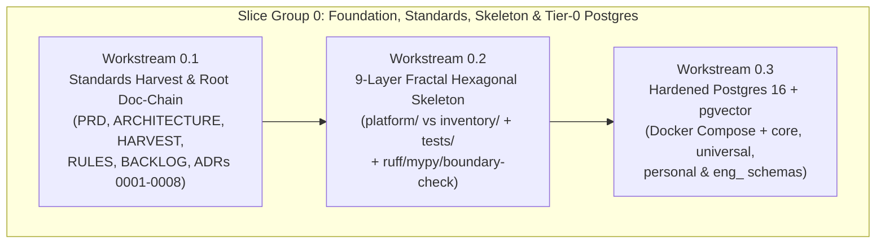

# Slice Group 0 Overall Plan: Governance, Doc-Chain, Standards, Hardened Postgres Infrastructure & Hexagonal Skeleton

> **Queue Position**: Slice Group 0 of 5 (Foundation)  
> **Parent Blueprint**: [`chotu_architecture_plan.md`](file:///home/nox/Developer/ds2/dsa-agent/docs/planning/chotu_architecture_plan.md) · **Planning Index**: [`docs/planning/README.md`](file:///home/nox/Developer/ds2/dsa-agent/docs/planning/README.md) · **Literate TDD Execution Plan**: [`docs/planning/tdd-plans/slice-00-tdd-plan.md`](file:///home/nox/Developer/ds2/dsa-agent/docs/planning/tdd-plans/slice-00-tdd-plan.md) · **Brainstorming Context**: [`brain-logs/README.md`](file:///home/nox/Developer/ds2/dsa-agent/brain-logs/README.md)

---

## 1. Why Slice Group 0 Comes First

It is always tempting at the start of a greenfield repository to jump straight into writing an LLM router, wiring up an agent loop, or copying over prompts from an older project. Every time we did that in earlier iterations across sibling repos, we paid a heavy tax later: domain models ended up importing vendor SDKs like `litellm` or `sqlalchemy` directly, platform machinery got tangled up with specific agent prompts, and SQLite or flat-file shortcuts buckled as soon as real consulting volume hit the system.

During our architecture brainstorming (captured in [`brain-logs/README.md`](file:///home/nox/Developer/ds2/dsa-agent/brain-logs/README.md)), we made a deliberate commitment: **Chotu (`dsa-agent`) will scream its architecture from Day 1, and its structural invariants will be enforced automatically before any runtime feature code is written.**

That is why Slice Group 0 exists. It does not implement business logic, LLM calls, or UI screens. Instead, it locks in the three foundational pillars that every subsequent slice depends on:
1. **The Authoritative Documentation Chain & Harvested Engineering Standards**: So every human reader and every coding agent starts with the exact same architectural map, harvesting ledger, non-negotiable engineering rules, and Architecture Decision Records (ADRs).
2. **The Physical 9-Layer Fractal Hexagonal Skeleton & Automated Boundary Guards**: Scaffolding `backend/platform/` (the domain-agnostic microkernel chassis) and `backend/inventory/` (the "Chotu Corp" capabilities), mirrored 1:1 by `backend/tests/`, with automated linters and CI boundary scripts that fail immediately if `domain/` imports a vendor library or if `platform/` imports `inventory/`.
3. **Tier-0 Hardened PostgreSQL 16 + `pgvector` HNSW Infrastructure with Multi-Schema Isolation**: Standing up the production-grade database container and bootstrap migrations right away (`core.*`, `universal.*`, `personal.*`, and the `eng_<slug>.*` template) so we never write throwaway SQLite or in-memory stubs that have to be ripped out later.

---

## 2. Workstream 0.1 — Harvesting `docs/standards/` & Writing the Root Documentation Chain

### Why This Matters
In [`dsa-prj/docs/standards/doc-chain.md`](file:///home/nox/Developer/ds2/dsa-prj/docs/standards/doc-chain.md), we learned that documentation only stays trustworthy when it forms a linked **review chain** — where a reader can drill down from high-level product purpose (`PRD.md`), to system structure (`ARCHITECTURE.md`), to what we are reusing from sibling repos (`HARVEST.md`), to the hard engineering constraints (`RULES.md`), to the specific decision records (`docs/adr/`), and finally to the execution backlog (`BACKLOG.md`). If those documents don't exist at the repository root — or if they are written as sterile AI bullet dumps — future agent sessions lose context and start inventing their own rules.

At the same time, [`dsa-prj/docs/standards/`](file:///home/nox/Developer/ds2/dsa-prj/docs/standards/) already contains battle-tested engineering standards (`hexagonal.md`, `code-structure.md`, `doc-chain.md`, `slice-delivery.md`, and `engineering-discipline.md`) learned the hard way across prior projects. Rather than reinventing those rules from scratch, we harvest and adapt them directly into `dsa-agent/docs/standards/` so they reflect Chotu's unified single-repo deployable (`backend/` + `frontend/`), our sovereign in-process harness, and our `narrative-writer` mandate.

### What We Will Build in Workstream 0.1

#### A. Harvested Engineering Standards (`docs/standards/`)
We will adapt the five core standard files from [`dsa-prj/docs/standards/`](file:///home/nox/Developer/ds2/dsa-prj/docs/standards/) into `/home/nox/Developer/ds2/dsa-agent/docs/standards/`:
- **`docs/standards/hexagonal.md`**: Locks in the six hexagonal laws for Chotu — zero vendor SDKs in `domain/`, every new port method ships with a port-contract test in the same change, one code path with variation in data, true adapter swappability, contract seams as ports, and strict `<Thing>Port` / `<Vendor><Thing>Adapter` naming across `domain/ | ports/ | adapters/`.
- **`docs/standards/code-structure.md`**: Defines the two-tree Microkernel layout (`backend/platform/` vs. `backend/inventory/`), the rule that `platform/` never imports `inventory/`, the principle that shipped inventory registers through the exact same registries as runtime-grown capabilities under `~/.chotu/`, the 1:1 `backend/tests/` mirror tree, and our two debugging chokepoints (`AgentRuntime.invoke()` and `ToolRegistry.invoke()`).
- **`docs/standards/doc-chain.md`**: Establishes Chotu's cross-reference review chain (`AGENTS.md` $\rightarrow$ `PRD.md` $\rightarrow$ `ARCHITECTURE.md` $\rightarrow$ `HARVEST.md` $\rightarrow$ `RULES.md` $\rightarrow$ `BACKLOG.md` $\rightarrow$ `docs/planning/` $\leftrightarrow$ `brain-logs/`), explaining when and how to validate links whenever our design evolves.
- **`docs/standards/slice-delivery.md`**: Enforces additive, test-first slice delivery — spec and plan before code, new machinery lands wired-off and proven with canned/contract tests first, runtime cutovers happen behind live config flags, and every slice group concludes with an explicit verification checklist.
- **`docs/standards/engineering-discipline.md`**: Captures our pre-change checklist (tracing every change to a slice plan and failing test first, enumerating cost and latency surfaces upfront) and shipping checklist (no weakened or silently skipped tests, doc-chain verified, all human-facing prose written via `narrative-writer`).

#### B. The Root Documentation Chain
At the root of `/home/nox/Developer/ds2/dsa-agent/`, we will write five cohesive, conversational documents that anchor the repository:
1. **`PRD.md` (Product Requirements & "Chotu Corp" Charter)**: Explains what Chotu is in plain English — the personal autonomous company ("Chotu Corp") with the human operator as Chairman/CEO and Chotu as Chief of Staff running across Conscious (interactive) and Subconscious (background daemon) loops; the daily consulting and R&D reality (~10 multi-perspective meetings/day, ~20 complex documents/day, 6–12 month client engagements alongside Personal R&D mode); the CSA/BAITS consulting engine; and the strict boundary between Internal Tools and Independent External Apps (`dsapps-*`).
2. **`ARCHITECTURE.md` (Authoritative System & Hexagonal Blueprint)**: Expands [`chotu_architecture_plan.md`](file:///home/nox/Developer/ds2/dsa-agent/docs/planning/chotu_architecture_plan.md) into the living architectural reference for the repository, walking through C1–C4 views, the 9 layers of `backend/platform/`, the departmental layout of `backend/inventory/`, the Postgres multi-schema topology (`core`, `universal`, `personal`, `eng_<slug>`), and end-to-end request lifecycles.
3. **`HARVEST.md` (Read-Only Sibling Repository Harvest Ledger)**: Following the governance pattern from [`substrate`](file:///home/nox/Developer/ds2/substrate/CLAUDE.md), this file tracks every module, schema, skill, agent, and UI component we harvest from `/home/nox/Developer/ds2/{dsa-prj,dsa-companion-config,okf-kb-manager,dsappz-dsrag-prj,classifier-training,substrate,dsapps-journal,dsapps-checkin}`, specifying its exact source path, target path in `dsa-agent`, whether it is copied or reshaped behind a hexagonal port, and its verification status.
4. **`RULES.md` (Non-Negotiable Engineering, Hexagonal & Epistemic Rules)**: Consolidates the hard invariants — the `narrative-writer` mandate, hexagonal boundary rules, the Subagents-Only rule for `lead/chotu`, workspace path jailing, the 6-value `scope:` citeability firewall, the 5-perspective claim model, zero forced auto-conflict resolution, and the origin-tagged hook recursion fence.
5. **`BACKLOG.md` (Slice-Ordered Epics & Delivery Tracker)**: Maps our six Slice Groups (`Slice Group 0` through `Slice Group 5`) into trackable epics and deliverables linked directly to `docs/planning/`.

#### C. Architecture Decision Records (`docs/adr/0001`–`0008`)
While [`brain-logs/conversation-retrospectives/`](file:///home/nox/Developer/ds2/dsa-agent/brain-logs/README.md) preserves the full multi-page story of our brainstorming journeys, developers and agents also benefit from crisp, linkable decision records in `docs/adr/` that summarize each major architectural commitment and link back to its full retrospective:
- **`0001-chotu-corp-conscious-and-subconscious-operating-model.md`**
- **`0002-microkernel-fractal-hexagonal-and-sovereign-in-process-harness.md`**
- **`0003-constructor-di-vs-runtime-service-locator-and-discovery.md`**
- **`0004-classifier-first-routing-subagents-only-and-probationary-dags.md`**
- **`0005-dual-mode-lifecycle-hooks-and-origin-tagged-recursion-fence.md`**
- **`0006-disjoint-universal-knowledge-engagement-datasets-and-elevation.md`**
- **`0007-bitemporal-multi-perspective-claims-and-truth-finder-hits-weighing.md`**
- **`0008-tier-0-hardened-postgres-pgvector-and-four-lane-master-task-queue.md`**

---

## 3. Workstream 0.2 — Scaffolding the 9-Layer Fractal Hexagonal Skeleton & Automated Boundary Tooling

### Why This Matters
When an codebase is empty, where you put the first ten files determines where the next thousand files end up. If we lay out the complete 9-layer `backend/platform/` chassis and the `backend/inventory/` departmental tree right now — complete with `domain/`, `ports/`, and `adapters/` packages in every platform layer — there is never any ambiguity about where a new class belongs.

Even more importantly, human discipline alone doesn't catch accidental imports at 2:00 AM. We need an automated boundary checker (`scripts/check_hexagonal_boundaries.py`) wired into `Makefile` and `pytest` from Day 1 so that if anyone ever imports `fastapi`, `sqlalchemy`, `litellm`, `anthropic`, `openai`, or `pgvector` inside a `domain/` module — or imports `backend.inventory` inside `backend.platform` — the build fails immediately with a clear explanation of which hexagonal rule was violated.

### What We Will Build in Workstream 0.2

#### A. The Physical `backend/` Directory Tree
We will scaffold the exact package hierarchy defined in [`chotu_architecture_plan.md`](file:///home/nox/Developer/ds2/dsa-agent/docs/planning/chotu_architecture_plan.md#L148-L175):

| Tree | Layers / Subsystems Created in Slice 0 | Internal Package Structure |
| :--- | :--- | :--- |
| **`backend/platform/`** *(The 9-Layer Chassis)* | `brain/`, `tools/`, `orchestration/`, `agentic_loop/`, `harness/`, `memory/`, `knowledge/`, `environment/`, `multiagent/` | Every single layer contains `__init__.py`, `domain/__init__.py`, `ports/__init__.py`, and `adapters/__init__.py` |
| **`backend/inventory/`** *(The "Chotu Corp" Content)* | `agents/lead/chotu/`, `agents/domain/{architects,builders,ingestion,kb}/`, `agents/internal/{extractors,classifiers}/`, `workflows/`, `hooks/`, `tools/`, `skills/`, `packs/{bvf,raid,baits}/` | Clean package markers and README/manifest placeholders ready for registration |
| **`backend/tests/`** *(1:1 Mirror Suite)* | `tests/platform/<layer>/`, `tests/inventory/<family>/`, `tests/contracts/`, `tests/architecture/` | Mirrors `platform/` and `inventory/` 1:1 so every module's test path is predictable by simple path substitution |

#### B. Python Toolchain, Strict Typing & Automated Boundary Checks
- **`backend/pyproject.toml`**: Configured for Python 3.12+ managed via `uv`, declaring core dependencies (Pydantic v2, FastAPI, SQLAlchemy 2.0 async + `asyncpg`, Alembic, `pgvector`, OpenTelemetry API/SDK, `structlog`) and dev tooling (`pytest`, `pytest-asyncio`, `ruff`, `mypy`).
- **`mypy --strict` & `ruff`**: Configured so type annotations are mandatory across all `domain/`, `ports/`, and `adapters/` modules from the very first file.
- **Automated Hexagonal Boundary Enforcer (`backend/tests/architecture/test_hexagonal_boundaries.py` & `scripts/check_hexagonal_boundaries.py`)**: Uses Python's `ast` module to parse every `.py` file under `backend/` and assert four hard invariants on every test run:
  1. `backend/platform/**/domain/**` imports **zero** banned vendor/infrastructure packages (`fastapi`, `sqlalchemy`, `asyncpg`, `pgvector`, `litellm`, `openai`, `anthropic`, `httpx`, `redis`, `celery`, etc.) and **zero** `adapters` modules.
  2. `backend/platform/**/ports/**` defines only abstract interfaces (`abc.ABC` / `typing.Protocol`) and domain types, never importing `adapters`.
  3. `backend/platform/**` **never** imports `backend/inventory/**`.
  4. `backend/inventory/agents/lead/chotu/**` **never** imports raw tool adapters directly, preserving the Subagents-Only structural boundary.

---

## 4. Workstream 0.3 — Tier-0 Hardened PostgreSQL 16 + `pgvector` Infrastructure & Multi-Schema Bootstrap

### Why This Matters
In [Retrospective #7 (`2026-10-27-07-real-world-scale-postgres-hardening-and-master-queues.md`)](file:///home/nox/Developer/ds2/dsa-agent/brain-logs/conversation-retrospectives/2026-10-27-07-real-world-scale-postgres-hardening-and-master-queues.md), we debunked the "single user = small data" fallacy. When an operator runs ~10 meetings a day across multiple perspectives, ingests ~20 dense documents a day, and has background Subconscious daemons indexing vectors and running HITS graph calculations while interactive turns are happening, SQLite file locks and flat JSON state files become immediate bottlenecks.

Furthermore, because Chotu operates across strict epistemic boundaries — platform orchestration state, disjoint Universal Knowledge, Personal R&D mode, and strictly isolated client engagements — dumping all tables into Postgres's default `public` schema invites accidental cross-engagement joins.

By standing up hardened PostgreSQL 16 with `pgvector` HNSW, `pg_trgm`, and `btree_gin` in Docker Compose during Slice Group 0 — and writing the multi-schema bootstrap mechanism right now — every persistence adapter we write in Slices 1 and 2 can test against real multi-schema Postgres from the start.

### What We Will Build in Workstream 0.3

#### A. Hardened Docker Compose (`infrastructure/docker-compose.yml` & `infrastructure/postgres/`)
- **PostgreSQL 16 + `pgvector` (`pgvector/pgvector:pg16`)**: Configured with tuned memory, connection, and WAL settings appropriate for concurrent vector HNSW indexing and `FOR UPDATE SKIP LOCKED` queue polling (`shared_buffers`, `work_mem`, `maintenance_work_mem` for fast HNSW graph builds, `max_connections`, and healthchecks).
- **Initialization Script (`infrastructure/postgres/init/01-extensions-and-schemas.sql`)**: Enables `vector`, `pg_trgm`, `btree_gin`, and `uuid-ossp` extensions at container startup and provisions the three permanent top-level schemas:
  - **`core`**: For platform state, the 4-Lane Priority Master Task Queue, `WorkflowRun` / `WorkflowNodeRun` DAG state, capability registries, and OpenTelemetry / retrieval trace ledgers.
  - **`universal`**: For the disjoint Universal Knowledge Fabric (`pgvector` HNSW embeddings, full-text `tsvector` indexes, sanitized cross-engagement learnings with `engagement_id` correlation citations).
  - **`personal`**: For the operator's Personal R&D mode (technique learning, tool design experiments, and personal research notes).
- **Optional Sidecar Profiles**: Pre-configured Docker Compose profiles (`--profile parsing`, `--profile local-llm`) for Docling document-parsing sidecars and local embedding/classifier runners so they can be toggled on cleanly without cluttering the base database startup.

#### B. Dynamic Per-Engagement Schema Provisioner & Alembic Foundation (`backend/migrations/`)
- Every client engagement in Chotu lives in its own isolated PostgreSQL schema named **`eng_<slug>`** (for example, `eng_acme_cloud_2026`).
- In Slice Group 0, we will wire up Alembic (`backend/migrations/`) alongside a clean schema-provisioning helper (`EngagementSchemaProvisioner`) that validates the engagement slug (strictly alphanumeric + underscores to prevent SQL injection), creates `SCHEMA IF NOT EXISTS eng_<slug>`, and proves in an automated integration test that `core`, `universal`, `personal`, and dynamically provisioned `eng_<slug>` schemas exist and are completely isolated from one another.
- **Root `Makefile`**: Provides one-command developer ergonomics (`make up`, `make down`, `make lint`, `make typecheck`, `make check-boundaries`, `make test`, `make migrate`) so every verification step is repeatable with a single command.

---

## 5. Verification & "Definition of Done" for Slice Group 0

Slice Group 0 is complete and ready to hand off to **Slice Group 1** only when every check below passes cleanly:

1. **Doc-Chain & Standards Integrity**:
   - All five harvested standard files exist under `docs/standards/` (`hexagonal.md`, `code-structure.md`, `doc-chain.md`, `slice-delivery.md`, `engineering-discipline.md`).
   - All five root doc-chain files exist at the repo root (`PRD.md`, `ARCHITECTURE.md`, `HARVEST.md`, `RULES.md`, `BACKLOG.md`) alongside ADRs `0001`–`0008` in `docs/adr/`, written in natural, conversational prose with valid `file://` cross-links.
2. **Physical Skeleton & 1:1 Test Mirror**:
   - All 9 layers under `backend/platform/` (`brain`, `tools`, `orchestration`, `agentic_loop`, `harness`, `memory`, `knowledge`, `environment`, `multiagent`) exist with `domain/`, `ports/`, and `adapters/` subpackages.
   - All departmental trees under `backend/inventory/` (`agents`, `workflows`, `hooks`, `tools`, `skills`, `packs`) and `backend/tests/` mirror directories are in place.
3. **Zero-Tolerance Linting, Typing & Boundary Enforcement**:
   - `make lint` (`ruff check` + `ruff format --check`) passes with zero warnings.
   - `make typecheck` (`mypy --strict backend`) passes with zero errors.
   - `make check-boundaries` (and `pytest backend/tests/architecture/test_hexagonal_boundaries.py`) passes — and includes a negative unit test proving that a simulated `sqlalchemy` or `litellm` import inside a `domain/` AST node or a `backend.inventory` import inside `backend.platform` is caught and rejected.
4. **Live Tier-0 Postgres + `pgvector` Multi-Schema Verification**:
   - `make up` brings up the hardened PostgreSQL 16 + `pgvector` container into a healthy state.
   - `make test` runs an integration test against the live container verifying that the `vector`, `pg_trgm`, and `btree_gin` extensions are active, that the `core`, `universal`, and `personal` schemas are provisioned, and that provisioning an isolated `eng_test_slice0` engagement schema works cleanly.
