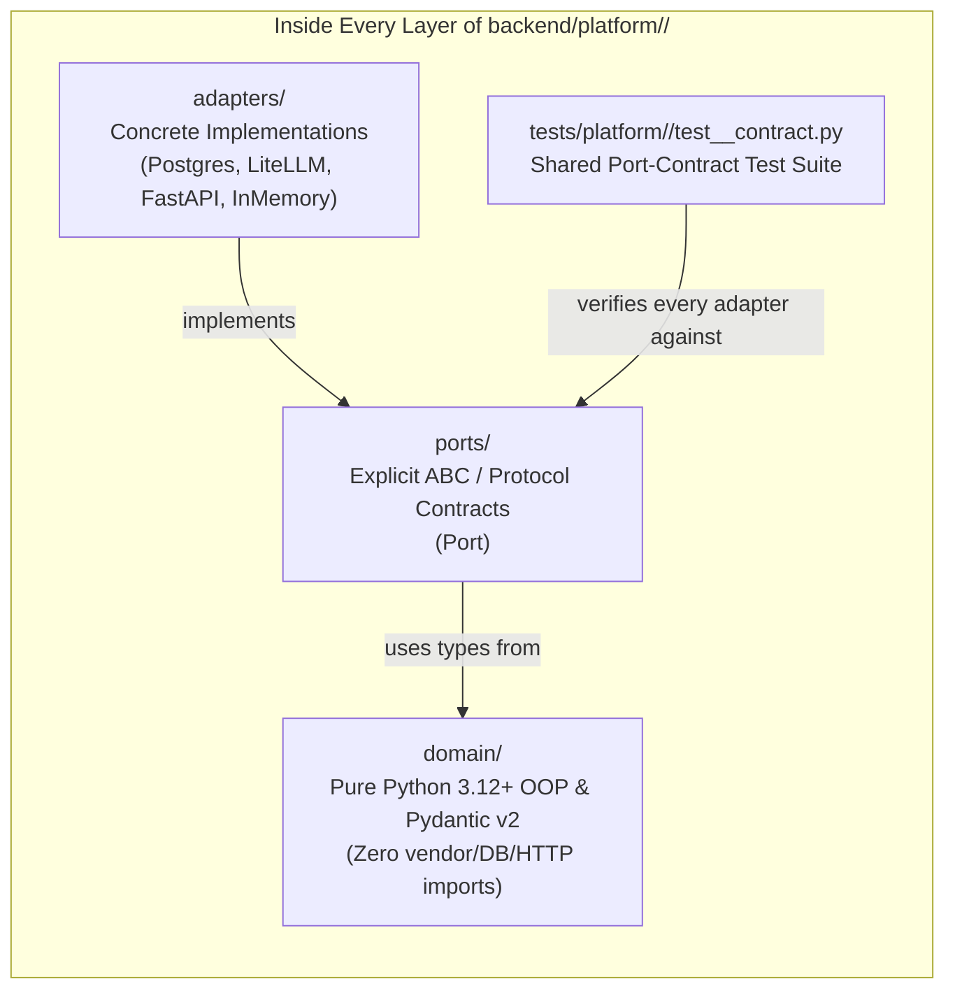
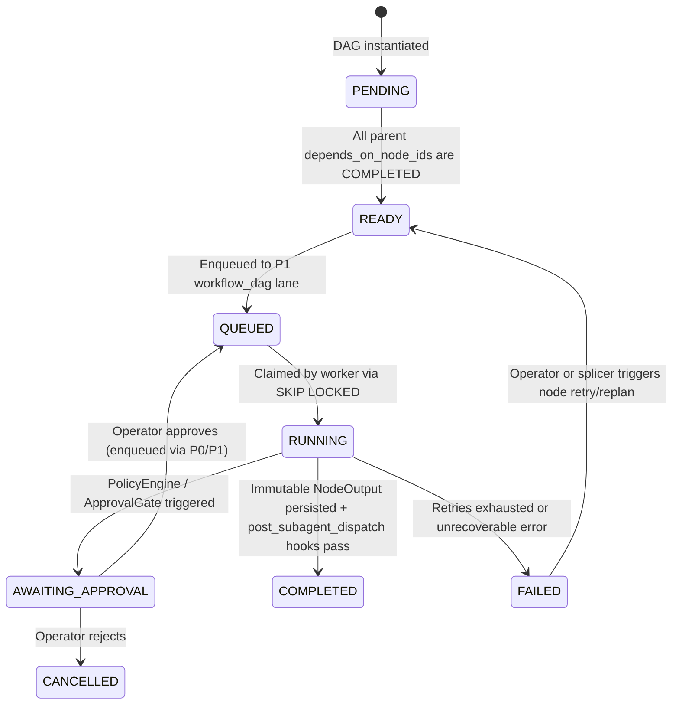
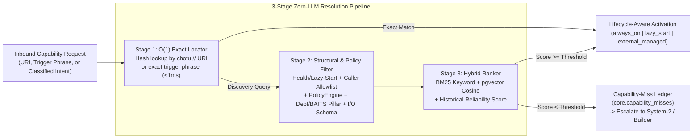

# Slice Group 1 Overall Plan: The 9-Layer `platform/` Microkernel Chassis, 4-Lane Master Queue, Service Locator & Sovereign Harness

- **Slice Group:** Slice 1 (follows Slice 0 skeleton & precedes Slice 2 Knowledge Fabric and Slice 3 Chotu Corp Inventory)
- **Primary Target Tree:** `backend/platform/`, `backend/migrations/` (`core.*`), and `backend/tests/platform/`
- **Related Blueprint & Retrospectives:**
  - [Chotu Architecture & Implementation Blueprint](file:///home/nox/Developer/ds2/dsa-agent/docs/planning/chotu_architecture_plan.md)
  - [Hexagonal Microkernel, OOP Philosophy & Sovereign Agent Harness](file:///home/nox/Developer/ds2/dsa-agent/brain-logs/conversation-retrospectives/2026-10-27-02-hexagonal-microkernel-and-sovereign-harness.md)
  - [Service Locator & Service Discovery Architecture](file:///home/nox/Developer/ds2/dsa-agent/brain-logs/conversation-retrospectives/2026-10-27-03-service-discovery-and-service-locator.md)
  - [Classifier-First Routing, Subagents-Only Invariant, Dynamic Workflows & Lifecycle Hooks](file:///home/nox/Developer/ds2/dsa-agent/brain-logs/conversation-retrospectives/2026-10-27-04-classifier-routing-dynamic-workflows-and-hooks.md)
  - [Real-World Consulting Scale, Hardened Postgres + `pgvector` Infrastructure & Master Task Queues](file:///home/nox/Developer/ds2/dsa-agent/brain-logs/conversation-retrospectives/2026-10-27-07-real-world-scale-postgres-hardening-and-master-queues.md)

---

## 1. Why Slice Group 1 Builds the Chassis Before the Agents

When people build an agent system, the natural temptation is to jump straight into writing agent prompts, wiring up a couple of tools, and watching an LLM answer a question in a chat loop. That shortcut feels fast in week one, and it is the exact reason earlier iterations became brittle under real daily consulting load. Once you have ten multi-perspective meetings and twenty dense documents flowing in every day—while you are simultaneously asking live architectural questions, reviewing deliverables, and running background extraction—a prompt loop without a hardened runtime chassis starts dropping tasks, locking its database, leaking files across client engagements, and mixing planning with raw tool execution.

Slice Group 1 exists to build the **operating system of Chotu Corp (`backend/platform/`)** before we load the **company departments and specialists (`backend/inventory/`)** on top of it.

### The Two-Tree Microkernel Split (`platform/` vs. `inventory/`)

In our architecture, `backend/platform/` is the domain-agnostic microkernel chassis. It knows *how* to classify work, discover capabilities, compose and run a Directed Acyclic Graph (DAG) of subagents, enforce workspace path jails, drain a priority queue, and record OpenTelemetry traces. What it never knows—and never imports—is any specific consulting framework, BAITS architect prompt, or skill playbook. Those live in `backend/inventory/` (and at runtime in `~/.chotu/`), which registers into the chassis through clean contracts.

This strict one-way boundary (`inventory/` uses `platform/`, `platform/` never imports `inventory/`) gives us two practical benefits right away:
1. We can test every single mechanism in `platform/`—priority preemption, DAG fan-out/fan-in, circuit breakers, workspace jailing, and hook recursion guards—using lightweight deterministic stub agents and stub tools in millisecond tests, without burning LLM tokens or debugging prompt wording at the same time.
2. When Chotu grows a new tool or skill at runtime under `~/.chotu/`, that capability is not a second-class hack bolted onto the side of the codebase. It loads through the exact same registration, discovery, policy, and execution pipelines as the capabilities shipped in `backend/inventory/`.

### Fractal Hexagonal Isolation Across All 9 Layers

Rather than treating "Hexagonal Architecture" as a single giant ring around the whole backend, `backend/platform/` applies **Fractal Hexagonal (Ports & Adapters)** isolation inside every one of its nine mechanism layers:

1. **`brain/`**: Tiered LLM routing, calibrated classifier checkpoints, and local/remote embedding adapters.
2. **`tools/`**: The `ToolRegistry.invoke()` execution chokepoint, jailed subprocess runners, and external application adapters (`ExternalAppAdapter`).
3. **`orchestration/`**: The upfront `WorkClassifierPort`, `DynamicWorkflowComposer`, per-node `WorkflowDAGRunner`, and `PolicyEngine`.
4. **`agentic_loop/`**: The governed ReAct execution loop and context compaction engine that powers individual subagents.
5. **`harness/`**: The FastAPI server, `HookRegistryPort`, 4-Lane Master Task Queue worker pool, Subconscious scheduler, `ApprovalBus`, channel adapters, and OpenTelemetry observability.
6. **`memory/`**: Operational working state (L1–L4) and the `RetrievalTrace` effectiveness ledger.
7. **`knowledge/`**: The ports and core engines for `okf-wiki/` projection, Small-to-Big retrieval, Truth Finder + HITS weighing, and Engagement Master Data (whose full domain schemas are expanded in Slice 2).
8. **`environment/`**: Workspace path jails (`EngagementWorkspaceJail`), project sandboxes, and isolated git worktrees.
9. **`multiagent/`**: The `AgentRuntime.invoke()` execution chokepoint, the Subagents-Only dispatcher, `ServiceDiscoveryPort`, and `ServiceLocatorPort`.

Inside each of these nine directories, the code is split into three folders with strict dependency rules:
- **`domain/`**: Pure Python 3.12+ classes, value objects, state machines, and domain logic (`Pydantic v2`, `mypy --strict`). There are **zero vendor SDKs, zero FastAPI imports, zero SQLAlchemy models, and zero LiteLLM/Anthropic/OpenAI clients** in `domain/`. We enforce this in CI with an automated import check so vendor churn can never leak into core logic.
- **`ports/`**: Explicit abstract contracts (`<Thing>Port`), defining the exact input types, output types, error semantics, and invariants expected at that boundary.
- **`adapters/`**: Concrete implementations (`PostgresTaskQueueAdapter`, `InMemoryTaskQueueAdapter`, `LiteLLMBrainAdapter`, `FastAPIHarnessAdapter`).

To make sure our adapters never drift from the promises made by their ports, **every port in Slice Group 1 ships with a reusable port-contract test suite**. Whether a test runs against an in-memory fake for fast unit testing or against a real PostgreSQL 16 container for integration testing, both adapters must pass the exact same contract test suite before the workstream is considered done.



---

## 2. Workstream 1.1 — The `core.*` Postgres Schema, 4-Lane Priority Master Task Queue & Transactional Outbox

### Why "Single User" Still Demands a Hardened Priority Queue

A common mistake in personal agent design is assuming that because there is only one human operator, an in-memory queue or a single SQLite file is plenty. That assumption falls apart the moment we look at what a normal day actually looks like for you.

Across your Work and Personal modes, Chotu handles roughly **10 meetings a day** (each carrying at least three distinct perspectives: `client_stated`, `internal_team`, and your own `personal_take`) alongside **20 dense documents a day** (slide decks, SOWs, architecture specs, and research papers). While the Subconscious daemon is in the background chunking those documents, extracting 1,000 to 3,000 atomic facts, computing embeddings, and recalculating HITS authority scores, you are sitting in a live meeting asking Chotu a time-sensitive question via the Web Portal or Telegram.

If live interactive turns share a first-in-first-out queue with background document ingestion, your interactive message gets stuck behind nineteen PDFs and four transcript extractions. Conversely, if background jobs fire off untracked `asyncio.create_task()` calls without a durable queue, a container restart or a temporary model timeout silently drops facts on the floor.

Workstream 1.1 solves both problems at the root by establishing the **`core.*` PostgreSQL 16+ schema**, the **4-Lane Priority Master Task Queue (`TaskQueuePort`)**, and the **Transactional Outbox (`core.outbox_events`)**.

### The 4-Lane Priority Master Task Queue (`SELECT ... FOR UPDATE SKIP LOCKED`)

All work in Chotu Corp is persisted as rows in `core.master_task_queue` and claimed by workers using PostgreSQL's non-blocking row-level locking (`SELECT ... FOR UPDATE SKIP LOCKED`). Tasks are partitioned into four strict priority lanes:

| Priority Lane | Queue Lane Name | What Runs Here | Worker Reservation & Preemption Policy |
| :--- | :--- | :--- | :--- |
| **P0 (Highest)** | `interactive` | Live user turns from Portal, Telegram, or CLI, plus human-in-the-loop approval resumes | **Dedicated reserved worker slots.** Interactive requests never wait behind background work; target pickup latency is **`<50ms`**. |
| **P1 (High)** | `workflow_dag` | Ready `WorkflowNodeRun` subagent dispatches for active engagement deliverables and syntheses | Claims from the shared high-priority pool; executes parallel DAG branches concurrently up to configured token/concurrency budgets. |
| **P2 (Medium)** | `outbox_hooks` | Near-real-time async observer hooks (`on_facts_persisted`, `okf-wiki/` $\rightarrow$ `pgvector` projection, staleness markers) | Drained continuously in small micro-batches immediately after workflow nodes complete. |
| **P3 (Bulk)** | `subconscious_bulk` | Bulk PDF/transcript parsing, Subconscious pattern recognition, Engagement Closure Retrospectives, vault hygiene | **Budget-throttled.** P3 workers check P0/P1 queue depth before claiming each item and yield capacity whenever higher-priority work arrives. |

Every claimed task uses a **durable lease with worker heartbeats** (`leased_until`, `worker_id`, `attempt_count`, `max_attempts`). If a worker process crashes mid-flight while running a subagent or waiting on an external sidecar, the lease expires and the reaper transitions the task back to `QUEUED` with exponential backoff (`next_run_at`). If a task exhausts its retry budget, it moves to `DEAD_LETTER` and surfaces an alert in the Portal's Queue Monitor—never failing silently.

### The Transactional Outbox (`core.outbox_events`)

Whenever a subagent or platform service writes state—for example, recording a new file drop in `raw/`, persisting extracted facts, or completing a workflow node—we need downstream side effects (like indexing embeddings or firing `on_workflow_complete` observer hooks) to happen reliably without slowing down the active turn.

Instead of firing best-effort in-memory events that vanish if the process restarts a millisecond later, Workstream 1.1 implements the **Transactional Outbox pattern**:
1. Within the **exact same database transaction** that commits the domain state change (such as marking a `WorkflowNodeRun` as `COMPLETED`), the adapter inserts an immutable event row into `core.outbox_events` (`status = 'PENDING'`).
2. An outbox relay worker polls `core.outbox_events` using `FOR UPDATE SKIP LOCKED`, fans the event out into the appropriate `P2 outbox_hooks` or `P1 workflow_dag` task rows, and marks the outbox event `PUBLISHED`.
3. Every outbox and task transition carries an `idempotency_key` (derived from the source entity ID, content SHA-256 hash, and event type), ensuring that even under at-least-once delivery, downstream hooks never duplicate embeddings or double-count workflow completions.

---

## 3. Workstream 1.2 — Per-Node Durable DAG State Machine (`WorkflowRun` + `WorkflowNodeRun`)

### Why a Shared Mutable State Dictionary Fails Under Parallel Subagents

When we inspected the workflow runner in the earlier `dsa-prj` codebase ([`workflow_runner.py`](file:///home/nox/Developer/ds2/dsa-prj/dsa/backend/dsa_platform/orchestration/workflow_runner.py)), we saw a pattern that works fine for sequential toy scripts but breaks down in Chotu Corp: a workflow had a single integer `current_step` and a shared mutable `run.state: dict` that every step modified in place inside a single synchronous HTTP request.

Now imagine what happens in Chotu when a client meeting transcript finishes extracting and the Orchestrator fans out across three BAITS pillars in parallel—dispatching `business_architect`, `information_architect`, and `security_architect` at the same time:
- If all three subagents read and write to a single shared `run.state` JSON blob in Postgres, the last subagent to finish overwrites the dictionary written by the other two (a classic lost-update race condition).
- If `security_architect` hits a high-risk policy rule and needs to pause for your approval (`AWAITING_APPROVAL`) on Telegram while `business_architect` and `information_architect` are free to finish their branches, a single workflow-level `current_step` integer cannot represent one branch pausing while two sibling branches complete.
- If the server restarts while a 4-node DAG is halfway through, a synchronous in-memory runner loses all progress and forces the entire workflow to start over from scratch.

### The Per-Node DAG State Machine & Immutable `NodeOutput` Records

Workstream 1.2 replaces the shared mutable dictionary with a durable, database-backed **Per-Node DAG State Machine** governed by `WorkflowStorePort` and executed by `WorkflowDAGRunner` inside `backend/platform/orchestration/`:

- **`WorkflowRun` (`core.workflow_runs`)**: Tracks the top-level DAG execution instance, including its `workflow_plan_id`, the triggering `WorkClassification`, the recursion guard tags (`origin: USER | HOOK | SUBCONSCIOUS` and `hop_depth: int`), overall `status`, and correlation trace IDs.
- **`WorkflowNodeRun` (`core.workflow_node_runs`)**: Every individual subagent node in the DAG gets its own row in Postgres with its own independent state machine and list of parent node dependencies (`depends_on_node_ids`).
- **`NodeOutput` (`core.workflow_node_outputs`)**: When a subagent node finishes, it **never mutates a shared dictionary**. Instead, it writes a single, append-only, immutable `NodeOutput` record containing its typed `output_payload` (validated against the capability's JSON schema) and any `artifact_refs` (paths and SHA-256 hashes of files written inside the engagement workspace).



Here is how a parallel fan-out/fan-in workflow actually runs under this state machine:
1. When `WorkflowDAGRunner` instantiates a `WorkflowPlan`, root nodes (nodes with no upstream parents) start in `READY` and are immediately enqueued into the `P1 workflow_dag` lane. Downstream nodes start in `PENDING`.
2. When a worker claims a `QUEUED` node, it transitions the row to `RUNNING`, assembles the node's input envelope by reading the immutable `NodeOutput` rows of its completed parent nodes, and dispatches the subagent via `AgentRuntime.invoke()`.
3. If one branch hits an approval gate, only that specific `WorkflowNodeRun` transitions to `AWAITING_APPROVAL` and publishes an approval request to `ApprovalBus`. Its sibling branches keep running and completing unimpeded.
4. The moment any node transitions to `COMPLETED`, the coordinator checks all downstream child nodes in the same transaction: any child whose parent nodes are now *all* `COMPLETED` atomically transitions from `PENDING` to `READY` and is enqueued to `P1 workflow_dag`.
5. If you restart the backend container mid-workflow, the system picks up right where it left off: `COMPLETED` nodes keep their immutable `NodeOutput` records, `AWAITING_APPROVAL` nodes wait for your click, and interrupted `RUNNING` nodes reclaim their leases and resume without re-running completed upstream work.

---

## 4. Workstream 1.3 — Constructor DI vs. Runtime Service Discovery & Service Locator (`chotu://` URIs)

### Resolving the Classic OOP Tension: Two Distinct Planes

In object-oriented design and Hexagonal Architecture, using a global static Service Locator for core infrastructure (for example, hiding `ServiceLocator.get(DatabasePort)` deep inside domain methods) is a well-known anti-pattern because it hides dependencies and makes unit testing painful. At the same time, Chotu Corp is an expanding ecosystem where new subagents, BAITS capability-bundle skills (`bvf`, `raid`), internal tools, out-of-process sidecars (like Docling), and independent external applications (`dsapps-journal`, `dsapps-checkin`) are added, upgraded, or put to sleep at runtime. Hardcoding Python imports for every capability is a dead end.

Workstream 1.3 resolves this cleanly by separating Chotu into **two strict planes**:

1. **Plane 1 — Core Platform Infrastructure (Constructor Dependency Injection at `bootstrap.py`)**:
   - Every core engine in `backend/platform/` receives its infrastructure ports (`LLMPort`, `TaskQueuePort`, `WorkflowStorePort`, `HookRegistryPort`, `ObservabilityPort`, `KnowledgeIndexPort`) explicitly through its `__init__` constructor.
   - Only the composition root (`backend/platform/harness/bootstrap.py`) knows which concrete adapters (`PostgresTaskQueueAdapter` vs. `InMemoryTaskQueueAdapter`) are wired together at startup.
2. **Plane 2 — Dynamic Runtime Capabilities (`ServiceDiscoveryPort` & `ServiceLocatorPort`)**:
   - All invocable capabilities of Chotu Corp live on the runtime capability plane behind `AgentRuntime.invoke()` and `ToolRegistry.invoke()`.
   - Every capability is registered as a strongly-typed `CapabilityDescriptor` addressed by a canonical `chotu://` URI:
     ```text
     chotu://<kind>/<namespace>/<name>@<version>
     ```
     where `<kind>` is one of `agent`, `skill`, `tool`, `pack`, `sidecar`, or `app` (for example, `chotu://agent/architects/business@1.0.0`, `chotu://skill/baits/make-raid@1.2.0`, `chotu://tool/core/grep@1.0.0`, or `chotu://app/external/dsapps-journal@2.1.0`).

### Hybrid Pull + Push Registration

Because Chotu orchestrates both on-disk plugins (`backend/inventory/` and `~/.chotu/`) and running external network processes, `CapabilityRegistry` supports **Hybrid Pull + Push Registration**:
- **Pull Registration (Filesystem Watcher & Startup Reconciliation)**: At startup—and continuously via a file watcher—the registry scans `backend/inventory/` and `~/.chotu/{agents,tools,skills,apps,packs}/` for `manifest.yaml` and `SKILL.md` descriptors. If a newly grown tool or edited manifest has a broken schema or missing dependency, **Fail-Loud Reconciliation** marks that capability `DISABLED` with a clear diagnostic message in `core.capability_registry` instead of crashing the server mid-turn.
- **Push Registration (Self-Registration & Heartbeat Endpoints)**: Independent external apps (`dsapps-*`), MCP servers, and container sidecars can register themselves dynamically when they boot via `POST /api/v1/registry/register` and report health via `POST /api/v1/registry/heartbeat`.

### The 3-Stage Zero-LLM Resolution Pipeline

When the Orchestrator or a subagent needs to resolve a capability, stuffing hundreds of tool and agent descriptions into an LLM prompt wastes tokens and degrades accuracy. Instead, `ServiceLocatorPort` and `ServiceDiscoveryPort` run a fast, deterministic **3-Stage Zero-LLM Resolution Pipeline**:



1. **Stage 1 — $O(1)$ Exact URI / Trigger Locator (`ServiceLocatorPort.locate`)**: When an established workflow DAG or command specifies a known URI (`chotu://agent/architects/security@1.0.0`) or exact trigger phrase (`csa ingest`), the locator resolves the descriptor in `<1ms` via direct hash lookup.
2. **Stage 2 — Structural, Policy & Pillar Filter**: For intent-based queries (`ServiceDiscoveryPort.discover`), the registry filters candidates in SQL by hard constraints: the capability must be `HEALTHY` (or `SLEEPING` with `lifecycle_policy == 'lazy_start'`), permitted by the caller's allowlist intersected with `PolicyEngine` rules, aligned with the target `department` / `baits_pillar`, and compatible with the required input/output JSON schema (`applies_to_kinds`).
3. **Stage 3 — Hybrid BM25 + `pgvector` + Historical Reliability Ranker**: Surviving candidates are ranked by a weighted score combining PostgreSQL full-text search (`tsvector`/`pg_trgm`), `pgvector` HNSW cosine similarity over capability descriptions, and the capability's **historical execution success rate** on similar intents. If no candidate clears the calibrated confidence threshold, the registry writes a structured record to the **Capability-Miss Ledger (`core.capability_misses`)** so the Orchestrator can splice in a Builder or Researcher subagent.

### Lifecycle-Aware Activation, Circuit Breaking & `fallback_uri`

External sidecars (such as the Docling document parsing service) and standalone apps should not burn workstation RAM 24/7 when idle. Every `CapabilityDescriptor` therefore declares a `lifecycle_policy` and optional `fallback_uri`:
- **`always_on`**: In-process Python subagents, skills, and tools—invoked immediately in-memory.
- **`lazy_start`**: Declares a `start_command` (or Docker Compose profile), `health_endpoint`, and `idle_timeout_s`. When located while `SLEEPING`, the Service Locator boots the service on demand, waits for a green readiness probe, executes the invocation, and spins it back down after `idle_timeout_s` of inactivity.
- **`external_managed` + Circuit Breaker + `fallback_uri`**: If an external service or sidecar fails its health check or times out repeatedly, a per-capability circuit breaker trips (`OPEN`) and transparently redirects the call to the descriptor's `fallback_uri` (for example, falling back from the Docling container sidecar to the local Python PDF extractor) so a single container hiccup never halts an engagement workflow.

---

## 5. Workstream 1.4 — Sovereign In-Process Harness, The Two Chokepoints & Workspace Jailing

### Why Chotu Runs a 100% Sovereign In-Process Harness

During our architectural retrospectives, we examined whether Chotu should delegate subagent execution or code-building work to an external CLI binary. We rejected that approach completely. A raw LLM is just a stateless predictor; the software that wraps it—the execution loop, skill loader, tool dispatcher, approval bus, and tracer—*is* the agent harness. If Chotu shells out to someone else's black-box CLI as its brain, you lose your Hexagonal Port guarantees, your OpenTelemetry call tree, your 6-value `scope:` citeability firewall, and Chotu's ability to inspect intermediate steps and crystallize new workflows.

In Workstream 1.4, we build Chotu's sovereign in-process harness around **two universal execution chokepoints**:

1. **`AgentRuntime.invoke(agent_uri, envelope, context)` (`backend/platform/multiagent/`)**:
   - Every single subagent turn across the entire system flows through this method.
   - Before the subagent's `AgenticExecutor` ReAct loop starts, `AgentRuntime.invoke()` opens a parent OpenTelemetry span (`subagent.invoke`), executes `pre_subagent_dispatch` hooks (which inject scoped `ContextPacket`s and BAITS skills), enforces token and step budgets, and binds the active engagement's workspace jail.
   - When the subagent finishes, `AgentRuntime.invoke()` runs `post_subagent_dispatch` guard hooks (such as citation anchor verification) before returning the typed `NodeOutput`.
2. **`ToolRegistry.invoke(tool_uri, args, caller_context)` (`backend/platform/tools/`)**:
   - Every tool call—whether it is an internal Python tool (`grep`, `file_ops`, `bash`), a knowledge tool, or an `ExternalAppAdapter` call to `dsapps-journal`—flows through this single seam.
   - `ToolRegistry.invoke()` opens a child OpenTelemetry span (`tool.invoke`), validates arguments against the tool's JSON schema, evaluates `PolicyEngine` rules and `pre_tool_invoke` hooks, pauses on `ApprovalBus` if human confirmation is required, executes the adapter inside the caller's `EngagementWorkspaceJail`, and logs execution reliability back to `CapabilityRegistry`.

Because nothing in Chotu can invoke a subagent or a tool without passing through these two methods, you get a complete, unbroken semantic trace tree (`turn -> workflow_run -> workflow_node -> subagent.invoke -> tool.invoke`) in the Web Portal's `TraceDrawer` for every action Chotu takes.

### Closing the Filesystem Backdoor: `EngagementWorkspaceJail` (`platform/environment/`)

Giving subagents tools like `python`, `bash`, `grep`, or `file_ops` creates an obvious security and data-hygiene trap if left unchecked: a subagent working on Client A (`workspaces/acme-cloud/`) could accidentally—or through a bad shell command—read files from Client B (`workspaces/globex-corp/`) or bypass the Knowledge Librarian to read/write raw files directly inside `CHOTU_VAULT_PATH`.

Workstream 1.4 closes this backdoor inside `backend/platform/environment/` with **`EngagementWorkspaceJail`**:
- Whenever a subagent executes inside an engagement (`engagement_slug = "acme-cloud"`), its execution context is bound to an `EngagementWorkspaceJail` rooted strictly at `workspaces/acme-cloud/`.
- Before any filesystem, `grep`, `python`, or `bash` tool executes inside `ToolRegistry.invoke()`, the jail canonicalizes all target paths (`Path.resolve(strict=False)`), follows symlinks, inspects command arguments, and rejects any path that escapes the active `workspaces/<slug>/` root.
- Subprocesses spawned by jailed tools run with their working directory locked to `workspaces/<slug>/`, stripped environment variables (no raw database credentials or cross-workspace paths), and OS-level path containment.
- Only the `knowledge` department's custodial tools (invoked through explicit, audited port contracts) are granted read/write access to `CHOTU_VAULT_PATH`, ensuring that client engagement boundaries cannot be bypassed via the filesystem.

---

## 6. Workstream 1.5 — Classifier-First Routing (`WorkClassifierPort`), Subagents-Only Invariant, Dynamic DAG Composition & Dual-Mode Hooks

### Upfront Classification (`WorkClassifierPort`)

In earlier projects, user messages went straight into a general-purpose agent prompt that tried to figure out what kind of request it was, pick tools, and answer the question all at once. In Chotu, **every inbound event**—whether it is a chat message from Telegram or the Web Portal, a file dropped into an engagement's `raw/` folder, or a scheduled cron trigger—passes through **`WorkClassifierPort`** (`backend/platform/orchestration/`) *before* any orchestrator planning or subagent dispatch happens.

Harvesting the calibrated checkpoint and taxonomy patterns from [`classifier-training`](file:///home/nox/Developer/ds2/classifier-training/CLAUDE.md), `WorkClassifierPort` combines fast deterministic rules, embedding similarity, and lightweight Laya classifier checkpoints to emit a strongly-typed `WorkClassification` value object:

```python
WorkClassification(
    intent="ingest_and_synthesize_transcript",
    mode="work_engagement",          # work_engagement | personal_rd | universal_research
    engagement_slug="acme-cloud",
    departments=["knowledge", "delivery"],
    baits_pillars=["business", "security"],
    scope="client",                  # engagement | client | internal | reference | prior-project | deliverable
    perspective="client_stated",     # client_stated | internal_team | personal_take | work_research | personal_rd
    complexity="standard_dag",       # fast_path_dag | dynamic_dag | novel_escalation
    risk_level="low",
    confidence=0.94,
)
```

### Enforcing the Hard "Subagents-Only" Invariant

One of our most important architectural rules is that **the Lead Orchestrator (`lead/chotu`) NEVER executes raw domain tools (`python`, `bash`, `grep`, `file_ops`, `vault_write`, etc.) or mutates engagement state directly**.

Workstream 1.5 enforces this rule structurally in code, not just by asking nicely in a system prompt:
- `lead/chotu`'s execution context is **not wired to raw domain tools** in `ToolRegistry`. If `lead/chotu` ever attempts to invoke a `chotu://tool/...` capability directly, `PolicyEngine` and `ToolRegistry.invoke()` reject the call immediately with a `SubagentsOnlyViolationError`.
- `lead/chotu` can only interact with `WorkClassifierPort`, `ServiceDiscoveryPort`, `DynamicWorkflowComposer`, and `WorkflowDAGRunner` to compose and dispatch **scoped Department Subagents (`chotu://agent/...`)**.
- Every actual unit of work executes inside a specialist subagent that has its own clean context window, its own minimal tool allowlist, and its own `EngagementWorkspaceJail`.

### Dynamic Workflow Composition & Probationary DAG Crystallization (`CANDIDATE` $\rightarrow$ `ESTABLISHED`)

Once `WorkClassifierPort` produces a `WorkClassification`, `DynamicWorkflowComposer` decides how to fulfill the work:

1. **System-1 Fast-Path Lookup (`ESTABLISHED` DAGs)**:
   - The composer first queries `WorkflowRegistry` (`core.workflow_plans`) for an `ESTABLISHED` DAG template matching the classification signature (`intent`, `mode`, `baits_pillars`).
   - If a match is found and `ServiceLocatorPort` confirms all referenced subagents are healthy, Chotu instantiates that `WorkflowPlan` immediately with **zero LLM planning latency**.
2. **System-2 Dynamic Subagent DAG Composition**:
   - When the task is novel or requires a custom combination of BAITS pillars, `DynamicWorkflowComposer` queries `ServiceDiscoveryPort` for candidate subagents and composes a typed `WorkflowPlan` DAG supporting sequential chains, parallel fan-out/fan-in across BAITS architects, and human approval gates.
   - If a running subagent node returns `CAPABILITY_MISS` or `NEEDS_REPLAN` mid-flight, the composer can dynamically splice a `tool_builder`, `skill_builder`, or `researcher` subagent node into the active `WorkflowRun` and resume downstream nodes once the gap is filled.
3. **Probationary Crystallization (Preventing Poisoned Fast-Paths)**:
   - Saving a newly composed dynamic DAG straight into the permanent System-1 fast path after a single run is dangerous—a lucky one-off or slightly flawed plan would become permanent habit.
   - Instead, every newly composed DAG is saved in `core.workflow_plans` with `status = 'CANDIDATE'` and `verified_success_count = 0`.
   - Each time that `CANDIDATE` DAG completes a full run with zero policy violations, zero citation gate failures, and positive evaluation checks, its `verified_success_count` increments. Only after **3 consecutive verified successes** (or an explicit one-click promotion by you in the Portal) does the DAG graduate to `status = 'ESTABLISHED'`. Any gate failure resets the streak counter to `0`.

### Dual-Mode Lifecycle Hooks & The Origin-Tagged Recursion Fence (`HookRegistryPort`)

To keep individual subagents clean and focused on their domain role—without pasting boilerplate code for context retrieval, citeability checks, staleness flags, and telemetry into every agent—Workstream 1.5 builds **`HookRegistryPort`** (`backend/platform/harness/`) supporting two execution modes:

- **Mode 1 — Blocking Guard & Mutator Hooks (Inline Synchronous)**:
  - Run inline during `pre_classify`, `pre_workflow_compose`, `pre_subagent_dispatch`, `post_subagent_dispatch`, and `pre_tool_invoke`.
  - **Mutators** enrich the execution envelope before a subagent starts (for example, `pre_subagent_dispatch` automatically queries the engagement's local knowledge index and attaches the relevant `ContextPacket` and BAITS skill instructions).
  - **Guards** validate invariants before a step is allowed to proceed or complete (for example, `pre_tool_invoke` enforces `EngagementWorkspaceJail` and `PolicyEngine` rules; `post_subagent_dispatch` verifies that synthesis outputs respect the 6-value `scope:` firewall and contain valid `[[concept#^fact]]` anchors before marking the node `COMPLETED`).
- **Mode 2 — Async Observer Hooks (Queued via `P2 outbox_hooks`)**:
  - Triggered on `on_facts_persisted`, `on_capability_miss`, and `on_workflow_complete`.
  - Written to `core.outbox_events` and drained asynchronously on the `P2 outbox_hooks` lane so they add **zero latency** to your interactive turn. They trigger `okf-wiki/` $\rightarrow$ `pgvector` indexing, mark `.csa/synthesis-status.md` pillars stale, update `RetrievalTrace` citation weights, and advance `CANDIDATE` DAG crystallization counters.

**The Origin-Tagged Recursion Fence**: Whenever async observer hooks like `on_workflow_complete` are allowed to trigger follow-up background workflows (such as background BAITS re-synthesis), there is a classic risk of infinite recursion: Workflow A completes $\rightarrow$ fires `on_workflow_complete` $\rightarrow$ spawns Workflow B $\rightarrow$ Workflow B completes $\rightarrow$ fires `on_workflow_complete` $\rightarrow$ spawns Workflow C forever.

To make infinite hook storms structurally impossible, every `WorkflowRun` and hook event carries two immutable fields:
- `origin`: `USER` | `HOOK` | `SUBCONSCIOUS`
- `hop_depth`: `int` (starts at `0` for user-initiated turns, increments by `+1` whenever a hook spawns child work)

`HookRegistryPort` enforces a hard gate at the platform level: **observer hooks may only enqueue follow-up workflows when `origin == USER` and `hop_depth == 0`**. Any workflow whose `origin` is `HOOK` or `SUBCONSCIOUS` (or whose `hop_depth > 0`) still records telemetry and updates database indexes, but is strictly blocked from spawning further child workflows.

---

## 7. Harvest Sources & Exit Criteria

### Authoritative Harvest Sources for Slice Group 1

We do not write Slice Group 1 from a blank page; we harvest proven patterns from our read-only sibling repositories in `/home/nox/Developer/ds2/` and adapt them to our hardened PostgreSQL + Fractal Hexagonal architecture:

| Sibling Source File / Directory | What We Harvest & Adapt | Target Location in `dsa-agent` |
| :--- | :--- | :--- |
| [`dsa-prj/docs/standards/hexagonal.md`](file:///home/nox/Developer/ds2/dsa-prj/docs/standards/hexagonal.md) & [`code-structure.md`](file:///home/nox/Developer/ds2/dsa-prj/docs/standards/code-structure.md) | The 9-layer `platform/` vs. `inventory/` separation, `domain/ \| ports/ \| adapters/` layout, zero-vendor-in-domain CI rule, and port-contract test conventions. | `docs/standards/` & `backend/platform/` structure |
| [`dsa-prj/dsa/backend/dsa_platform/`](file:///home/nox/Developer/ds2/dsa-prj/dsa/backend/dsa_platform) | `PolicyEngine`, `ApprovalBus`, `AgenticExecutor` loop primitives, `ToolRegistry`, and `AgentRegistry` chokepoint patterns—upgraded from in-memory/sequential state to our `core.*` Postgres schemas and `chotu://` URI contracts. | `backend/platform/{brain,tools,orchestration,agentic_loop,harness,multiagent}/` |
| [`dsa-prj/dsa/backend/dsa_platform/orchestration/workflow_runner.py`](file:///home/nox/Developer/ds2/dsa-prj/dsa/backend/dsa_platform/orchestration/workflow_runner.py) | Reference baseline for workflow execution—explicitly replacing its single `current_step` integer and shared mutable `run.state: dict` with our per-node `WorkflowRun` + `WorkflowNodeRun` + immutable `NodeOutput` DAG state machine. | `backend/platform/orchestration/{domain,ports,adapters}/` |
| [`classifier-training/CLAUDE.md`](file:///home/nox/Developer/ds2/classifier-training/CLAUDE.md) & [`classifier-training/taxonomies/`](file:///home/nox/Developer/ds2/classifier-training/taxonomies) | Taxonomy contract schemas, confidence calibration thresholds, and Laya checkpoint routing patterns for upfront work classification. | `backend/platform/orchestration/ports/work_classifier_port.py` & `domain/classification.py` |

### Slice Group 1 Verification & Exit Criteria

Slice Group 1 is complete only when all six verification gates below pass under `pytest` and `mypy --strict`:

1. **Zero-Vendor-in-Domain & Strict Typing Gate**:
   - `mypy --strict backend/platform` passes with zero errors.
   - The automated architectural linter confirms that no file matching `backend/platform/*/domain/**/*.py` imports FastAPI, SQLAlchemy, asyncpg, psycopg, LiteLLM, or any external LLM/vendor SDK.
2. **Port-Contract Test Suite across All 9 Layers**:
   - Every port introduced in Slice Group 1 (`TaskQueuePort`, `OutboxPort`, `WorkflowStorePort`, `ServiceDiscoveryPort`, `ServiceLocatorPort`, `WorkClassifierPort`, `HookRegistryPort`, `WorkspaceJailPort`, `PolicyEnginePort`, `ApprovalBusPort`, `LLMPort`, `ObservabilityPort`) has a shared contract test suite (`test_<port>_contract.py`) passing against both its `InMemory*Adapter` and its `Postgres*Adapter`.
3. **4-Lane Priority Preemption & Outbox Durability Proof**:
   - Integration test against PostgreSQL 16 verifies that when 50 bulk tasks are queued in `P3 subconscious_bulk`, a newly enqueued `P0 interactive` task is claimed by the reserved interactive worker slot in `<50ms`.
   - Simulating a worker crash mid-task proves that expired leases are reclaimed with exponential backoff and that `core.outbox_events` delivers every pending event with zero duplicates and zero dropped rows.
4. **Parallel DAG Fan-Out/Fan-In & Approval Pause Proof**:
   - Integration test runs a 4-node DAG (`root -> [branch_a || branch_b] -> join_node`) where `branch_a` completes immediately while `branch_b` pauses at `AWAITING_APPROVAL`. Verifies that `branch_a`'s immutable `NodeOutput` is preserved without race conditions, `join_node` remains `PENDING` until `branch_b` is approved, and `join_node` automatically transitions to `READY -> COMPLETED` upon approval.
5. **3-Stage Service Discovery, Lazy-Start & Fallback Proof**:
   - Verifies `<1ms` exact `chotu://` URI resolution, filtered hybrid discovery ranking, automatic logging to `core.capability_misses` when confidence falls below threshold, `lazy_start` wakeup/idle-shutdown lifecycle transitions, and circuit-breaker failover to `fallback_uri` when a primary capability is unhealthy.
6. **Subagents-Only, Workspace Jail & Hook Recursion Fence Proof**:
   - Verifies that any attempt by `lead/chotu` to call `ToolRegistry.invoke()` on a raw tool raises `SubagentsOnlyViolationError`.
   - Verifies that `EngagementWorkspaceJail` blocks any file read, file write, symlink traversal, or subprocess path targeting another engagement (`workspaces/other-client/`) or `CHOTU_VAULT_PATH`.
   - Verifies that `CANDIDATE` DAGs require 3 consecutive verified successes before graduating to `ESTABLISHED`, and that `on_workflow_complete` observer hooks are blocked from spawning recursive workflows whenever `origin != USER` or `hop_depth > 0`.
