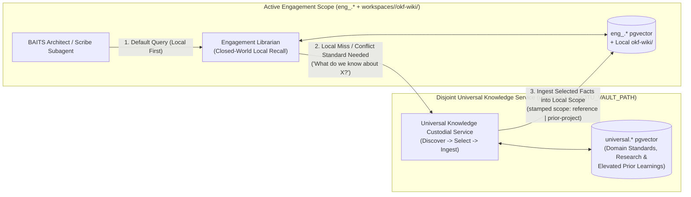
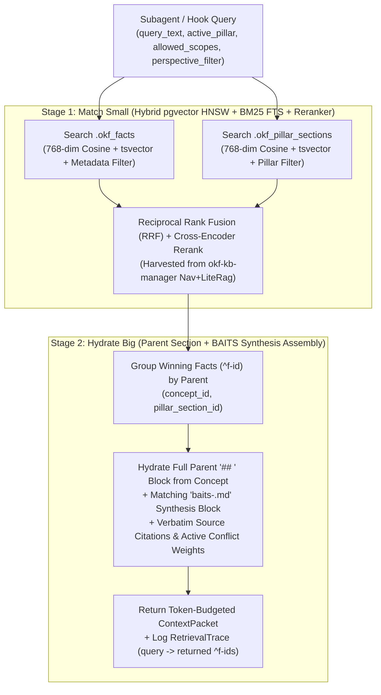
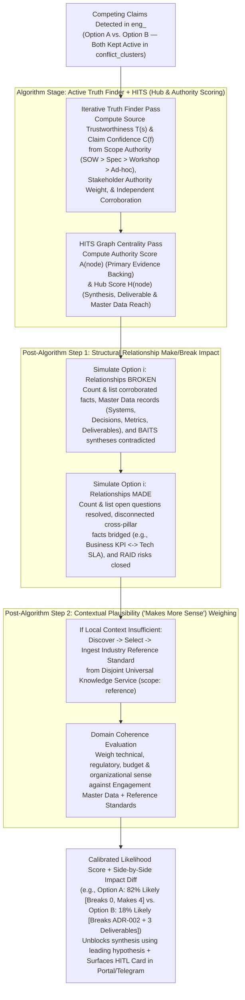

# Slice Group 2 Overall Plan: Disjoint Knowledge Fabric, Small-to-Big Recall, Engagement Master Data, Truth Finder + HITS & Elevation

- **Slice Group:** Slice 2 (`platform/knowledge/`, `inventory/agents/domain/kb/`, `inventory/agents/domain/ingestion/`, and `migrations/` for `eng_<slug>.*`, `universal.*`, and `personal.*`)
- **Architectural Charter:** [`chotu_architecture_plan.md`](file:///home/nox/Developer/ds2/dsa-agent/docs/planning/chotu_architecture_plan.md)
- **Foundational Retrospectives:**
  - [`2026-10-27-05-knowledge-fabric-engagement-datasets-and-elevation.md`](file:///home/nox/Developer/ds2/dsa-agent/brain-logs/conversation-retrospectives/2026-10-27-05-knowledge-fabric-engagement-datasets-and-elevation.md)
  - [`2026-10-27-06-versioned-knowledge-truth-finder-and-hits-weighing.md`](file:///home/nox/Developer/ds2/dsa-agent/brain-logs/conversation-retrospectives/2026-10-27-06-versioned-knowledge-truth-finder-and-hits-weighing.md)
  - [`2026-10-27-07-real-world-scale-postgres-hardening-and-master-queues.md`](file:///home/nox/Developer/ds2/dsa-agent/brain-logs/conversation-retrospectives/2026-10-27-07-real-world-scale-postgres-hardening-and-master-queues.md)

---

## 1. Why Slice Group 2 Is Built Around the Operator's Real Daily Knowledge Load

If Slice Group 1 builds the engine block of Chotu Corp—the 9-layer hexagonal chassis, the 4-lane Master Task Queue, the per-node DAG runner, and the service discovery plane—then **Slice Group 2 builds the institutional memory and reasoning fabric that makes Chotu actually useful in the middle of a fast-moving consulting practice.**

When most people design a knowledge base for a single operator, they quietly assume that "one person" means a light trickle of notes and a few PDFs a week. Under that assumption, you can get away with grepping Markdown files on disk, throwing everything into a single flat vector table, and overwriting old facts whenever a newer document arrives.

We know from lived experience why that approach breaks down in real consulting work. Your typical day is not a quiet stream of notes; it is a high-velocity flood of competing perspectives and evolving artifacts:
- **~10 meetings every single day**, where the same system or business problem is described through at least three different lenses: what the client's stakeholders state (`client_stated`), what our internal delivery team sees (`internal_team`), and your own architectural hypotheses, work research, and personal R&D (`personal_take`, `work_research`, `personal_rd`).
- **~20 dense documents every day**—slide decks, SOWs, architecture specs, spreadsheets, transcripts, and research papers—yielding **1,000 to 3,000+ atomic claims and citations daily**, compounding into **300,000 to 1,000,000+ embedded vectors and graph edges** over a 6-to-12-month horizon.
- **Living Engagement Master Data**: After every meeting and document drop, you have to keep a clean, queryable ledger of the engagement's Stakeholders, Systems, Capabilities, Decisions, Metrics, Deliverables, and RAID items so deliverables stay anchored to reality.
- **Constant mid-engagement contradictions**: What a client VP says in Week 1 Discovery is routinely contradicted by a Principal Engineer in a Week 3 technical deep-dive, or refined as designs move from `v0.1` to `v1.0`. If the system treats every discrepancy as a hard blocker (`⚠ conflict`), synthesis grinds to a halt. Conversely, if the system blindly overwrites the Week 2 signed SOW with a casual remark from a Week 5 status call just because the call has a newer timestamp, it silently corrupts your architecture.
- **Long-horizon recall (6 to 12+ months later)**: Six months or a year after an engagement wraps up, another client comes along with a remarkably similar constraint. You need to ask Chotu, *"How did we handle this class of cutover before, and what burned us?"*—and get back both the distilled lesson and a direct path back to the exact ground-truth dataset of that earlier project, without ever leaking raw client data across engagement boundaries.

Slice Group 2 is designed from the ground up around these five operational realities. It splits into five tightly integrated workstreams (`2.1` through `2.5`) that live inside `backend/platform/knowledge/` (following strict `domain/ | ports/ | adapters/` isolation) and power the custodial knowledge subagents in `backend/inventory/agents/domain/kb/` and `backend/inventory/agents/domain/ingestion/`.

---

## 2. Workstream 2.1 — Closed-World Engagement Scope (`eng_<slug>.*`) vs. Disjoint Universal Knowledge Service (`universal.*`) & `Discover -> Select -> Ingest`

### The Problem We Are Solving
In early iterations, it was tempting to think of the Universal Knowledge Vault (`chotu-vault`) as a big bucket where all project knowledge piles up over time, or as a global index that Chotu searches on every single turn. Both ideas create serious problems in practice.

First, if Universal Knowledge is just an accumulation of project files, client-confidential statements bleed into general domain memory, and every search gets noisy with project-specific politics and one-off compromises. Second, if Chotu queries all of Universal Knowledge on every turn inside an active project, subagents waste context tokens and latency sifting through general theory when the answer was already stated in Tuesday's client workshop. Worse still, if an engagement deliverable relies on an external floating pointer into the Universal Vault, that engagement is no longer self-contained or auditable six months later if the Universal Vault evolves.

### How the Disjoint Architecture Works
In Slice Group 2, **Engagement Knowledge** and **Universal Knowledge** are physically and logically disjoint infrastructures managed under strict rules:

1. **Engagement Scope (`eng_<slug>.*` + `workspaces/<slug>/okf-wiki/`) Is Closed-World First**:
   When any subagent executes a task inside an active engagement (`eng_<slug>`), its `WorkspaceJail` restricts filesystem access to `workspaces/<slug>/`, and its default `KnowledgeLibrarianPort` queries **only** the `eng_<slug>.*` PostgreSQL schema. Chotu does not scan Universal Knowledge on routine engagement turns.
2. **Universal Knowledge (`universal.*` + `CHOTU_VAULT_PATH`) Is a Queryable Reference Layer Managed by Chotu as CEO**:
   The Universal Knowledge Layer holds pure domain knowledge, industry standards, methodology playbooks, research notes you send Chotu over Telegram or the Portal, and sanitized lessons elevated from past engagements. Additionally, a parallel `personal.*` schema isolates your Personal Mode R&D—techniques you are learning and tools you are prototyping for yourself—until they are ready to graduate into work capabilities.
   Chotu queries `universal.*` during an engagement **if and only if** the local engagement scope cannot answer a question or resolve a conflict on its own. Typical triggers include:
   - *"What do we know about topic X?"*
   - *"Have we done an X engagement in the past?"*
   - *"How did we build a block diagram or BVF mapping previously?"*
   - *"What industry standards or reference architectures help resolve this conflict between the client's two teams?"*
3. **The `Discover -> Select -> Ingest` Handshake**:
   When a local miss or conflict triggers a Universal Knowledge lookup, the engagement subagent cannot reach across the schema wall itself. Instead, the workflow invokes the custodial Universal Librarian to **Discover** candidate concepts, patterns, or prior-project lessons from `universal.*`, **Select** the specific items that actually fit the current engagement's context, and **Ingest** a local copy directly into `workspaces/<slug>/okf-wiki/` and `eng_<slug>.*`.
   Ingested items are stamped with `scope: reference` (for domain standards and research) or `scope: prior-project` (for elevated lessons from earlier engagements), along with provenance URI pointers (`universal://<domain>/<concept>#^<fact_id>`). Because the selected knowledge is physically ingested into the engagement scope, the engagement dataset remains **100% self-contained, reproducible, and auditable** forever.



### Hexagonal Grounding in `backend/platform/knowledge/`
- **Domain (`domain/scope_boundary.py`)**: Pure Python value objects for `KnowledgeCoordinates(schema_namespace, workspace_root)`, `UniversalIngestionPackage`, and the citeability firewall rules that verify no cross-engagement read ever occurs.
- **Port (`ports/universal_bridge_port.py`)**: `UniversalKnowledgeBridgePort` exposing `discover_candidates(query, domain_filters, top_k)`, `select_for_engagement(candidate_ids, rationale)`, and `ingest_into_engagement(engagement_slug, selected_items, target_scope)`.
- **Adapter (`adapters/postgres_universal_bridge.py`)**: Concrete adapter that reads from `universal.*`, writes canonical Markdown concept/fact blocks into `workspaces/<slug>/okf-wiki/reference/`, and enqueues a `P2 outbox_hooks` event so the engagement's `OKFIndexer` immediately embeds the newly ingested reference facts into `eng_<slug>.*`.

---

## 3. Workstream 2.2 — Canonical `okf-wiki/` Markdown + Derived `pgvector` Projection (`OKFIndexer`) & Small-to-Big Librarian Retrieval

### Why We Had to Solve the `okf-wiki/` $\leftrightarrow$ `pgvector` Gap Here
When we examined [`dsa-companion-config`](file:///home/nox/Developer/ds2/dsa-companion-config/README.md), we found an unfinished bridge between Markdown knowledge files and vector search. In that earlier repository, `csa-persist-facts` read from a temporary `/tmp/csa_knowledge.json` scratch file during extraction, exited `0` silently whenever PostgreSQL was down, and left `csa-context` and `csa-ask` still grepping Markdown files directly off the disk. Whenever someone edited `okf-wiki/`, ran a synthesis pass, or imported a note, `pgvector` drifted out of sync—and recall never actually used `pgvector`.

At our real consulting scale (500,000+ vectors across engagements and universal domains), grepping the filesystem is a non-starter, and silent database skips destroy trust. At the same time, we refuse to make an opaque database blob the primary home of your knowledge: **`okf-wiki/` Markdown on disk must remain the human-readable, Git-auditable canonical truth.**

### Part A: The Durable `OKFIndexer` Projection Pipeline
To make `okf-wiki/` the canonical write-master and PostgreSQL `pgvector` a 100% reliable, recomputable read projection, Workstream 2.2 introduces the **`OKFIndexer`** driven by the `P2 outbox_hooks` lane from Slice 1:

1. **Canonical Write to `okf-wiki/` + Sync Ledger Outbox**:
   Whenever `csa-extract`, `csa-concept-writer`, `csa-synthesize`, or the `ObsidianWatcher` writes or modifies a Markdown file in `okf-wiki/` (either `okf-wiki/<type>/concept-*.md` or `okf-wiki/synthesis/baits-<pillar>.md`), the writer computes the file's `sha256` content hash and records a row in `<schema>.okf_sync_ledger(file_path, sha256_hash, status='PENDING_INDEX', updated_at)` alongside a `P2 outbox_hooks` task (`on_facts_persisted`).
2. **Deterministic Structural Parsing (Zero Scratch Files)**:
   The `OKFIndexer` never reads `/tmp` scratch files. It parses the canonical `okf-wiki/` Markdown file directly, extracting:
   - The YAML frontmatter (`concept_id`, `title`, `type`, `domain`, `frameworks`, `pillars`, `created_at`, `updated_at`).
   - Every **Pillar Section** (`## Business`, `## Application`, `## Information`, `## Technology`, `## Security`, or synthesized blocks inside `okf-wiki/synthesis/baits-<pillar>.md`).
   - Every **Atomic Fact / Claim (`^f-id`)** anchored inside those sections, along with its inline or block metadata (`scope`, `perspective`, `version`, `observed_at`, `ingested_at`, `source_uri`, and verbatim quote span).
   - Every **WikiLink & Citation Edge** (`[[concept-slug#^f-id]]`) to populate the relational citation graph.
3. **Dual-Granularity Embedding & Transactional Upsert**:
   The `OKFIndexer` computes 768-dimensional embeddings (via `LLMPort.embed_batch()`) and `tsvector` full-text lexemes for **two distinct granularities**:
   - `<schema>.okf_facts`: Every individual atomic claim (`^f-id`).
   - `<schema>.okf_pillar_sections`: Every `## <Pillar>` section in a concept file and every synthesis block in `baits-<pillar>.md`.
   Both tables carry HNSW vector indexes (`vector_cosine_ops`, `m=16`, `ef_construction=64`) and GIN indexes on `search_tsv` and metadata tags (`pillar`, `scope`, `perspective`). Once committed, `okf_sync_ledger.status` flips to `'INDEXED'`. If the embedding service is momentarily busy, the task stays in the P2 queue with exponential backoff—**zero silent skips**. And because `okf-wiki/` holds every piece of metadata, running `chotu kb reindex --schema eng_<slug>` can rebuild the entire Postgres projection from disk at any time.

### Part B: Small-to-Big Librarian Retrieval ("Match Small, Hydrate Big")
Why do we index *both* atomic facts and pillar sections? Because in our design conversations we saw that neither granularity works alone:
- **Fact-only retrieval** is great at finding a specific number, API limit, or stakeholder quote (`"RPO must be under 15 minutes"`), but if you hand a subagent twenty isolated one-line sentences stripped of their surrounding section, the subagent loses the architectural narrative and misinterprets how those facts fit together.
- **Whole-concept retrieval** preserves narrative, but a single `concept-payment-gateway.md` file might span Business, Application, Technology, and Security sections. Embedding the whole file blurs all five BAITS pillars into one muddied vector and stuffs irrelevant sections into the subagent's prompt.

**Small-to-Big Retrieval** gives us the precision of atomic claims and the coherent context of pillar sections without prompt bloat:



1. **Match Small (Millisecond Hybrid Search)**:
   When `KnowledgeLibrarianPort.retrieve()` is called (either explicitly by a subagent or automatically by the `pre_subagent_dispatch` hook injecting a `ContextPacket`), PostgreSQL executes a parallel hybrid search (HNSW cosine similarity + `ts_rank_cd` BM25 fused via Reciprocal Rank Fusion) across both `okf_facts` and `okf_pillar_sections`, filtered by the caller's allowed `scope:` and `pillar:`.
2. **Hydrate Big (Coherent Section + Synthesis Context)**:
   Instead of returning disconnected one-liners, the Librarian takes the top-scoring atomic facts (`^f-id`), looks up their parent `(concept_id, pillar)` section in `okf_pillar_sections`, and hydrates the **entire `## <Pillar>` section** from the parent Concept alongside the corresponding section from `okf-wiki/synthesis/baits-<pillar>.md`. Within that hydrated section, the exact winning `^f-id` anchors, their verbatim source citations, and any active Truth Finder likelihood weights are highlighted.
3. **Closed-Loop Retrieval Telemetry (`RetrievalTrace`)**:
   Every retrieval writes a `RetrievalTrace` record capturing the query, the hydrated `^f-id` claims, and (once the subagent finishes its node via `on_workflow_complete`) which `[[concept#^f-id]]` anchors the subagent actually cited in its output. Over time, this telemetry feeds back into ranking weights and flags stale or noisy concepts for the Vault Hygiene agent.

---

## 4. Workstream 2.3 — Multi-Perspective Versioned Claims & Engagement Master Data

### Capturing Multi-Perspective, Bitemporal Reality
In a real engagement, knowing *what* was said is useless unless you also know **who said it, from what vantage point, when it was true in reality, and whether it can be cited in a client-facing deliverable.**

Every atomic claim (`^f-id`) in `okf-wiki/` and `<schema>.okf_facts` carries three mandatory classification and temporal axes:

1. **The 6-Value `scope:` Axis (Citeability & Provenance Boundary)**:
   Harvested and hardened from [`dsa-companion-config`](file:///home/nox/Developer/ds2/dsa-companion-config/README.md), every claim is stamped with one of six scopes:
   - `engagement`: Contractual charter, SOW terms, milestone dates, and commercial boundaries of the current project.
   - `client`: Statements, documents, diagrams, and metrics originating from the client organization.
   - `internal`: Delivery-team discussions, internal architecture reviews, margin/staffing notes, and candid risk assessments (**blocked from client-facing export by the `post_subagent_complete` citeability firewall hook**).
   - `reference`: Industry standards, vendor documentation, or domain frameworks ingested from the Universal Knowledge Layer.
   - `prior-project`: Sanitized lessons or benchmark patterns ingested from a closed engagement via Universal Knowledge.
   - `deliverable`: Verified claims and decisions that have been formally published in an approved engagement deliverable.

2. **The 5-Value `perspective:` Axis (Whose Lens Is This?)**:
   Because a single day's 10 meetings span wildly different viewpoints, every claim also records its perspective (plus an optional `speaker_role` / `department` qualifier, such as `VP of Retail Banking` or `Principal DBA`):
   - `client_stated`: What a client stakeholder explicitly stated or provided in a document.
   - `internal_team`: What our own consulting/engineering team observed, agreed upon, or proposed internally.
   - `personal_take`: Your own architectural intuition, working hypothesis, or strategic observation captured during or after a meeting.
   - `work_research`: Targeted benchmarking, documentation checks, or codebase inspection done to solve an engagement problem.
   - `personal_rd`: Exploratory learning, tool building, or technique testing done in Personal Mode.

3. **Bitemporal Versioning & Lineage (`version`, `observed_at`, `ingested_at`, `lineage_parent_id`)**:
   Adapted from [`substrate`](file:///home/nox/Developer/ds2/substrate/CLAUDE.md), every fact tracks two timestamps and an explicit lineage chain:
   - `observed_at`: When the statement was actually made or when the architecture artifact (`v0.1`, `v0.2`, `v1.0`) was authored in the real world.
   - `ingested_at`: When Chotu extracted and recorded it into the ledger.
   - `version` & `lineage_parent_id`: When a design or metric evolves legitimately over time (for example, an architecture diagram progressing from `v0.1` to `v0.2`), the new claim links to its predecessor via `lineage_parent_id` with `evolution_type = 'ITERATION'`, distinguishing natural design evolution from an unresolved conflict (`evolution_type = 'COMPETING_CLAIM'`).

### First-Class Engagement Master Data (`eng_<slug>.master_*`)
Beyond unstructured concepts and atomic claims, every consulting engagement runs on structured master entities that you update after every meeting and reference across every deliverable. If Stakeholders, Systems, or RAID items only exist buried inside Markdown paragraphs, you cannot reliably query *"Which systems owned by the Retail VP are impacted by Decision D-14?"* or simulate the blast radius of a conflicting claim.

Workstream 2.3 establishes seven canonical **Engagement Master Data** tables inside every `eng_<slug>.*` schema (with bidirectional sync to `workspaces/<slug>/okf-wiki/master-data/*.md` so they remain readable in Obsidian and Git):

| Master Data Table (`eng_<slug>.*`) | Core Fields & Role in the Engagement Graph |
| :--- | :--- |
| **`master_stakeholders`** | `stakeholder_id`, `name`, `title`, `organization` (`client` vs `internal`), `department`, `influence_level`, `authority_weight`, `stated_priorities[]`, `linked_fact_ids[]`. Weights source authority in Truth Finder + HITS. |
| **`master_systems`** | `system_id`, `name`, `category`, `owner_stakeholder_id`, `lifecycle_state` (`legacy`, `target`, `transitional`), `baits_pillars[]`, `interfaces[]`, `sla_metrics`, `linked_fact_ids[]`. |
| **`master_capabilities`** | `capability_id`, `name`, `bvf_level` (`L1`, `L2`, `L3`), `current_maturity`, `target_maturity`, `supporting_system_ids[]`, `business_value_driver`, `linked_fact_ids[]`. Powers BVF capability-bundle analysis. |
| **`master_decisions`** | `decision_id` (e.g., `ADR-004`), `title`, `status` (`proposed`, `accepted`, `superseded`, `contested`), `decided_by_stakeholder_ids[]`, `decided_at`, `impacted_system_ids[]`, `impacted_capability_ids[]`, `rationale_fact_ids[]`. |
| **`master_metrics`** | `metric_id`, `name`, `category` (`kpi`, `sla`, `nfr`, `financial`), `baseline_value`, `target_value`, `unit`, `measured_system_id`, `source_fact_id`, `version`. |
| **`master_deliverables`** | `deliverable_id`, `title`, `sow_milestone`, `artifact_type`, `current_version`, `status` (`draft`, `in_review`, `approved`, `published`), `cited_fact_ids[]`, `depended_decision_ids[]`. |
| **`master_raid_items`** | `raid_id`, `category` (`Risk`, `Assumption`, `Issue`, `Dependency`), `severity`, `probability`, `owner_stakeholder_id`, `mitigation_plan`, `impacted_deliverable_ids[]`, `trigger_conflict_id`. Powers the RAID capability-bundle. |

Every row in these seven tables links directly to the atomic `^f-id` claims that substantiate it via `eng_<slug>.entity_fact_links`. That relational backbone is what makes Workstream 2.4's structural Make/Break simulation exact rather than guesswork.

---

## 5. Workstream 2.4 — Active Truth Finder + HITS Engine & The 2-Step Make/Break + Plausibility Weighing Pipeline

### Why Forced Auto-Conflict Resolution Is Dangerous in Consulting
Suppose in Week 2, the client's Chief Architect signs off on an Architecture Decision Record (`ADR-002`) stating that the core ledger must remain on-premises in Phase 1 due to regulatory residency rules. Then in Week 5, during a casual sprint planning call, a product manager says, *"We're moving the whole ledger to AWS in Phase 1."*

What happens if an AI system uses naive "newer timestamp wins" auto-supersession? It overwrites `ADR-002`, invalidates three weeks of Technology and Security synthesis, and quietly corrupts your deliverables. What happens if it uses naive "flag `⚠ conflict` and halt"? Your BAITS synthesis pipeline freezes, and you are forced to manually referee dozens of minor transcript discrepancies every evening just to keep work moving.

In our design retrospective ([`2026-10-27-06`](file:///home/nox/Developer/ds2/dsa-agent/brain-logs/conversation-retrospectives/2026-10-27-06-versioned-knowledge-truth-finder-and-hits-weighing.md)), you laid down the exact law for how Chotu handles conflicts:
1. **Never force auto-conflict resolution**: Competing claims both stay **active and versioned** side-by-side in the engagement's epistemic graph (`eng_<slug>.conflict_clusters`).
2. **Run Truth Finder + HITS actively**, and then execute **only two explicit steps after the algorithm**:
   - **Step 1**: Evaluate which competing option **makes or breaks** existing and new relationships across the engagement graph.
   - **Step 2**: Evaluate which option **makes more sense** in the domain context (pulling reference standards from Universal Knowledge if needed), and weigh the options so we know which one is more likely.

### How the Pipeline Operates Step-by-Step

Whenever the `OKFIndexer` or `csa-extract` detects that a newly ingested claim $C_{\text{new}}$ contradicts an existing active claim $C_{\text{existing}}$ on the same subject, attribute, or Master Data entity (or when two perspectives clash in the same meeting), it creates or updates a `ConflictCluster` in `eng_<slug>.conflict_clusters` and dispatches the **`TruthFinderEngine`** (`backend/platform/knowledge/domain/truth_finder.py`):



#### The Algorithm Stage: Active Truth Finder + HITS (Hubs & Authorities)
Before looking at downstream impact, the engine runs two complementary graph algorithms over the engagement's bipartite Source–Claim–Entity graph:
1. **Truth Finder (Iterative Source Trustworthiness & Claim Implication)**:
   - Every source $s$ starts with a base prior derived from its document class and `scope:`/`perspective:` metadata (signed SOW or approved `deliverable` > formal architecture spec > `reference` standard > multi-attendee workshop transcript > casual 1:1 chat) and the `influence_level` / `authority_weight` of the speaking stakeholder in `master_stakeholders`.
   - Truth Finder iteratively updates source trustworthiness $T(s)$ and claim confidence $C(f)$, factoring in **inter-source implication** (whether independent perspectives—say, `client_stated` from engineering and `work_research` from code inspection—corroborate the same claim).
2. **HITS (Hyperlink-Induced Topic Search — Authorities & Hubs)**:
   - Over the citation and ontology graph (`okf_citations` + `entity_fact_links`), HITS computes an **Authority Score $A(v)$** (how strongly a claim or entity is backed by high-trust primary evidence) and a **Hub Score $H(v)$** (how many BAITS synthesis sections, Master Data decisions, capabilities, and active deliverables depend on that node). A high-Hub node tells us immediately that changing this claim will ripple across the entire engagement.

#### Post-Algorithm Step 1: Structural Relationship Make/Break Impact (`RelationshipImpactAnalyzer`)
Once Truth Finder and HITS scores are computed, the engine executes **Step 1**: a deterministic graph simulation (`simulate_make_break_impact(cluster_id)`) that tests what happens to the engagement's graph topology if Option $A$ is accepted as the primary truth versus if Option $B$ is accepted:
- **Relationships BROKEN by Option $i$ (`broken_edges[]`)**:
  The analyzer traverses `okf_citations`, `entity_fact_links`, and `master_*` foreign keys to count and list every existing relationship that Option $i$ would invalidate:
  - Which corroborated facts (`^f-id`) with high Authority scores would be directly contradicted?
  - Which accepted `master_decisions` (ADRs), `master_systems` interfaces, or `master_metrics` SLAs would be violated?
  - Which `okf-wiki/synthesis/baits-<pillar>.md` sections or `master_deliverables` would become inconsistent or orphaned?
- **Relationships MADE by Option $i$ (`made_edges[]`)**:
  Conversely, the analyzer checks what new structural connections Option $i$ unlocks:
  - Does Option $i$ bridge previously disconnected claims across BAITS pillars (for example, connecting an unlinked Business transaction volume target in `## Business` to a database partitioning constraint in `## Technology`)?
  - Does Option $i$ resolve an open `Assumption` or `Issue` tracked in `master_raid_items`?
  - Does Option $i$ align with newly discovered primary evidence that explains *why* an earlier assumption was incomplete?

This produces a concrete **Structural Delta Score ($\Delta \text{Rel}_i$)** alongside an exact, human-readable bill of materials showing every fact, decision, system, and deliverable made or broken by each option.

#### Post-Algorithm Step 2: Contextual Plausibility ("Makes More Sense") Weighing (`PlausibilityWeigher`)
Numbers and edge counts alone are not enough; sometimes a single new architectural discovery legitimately overturns ten outdated assumptions from Week 1 because the new discovery *makes far more technical and business sense*.

In **Step 2**, the `truth_finder_agent` evaluates **contextual plausibility ("Which option makes more sense?")**:
1. **On-Demand Universal Reference Check**: If the local engagement facts aren't enough to judge which claim is more realistic (for example, two client engineers disagreeing on whether a zero-trust mesh adds 2ms or 80ms of p99 latency under their workload), the agent invokes Workstream 2.1's `UniversalKnowledgeBridgePort` to **Discover, Select, and Ingest** relevant industry benchmarks or prior-project reference facts into the engagement (`scope: reference`).
2. **Domain & Engagement Coherence Scoring**: Evaluating the competing options against the client's `master_systems` stack, budget, regulatory constraints, team maturity, and ingested reference standards, Step 2 computes a calibrated **Plausibility Score ($P_i \in [0, 1]$)** and a plain-English explanation of why Option $A$ makes more (or less) sense than Option $B$.
3. **Combined Likelihood Score & Non-Blocking Delivery**:
   The engine combines the three signals into a normalized **Likelihood Weight** for each competing option:
   $$\text{Likelihood}(O_i) = \text{softmax}\Big(w_{\text{TF}} \cdot \text{TF\_HITS}(O_i) + w_{\text{rel}} \cdot \Delta\text{Rel}_{\text{Make/Break}}(O_i) + w_{\text{sense}} \cdot \text{Plausibility}(O_i)\Big)$$
   - **Both claims remain active** in `eng_<slug>.okf_facts` and `eng_<slug>.conflict_clusters`.
   - **Delivery never stalls**: BAITS architects and `csa-synthesize` continue working using the leading weighed hypothesis (explicitly annotating the synthesis with the confidence weight and alternative impact), while the Web Portal (`ProjectPage`) and Telegram surface a clean **Truth Finder Comparison Card** showing the likelihood percentages, the exact Make/Break impact list, and the sense-making rationale so you can either lock in the decision with one click or take a surgical clarifying question into your next client meeting.

---

## 6. Workstream 2.5 — Engagement Closure Retrospectives & The Elevation Technique

### Turning Every Closed Engagement into a Cited Empirical Dataset
How does Chotu get smarter from project to project over 6 to 12+ months without turning Universal Knowledge into a messy dump of client files? Through the **Elevation Technique** ([`2026-10-27-05`](file:///home/nox/Developer/ds2/dsa-agent/brain-logs/conversation-retrospectives/2026-10-27-05-knowledge-fabric-engagement-datasets-and-elevation.md)).

When an engagement closes (or completes a major SOW milestone), we do **not** delete or flatten `eng_<engagement_id>.*`. That engagement schema and its `workspaces/<engagement_id>/okf-wiki/` folder remain intact as a permanent, queryable **empirical dataset**. Then, Chotu queues an asynchronous **Retrospective Discovery Workflow** on the `P3 subconscious_bulk` lane, led by `retro_elevator_agent`.

### The 5-Lens Retrospective Discovery Queue
Rather than generating a generic summary paragraph, `retro_elevator_agent` executes five structured discovery lenses against the engagement's complete history (its Master Data evolution, BAITS syntheses, deliverables, and Truth Finder conflict resolutions):

1. **Lens 1 — Achievements & Actual Execution Path**:
   *What did we actually achieve in this engagement, and how did we end up having to do it compared to our initial SOW plan?*
2. **Lens 2 — Methodology & Framework Efficacy (What Worked vs. Failed)**:
   *Which analytical methods, BAITS synthesis flows, capability-bundles (BVF, RAID), or estimation models worked well in this engagement, and which ones fell flat or required heavy adaptation?*
3. **Lens 3 — People, Process, Technology, Tools & Techniques (PPTTT)**:
   *Across People (stakeholder dynamics, team topology), Process (governance, review cadence), Technology (stack choices, integration patterns), Tools, and Techniques, what worked for us and what created friction?*
4. **Lens 4 — Counterfactuals & Day-1 Anti-Repeat Rules**:
   *Knowing what we know today, how would we approach this differently from Day 1? If another engagement like this lands six months or a year from now, what concrete preconditions and risks must we factor in immediately so our mistakes never repeat?*
5. **Lens 5 — Harvested Domain & Architectural Research**:
   *What reusable domain research, regulatory findings, benchmark numbers, and architectural patterns did we collect during this engagement that hold true beyond this single client?*

### Elevating into Universal Knowledge with `engagement://<engagement_id>#^<anchor>` Correlation
The answers to those five lenses are first written canonically into the engagement's own wiki under `workspaces/<engagement_id>/okf-wiki/retrospective/concept-retro-*.md` with atomic anchor IDs (`^retro-01`, `^retro-02`, ...).

Next, `retro_elevator_agent` **sanitizes and elevates** those distilled insights into the disjoint **Universal Knowledge Fabric** (`CHOTU_VAULT_PATH` + `universal.okf_facts` and `universal.elevated_learnings`), stamping every elevated claim with a permanent citation correlation key pointing back to the source engagement dataset:
```markdown
When migrating a dual-core retail ledger under strict residency constraints, decouple the read-replica reconciliation pipeline before cutover; attempting inline synchronous cutover caused a 3-week UAT stall under peak batch load. ^u-f892
- **scope**: prior-project
- **pillar**: Technology
- **citation**: [[engagement://eng_2026_acme#^retro-07]]
- **correlation_engagement_id**: eng_2026_acme
```

**Why this two-stage correlation is so powerful**:
- **Stage 1 (Fast Universal Recall)**: Ten months later, when you kick off `eng_2027_globex`, Chotu's Universal Knowledge query (*"Have we done a retail ledger cutover before, and what burned us?"*) immediately returns `^u-f892` in milliseconds from `universal.*`.
- **Stage 2 (Targeted Deep Drill-Down via `engagement_id`)**: If you then ask Chotu, *"Show me the actual stakeholder constraints, system topology, and Truth Finder conflict that led to `^retro-07` in `eng_2026_acme`,"* Chotu uses the `correlation_engagement_id` (`eng_2026_acme`) to run a targeted, read-only inspection query against `eng_2026_acme.*`—recovering the exact empirical reality without ever polluting `eng_2027_globex` with raw `eng_2026_acme` files.

---

## 7. Harvest Sources, Module Map & Slice 2 Exit Criteria

### Authoritative Harvest Sources for Slice Group 2
We never modify sibling repositories; we harvest their proven patterns and adapt them cleanly into `backend/platform/knowledge/` (`domain/ | ports/ | adapters/`) and `backend/inventory/`:

| Source Repository & Exact Files | What We Harvest & How We Adapt It in Slice Group 2 | Target Path in `dsa-agent` |
| :--- | :--- | :--- |
| **[`dsa-companion-config`](file:///home/nox/Developer/ds2/dsa-companion-config/README.md)**<br>- `csa_vectors/schema.sql`<br>- `ontology/ontology.py`<br>- `skills/csa-extract/SKILL.md`<br>- `skills/csa-concept-writer/SKILL.md`<br>- `skills/csa-synthesize/SKILL.md`<br>- `skills/csa-context/SKILL.md`<br>- `skills/csa-ask/SKILL.md` | Harvest the 6-value `scope:` taxonomy, BAITS pillar definitions, `okf-wiki/` concept/fact Markdown conventions, and ontology entity relationship rules. Replace the `/tmp/csa_knowledge.json` scratch-file script and filesystem grep with the durable `OKFIndexer` (`okf_sync_ledger` + `P2 outbox_hooks`) and `pgvector` Small-to-Big Librarian. | `backend/migrations/versions/0002_knowledge_schemas.py`,<br>`backend/platform/knowledge/`,<br>`backend/inventory/agents/domain/{ingestion,kb}/`,<br>`backend/inventory/skills/` |
| **[`okf-kb-manager`](file:///home/nox/Developer/ds2/okf-kb-manager/CLAUDE.md)**<br>- `CLAUDE.md` (`Nav+LiteRag` hybrid retrieval, cross-encoder reranking, citation graph, faithfulness/completeness judges, changeset review gates) | Harvest the `Nav+LiteRag` reciprocal rank fusion (BM25 + vector cosine), cross-encoder reranking pipeline, `[[concept#^fact]]` citation graph traversal, and retrieval effectiveness trace scoring. | `backend/platform/knowledge/adapters/pgvector_librarian.py`,<br>`backend/platform/knowledge/domain/citation_graph.py`,<br>`backend/platform/memory/domain/retrieval_trace.py` |
| **[`substrate`](file:///home/nox/Developer/ds2/substrate/CLAUDE.md)**<br>- `CLAUDE.md` (Bitemporal fact superseding & lineage invariants) | Harvest bitemporal timestamp modeling (`observed_at` vs. `ingested_at`) and explicit fact lineage (`lineage_parent_id`, `ITERATION` vs. `COMPETING_CLAIM`), replacing auto-supersession with our active Truth Finder + HITS + 2-Step Weighing pipeline. | `backend/platform/knowledge/domain/bitemporal_fact.py`,<br>`backend/platform/knowledge/domain/truth_finder.py` |

### Slice Group 2 Verification & Exit Criteria
Slice Group 2 is complete only when all seven automated verification suites pass under `pytest` and `mypy --strict`:

1. **Zero-Vendor-in-Domain & Port-Contract Suite**:
   - `backend/platform/knowledge/domain/` passes the CI import check with zero SQLAlchemy, `asyncpg`, `pgvector`, FastAPI, or LiteLLM imports.
   - Contract tests pass for `OKFIndexerPort`, `KnowledgeLibrarianPort`, `UniversalKnowledgeBridgePort`, `EngagementMasterDataPort`, `TruthFinderPort`, and `RetrospectiveElevatorPort` against both in-memory fakes and live PostgreSQL 16 + `pgvector` test containers.
2. **Closed-World Isolation & `Discover -> Select -> Ingest` Firewall Test**:
   - Verify that a subagent scoped to `eng_alpha` cannot query `eng_beta.*` under any circumstances.
   - Verify that on a local miss in `eng_alpha`, invoking `UniversalKnowledgeBridgePort` discovers candidates in `universal.*`, ingests the selected items into `workspaces/eng_alpha/okf-wiki/reference/` + `eng_alpha.okf_facts` stamped with `scope: reference` or `prior-project`, and preserves 100% self-contained auditability inside `eng_alpha`.
3. **Canonical `okf-wiki/` $\rightarrow$ `pgvector` Round-Trip & Zero-Silent-Skip Test**:
   - Write multi-pillar `concept-*.md` and `baits-<pillar>.md` files to `okf-wiki/`; verify `okf_sync_ledger` records the SHA-256 hash, the `P2 outbox_hooks` worker indexes both `okf_facts` (`^f-id`) and `okf_pillar_sections` (`## <Pillar>`), and simulated embedding failures retry with exponential backoff rather than dropping facts.
   - Drop the `eng_alpha` vector tables, run `OKFIndexer.reindex_workspace("eng_alpha")`, and verify 100% bit-identical reconstruction of facts, pillar sections, citations, and Master Data from `okf-wiki/` Markdown alone.
4. **Small-to-Big Librarian Retrieval & Citeability Firewall Test**:
   - Issue a fine-grained fact query; verify the Librarian matches the atomic `^f-id` and `## <Pillar>` vectors in `<50ms` via HNSW + FTS and hydrates the full parent `## <Pillar>` section + `baits-<pillar>.md` synthesis block with verbatim citations and a logged `RetrievalTrace`.
   - Verify that when preparing a client-facing deliverable (`target_scope = 'deliverable'`), the Librarian and `post_subagent_complete` hook strictly strip or block any claim stamped `scope: internal` or `perspective: personal_take` unless explicitly promoted.
5. **Multi-Perspective & Engagement Master Data Link Test**:
   - Ingest a single meeting transcript containing `client_stated`, `internal_team`, and `personal_take` claims; verify all three perspectives are preserved with distinct `perspective:` tags and linked to rows in `master_stakeholders`, `master_systems`, `master_decisions`, and `master_raid_items`.
6. **Active Truth Finder + HITS + 2-Step Weighing Simulation Test**:
   - Seed an engagement with an accepted `ADR-002` decision (`master_decisions`), three dependent deliverables (`master_deliverables`), and corroborating `## Technology` facts. Inject a contradicting casual claim from a later meeting transcript.
   - Verify that **neither claim is auto-overwritten**, `TruthFinderEngine` computes Truth Finder + HITS Hub/Authority scores, **Step 1** accurately enumerates the exact broken edges (`ADR-002` + 3 deliverables) vs. made edges, **Step 2** pulls a reference benchmark from `universal.*` to score domain plausibility, and the engine outputs calibrated likelihood weights alongside a structured HITL review card.
7. **Engagement Closure 5-Lens Retrospective & Elevation Drill-Down Test**:
   - Trigger engagement closure on `eng_2026_acme`; verify the P3 workflow generates all 5 retrospective lenses in `workspaces/eng_2026_acme/okf-wiki/retrospective/`, elevates the sanitized learnings into `universal.okf_facts` and `universal.elevated_learnings` with `citation: engagement://eng_2026_acme#^retro-XX`, and verifies two-stage drill-down from a new engagement (`eng_2027_globex`) back to `eng_2026_acme`'s empirical dataset via `engagement_id`.
