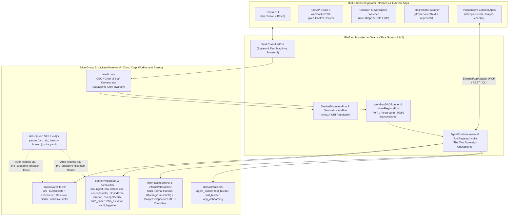
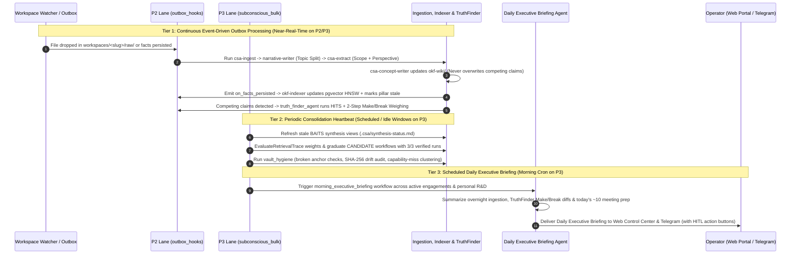

# Slice Group 3 Overall Plan: Chotu Corp Inventory — Lead Orchestrator, BAITS Architects, Capability-Bundles, Extractors & Subconscious Daemon

- **Slice Group:** `Slice Group 3`
- **Parent Blueprint:** [`chotu_architecture_plan.md`](file:///home/nox/Developer/ds2/dsa-agent/docs/planning/chotu_architecture_plan.md)
- **Foundational Retrospectives:**
  - [`2026-10-27-01-identity-and-chotu-corp-operating-model.md`](file:///home/nox/Developer/ds2/dsa-agent/brain-logs/conversation-retrospectives/2026-10-27-01-identity-and-chotu-corp-operating-model.md)
  - [`2026-10-27-03-service-discovery-and-service-locator.md`](file:///home/nox/Developer/ds2/dsa-agent/brain-logs/conversation-retrospectives/2026-10-27-03-service-discovery-and-service-locator.md)
  - [`2026-10-27-04-classifier-routing-dynamic-workflows-and-hooks.md`](file:///home/nox/Developer/ds2/dsa-agent/brain-logs/conversation-retrospectives/2026-10-27-04-classifier-routing-dynamic-workflows-and-hooks.md)
- **Target Scope:** `backend/inventory/` (Lead Orchestrator, BAITS Architects, Ingestion & KB Custodians, Internal Extractors & Classifiers, Self-Extension Builders, Operationalized Skills, Capability-Bundle Packs, Seeded Workflows, Declarative Hooks) + `backend/platform/harness/` (3-Tier Subconscious Scheduler & Multi-Channel Comms Adapters) + `backend/platform/tools/adapters/` (`ExternalAppAdapter`)

---

## 1. Why Slice Group 3 Brings "Chotu Corp" to Life on Top of the Platform Chassis

By the time Slice Groups 1 and 2 are complete, we have a rock-solid engine room. Slice Group 1 gives us the 9-layer hexagonal microkernel in `backend/platform/`—complete with the 4-lane priority Master Task Queue (`P0` through `P3`), the per-node workflow DAG runner, the `ServiceDiscoveryPort` and `ServiceLocatorPort` capability registries, the dual-mode lifecycle hook engine, and workspace path jailing. Slice Group 2 gives us the epistemic memory and knowledge fabric—per-engagement schema isolation (`eng_<slug>.*`), the `okf-wiki/` to `pgvector` Small-to-Big Librarian, multi-perspective claim tracking, the Truth Finder + HITS weighing engine, and the engagement-closure Elevation pipeline.

Yet an engine room on its own cannot run a consulting engagement or manage a personal R&D lab. If you drop a 60-page client statement of work and three contradictory stakeholder meeting transcripts into an engagement workspace right after Slice Group 2 finishes, the database schemas and queues are ready, but nobody is home to read the documents, extract the claims, weigh the architectural trade-offs across business and security lenses, or prepare your morning briefing before your first meeting of the day.

**Slice Group 3 is where we staff the company.** In this slice group, we populate `backend/inventory/` with the actual departments, specialist subagents, operationalized skills, methodology packs, and background playbooks that turn the platform chassis into **"Chotu Corp"**—your autonomous consulting and R&D organization where you act as Chairman & CEO and Chotu serves as Lead Orchestrator & Chief of Staff.

### The Strict Microkernel Boundary: Zero Hardcoding in `backend/platform/`
The most important architectural rule governing Slice Group 3 is that **nothing we build in `backend/inventory/` receives special-case treatment inside `backend/platform/`**. In earlier iterations across sibling projects, it was easy for domain assumptions—like the five BAITS architecture pillars, specific `csa-*` skill names, or transcript parser flags—to leak into the core execution loop. Whenever that happens, the platform stops being a clean microkernel and turns into a rigid monolith.

In `dsa-agent`, `backend/platform/` never imports `backend/inventory/`. Every single department agent, extractor, classifier, skill playbook, workflow template, and capability-bundle pack shipped in `backend/inventory/` registers itself at startup through the exact same declarative `manifest.yaml` and `SKILL.md` contracts—and resolves at runtime through the exact same `chotu://<kind>/<namespace>/<name>@<version>` URIs via `ServiceDiscoveryPort` and `ServiceLocatorPort`—as capabilities that Chotu grows dynamically at runtime under `~/.chotu/`.

---

## 2. Workstream 3.1 — The Lead Orchestrator (`lead/chotu`) & Departmental Subagents

In a typical consulting workday, you move rapidly between ~10 meetings and ~20 complex documents while switching contexts between client engagements (`mode: work_engagement`), cross-client methodology research (`mode: universal_research`), and personal technical exploration (`mode: personal_rd`). If a single monolithic agent tried to handle your live chat, run bash commands, parse PDFs, and write BAITS architecture sections inside one context window, its prompt would quickly bloat with raw tool outputs and lose track of perspective boundaries.

Workstream 3.1 solves this by organizing `backend/inventory/agents/` into a clear executive and departmental hierarchy.

### 2.1 The Lead Orchestrator (`lead/chotu`) & The Subagents-Only Invariant
At the top of the hierarchy sits **`lead/chotu`** (`backend/inventory/agents/lead/chotu/`), acting as your Chief of Staff across both Work and Personal modes.

When you send a request—or when a file watcher or scheduled trigger fires—the flow never starts with free-form LLM tool calling:
1. **Upfront Classification (`WorkClassifierPort`)**: The inbound event is classified first into a structured `WorkClassification` envelope specifying `intent`, `mode` (`work_engagement`, `personal_rd`, or `universal_research`), `engagement_slug`, target `departments[]`, `baits_pillars[]`, the 6-value `scope`, the 5-value `perspective`, `complexity`, and `risk_level`.
2. **System-1 Established Lookup vs. System-2 Dynamic DAG Composition**:
   - `lead/chotu` first checks `WorkflowRegistry` for an `ESTABLISHED` workflow DAG matching the classification signature. If a proven playbook already exists (for example, standard transcript ingestion or a single-pillar synthesis refresh) and all required subagents report `HEALTHY`, `lead/chotu` dispatches that DAG immediately with zero LLM planning latency.
   - If the request is novel or spans multiple pillars and perspectives in a new way, `lead/chotu` uses `DynamicWorkflowComposer` and `ServiceDiscoveryPort` to assemble a custom Subagent DAG—combining sequential steps, parallel fan-out/fan-in across specialist architects, and human approval gates. Every newly composed DAG starts with `status = CANDIDATE` and only graduates to `ESTABLISHED` after **3 consecutive verified runs** (or your explicit one-click promotion).
3. **Strict Enforcement of the Subagents-Only Invariant**:
   - `lead/chotu` **never** calls raw tools (`bash`, `python`, `grep`, `sql`, `vault_write`, etc.) and never mutates engagement files directly. Its manifest (`backend/inventory/agents/lead/chotu/manifest.yaml`) grants zero raw tool permissions; at the runtime boundary, it can only invoke classification, capability discovery, and subagent DAG dispatch. All actual domain execution happens inside scoped departmental subagents running within their own isolated context windows and workspace jails.

### 2.2 BAITS Consulting & Architecture Department (`domain/architects/`)
Located in `backend/inventory/agents/domain/architects/`, this department houses the specialist consulting minds harvested and adapted from [`dsa-companion-config`](file:///home/nox/Developer/ds2/dsa-companion-config/README.md). Rather than treating architecture as a single generic prompt, each pillar and delivery role is a distinct subagent with its own capability URI, curated skill attachments, and analytical rubric:

- **The Five BAITS Pillar Architects**:
  - **`business-architect` (`chotu://agent/architects/business-architect@1.0.0`)**: Analyzes business capabilities, value streams, strategic drivers, stakeholder incentives, KPIs, and organizational readiness. When the `bvf` (Business Value Framework) pack is active on an engagement, it links technical proposals directly to measurable business outcomes.
  - **`application-architect` (`chotu://agent/architects/application-architect@1.0.0`)**: Focuses on service boundaries, API contracts, integration patterns, user journeys, legacy modernization seams, and application portfolio trade-offs.
  - **`information-architect` (`chotu://agent/architects/information-architect@1.0.0`)**: Governs domain data models, canonical schemas, master data management, data lineage, analytics pipelines, and epistemic consistency across client systems.
  - **`technology-architect` (`chotu://agent/architects/technology-architect@1.0.0`)**: Evaluates cloud topology, compute/storage sizing, runtime SLAs, latency budgets, deployment pipelines, and infrastructure resilience.
  - **`security-architect` (`chotu://agent/architects/security-architect@1.0.0`)**: Examines IAM boundaries, zero-trust posture, data residency, compliance mandates, threat models, and encryption controls.
- **Cross-Pillar Delivery Specialists**:
  - **`csa-researcher` (`chotu://agent/architects/csa-researcher@1.0.0`)**: Investigates open architectural questions. It always checks the active engagement's local dataset (`eng_<slug>`) first, and only when the local dataset misses does it execute the controlled **Discover $\rightarrow$ Select $\rightarrow$ Ingest** flow against the Universal Knowledge Fabric (`universal.*`) or external research sources, tagging imported reference material with `scope: reference` or `scope: prior-project`.
  - **`csa-reviewer` (`chotu://agent/architects/csa-reviewer@1.0.0`)**: Runs quality, completeness, and citeability audits on synthesized architecture views and deliverables. It verifies that every factual assertion carries a valid `[[concept#^fact]]` anchor, respects the 6-value `scope:` citeability firewall (ensuring `internal` or `personal_take` notes never leak into `deliverable` artifacts), and accounts for active multi-perspective conflicts flagged by the Truth Finder engine.
  - **`csa-scribe` (`chotu://agent/architects/csa-scribe@1.0.0`)**: Structures executive summaries, Architecture Decision Records (ADRs), RAID log updates, and formal milestone artifacts from reviewed synthesis state.
  - **`narrative-writer` (`chotu://agent/architects/narrative-writer@1.0.0`)**: Our dedicated conversational writer and topic extractor. Whenever a workflow produces human-facing prose—whether teasing apart distinct topics from a multi-turn meeting transcript, writing an engagement narrative, drafting a retrospective, or formatting a client guide—`narrative-writer` ensures the output reads with natural conversational flow and plain professional language rather than robotic bullet dumps.

Because these architects are independent nodes in a `WorkflowPlan` DAG, `lead/chotu` can fan out a new client SOW across `business-architect`, `information-architect`, and `security-architect` in parallel on the `P1 workflow_dag` queue lane, and then fan their pillar assessments into `csa-reviewer` and `csa-scribe`.

### 2.3 Ingestion & Knowledge Warehouse Department (`domain/ingestion/` & `domain/kb/`)
To keep the BAITS architects focused on reasoning rather than file plumbing, all reading, chunking, fact extraction, indexing, and knowledge hygiene live in two custodial departments under `backend/inventory/agents/domain/`:

1. **The Ingestion Pipeline (`domain/ingestion/`)**:
   - **`csa-ingest` (`chotu://agent/ingestion/csa-ingest@1.0.0`)**: The intake gatekeeper for an engagement's `raw/` drop folder or inbound channel attachments. It computes SHA-256 content hashes for idempotency, records source metadata (author, meeting date, participants, channel), invokes the appropriate internal extractor, and hands normalized markdown to `csa-extract`.
   - **`csa-extract` (`chotu://agent/ingestion/csa-extract@1.0.0`)**: Decomposes normalized source documents and transcripts into atomic, verifiable claims/facts (`^f-id`). Crucially, it tags every extracted claim with bitemporal timestamps (`observed_at`, `ingested_at`), the 6-value **`scope:`** (`engagement`, `client`, `internal`, `reference`, `prior-project`, `deliverable`), and the 5-value **`perspective:`** (`client_stated`, `internal_team`, `personal_take`, `work_research`, `personal_rd`), linking entities directly against the engagement's Master Data records (Accounts, Stakeholders, Systems, Milestones).
   - **`csa-concept-writer` (`chotu://agent/ingestion/csa-concept-writer@1.0.0`)**: Organizes extracted atomic facts into canonical `okf-wiki/` concept pages with structured `## <Pillar>` sections and `[[concept#^f-id]]` anchors, never overwriting competing perspectives when a new transcript contradicts an earlier claim.
   - **`okf-indexer` (`chotu://agent/ingestion/okf-indexer@1.0.0`)**: Triggered via the `on_facts_persisted` outbox hook on the `P2` lane, it projects updated `okf-wiki/` Markdown files into `eng_<slug>.*` (or `universal.*` / `personal.*`) `pgvector` HNSW and full-text search tables at both the atomic fact level and the parent pillar-section level.

2. **The Knowledge Custodians (`domain/kb/`)**:
   - **`context_retrieval_agent` / Librarian (`chotu://agent/kb/context-retrieval-agent@1.0.0`)**: Executes Small-to-Big hybrid retrieval (adapted from [`okf-kb-manager`](file:///home/nox/Developer/ds2/okf-kb-manager/CLAUDE.md)). It queries `pgvector` HNSW + BM25 for atomic facts and pillar sections, hydrates the winning facts inside their parent `okf-wiki/` concept and `## <Pillar>` context with verbatim anchors, and packages a token-budgeted `ContextPacket` for downstream subagents.
   - **`csa-synthesize` (`chotu://agent/kb/csa-synthesize@1.0.0`)**: Maintains the living BAITS pillar synthesis views (`baits-business.md`, `baits-application.md`, etc.) and `.csa/synthesis-status.md`, folding in newly indexed facts while explicitly preserving multi-perspective tension when claims diverge.
   - **`truth_finder_agent` (`chotu://agent/kb/truth-finder-agent@1.0.0`)**: Orchestrates the active Truth Finder + HITS engine whenever competing claims collide on the same concept or architectural decision. Instead of auto-overwriting, it computes Hub/Authority scores and runs the **2-Step Weighing Pipeline**:
     - *Step 1 (Structural Relationship Make/Break Impact)*: Traces how many downstream ontology links, SOW milestones, and BAITS decisions each competing claim validates ("makes") versus invalidates ("breaks").
     - *Step 2 (Contextual Plausibility Weighing)*: Evaluates domain coherence against reference standards to assign a calibrated likelihood score and side-by-side rationale for human-in-the-loop (HITL) confirmation.
   - **`retro_elevator_agent` (`chotu://agent/kb/retro-elevator-agent@1.0.0`)**: Runs at milestone boundaries or engagement closure across the **5 Retrospective Discovery Lenses** (Sanitized Reusable Learnings, Client/Account Intelligence, People & Stakeholder Patterns, Process & Estimation Calibration, and Self-Improvement Signals), elevating distilled concepts into `universal.*` with `engagement://<engagement_id>#^<anchor>` correlation citations.
   - **`vault_hygiene` (`chotu://agent/kb/vault-hygiene@1.0.0`)**: Audits `okf-wiki/` and `CHOTU_VAULT_PATH` for broken wikilinks, orphaned fact anchors, unindexed SHA-256 drift, and schema compliance.

### 2.4 Internal Extractors & Classifiers (`internal/extractors/` & `internal/classifiers/`)
Handling ~20 complex documents and ~10 meeting transcripts every day requires specialized, deterministic extraction and classification utilities that subagents like `csa-ingest` and `csa-extract` can invoke reliably. These live under `backend/inventory/agents/internal/`:

- **Multi-Format Extractors (`internal/extractors/`)** — harvested from [`dsa-companion-config`](file:///home/nox/Developer/ds2/dsa-companion-config/README.md) and [`dsappz-dsrag-prj`](file:///home/nox/Developer/ds2/dsappz-dsrag-prj/CLAUDE.md):
  - **`parse-pdf`**: Connects to the Docling sidecar (`lifecycle_policy: lazy_start` via [`parsing-service/`](file:///home/nox/Developer/ds2/dsappz-dsrag-prj/parsing-service)) with a local PyMuPDF/pdfplumber fallback (`fallback_uri`) to extract layout-aware markdown, tables, and page-coordinate bounding boxes from dense SOWs and architecture PDFs.
  - **`parse-office`**: Extracts structured markdown and sheet/slide hierarchies from `.docx`, `.pptx`, and `.xlsx` workbooks (`parsers/` in [`dsappz-dsrag-prj`](file:///home/nox/Developer/ds2/dsappz-dsrag-prj/parsers)).
  - **`parse-transcript`**: Parses multi-speaker meeting transcripts (VTT, SRT, Otter/Fireflies/Teams JSON, or raw markdown notes), preserving speaker attribution, timestamps, and conversational turns so `csa-extract` can accurately distinguish a client VP's statement (`perspective: client_stated`) from an internal architect's comment (`perspective: internal_team`) or your own post-call voice memo (`perspective: personal_take`).
  - **`parse-html`**, **`parse-image`**, and **`parse-local`**: Convert web documentation, whiteboard/architecture diagram images (via vision/OCR), and local code/config files into normalized source artifacts with citation anchors.
- **Calibrated Classifiers (`internal/classifiers/`)** — harvested from [`classifier-training`](file:///home/nox/Developer/ds2/classifier-training/CLAUDE.md) and [`dsa-companion-config`](file:///home/nox/Developer/ds2/dsa-companion-config/README.md):
  - **Work & Intent Classifier**: Powers `WorkClassifierPort` using Laya checkpoint patterns, deterministic keyword/channel rules, and fast embedding similarity.
  - **6-Value Scope Classifier**: Classifies material into `engagement`, `client`, `internal`, `reference`, `prior-project`, or `deliverable` to enforce strict citeability firewalls.
  - **5-Value Perspective Classifier**: Tags claims as `client_stated`, `internal_team`, `personal_take`, `work_research`, or `personal_rd`.
  - **BAITS Pillar Classifier**: Multi-label classifier that tags incoming facts and queries with their relevant BAITS pillars (`business`, `application`, `information`, `technology`, `security`) so Small-to-Big retrieval and synthesis hooks target the exact right sections.

### 2.5 Self-Extension Builders (`domain/builders/`)
Whenever a workflow encounters a capability gap—logged in the **Capability-Miss Ledger** by `ServiceDiscoveryPort`—Chotu does not stall or ask you to hand-code glue scripts. Instead, `lead/chotu` dispatches the Engineering & App Factory department in `backend/inventory/agents/domain/builders/`:

- **`agent_builder` (`chotu://agent/builders/agent-builder@1.0.0`)**: Scaffolds new specialist subagent definitions (`manifest.yaml`, system prompt, I/O JSON schema, and contract tests) inside `~/.chotu/agents/` or a project worktree.
- **`tool_builder` (`chotu://agent/builders/tool-builder@1.0.0`)**: Writes, unit-tests, and packages new atomic internal tools inside a sandboxed worktree (`platform/environment/`).
- **`skill_builder` (`chotu://agent/builders/skill-builder@1.0.0`)**: Extracts recurring multi-step reasoning procedures or newly discovered methodology patterns into reusable `SKILL.md` playbooks.
- **`app_onboarding` (`chotu://agent/builders/app-onboarding@1.0.0`)**: Inspects an independent external application repository (such as `dsapps-journal` or `dsapps-checkin`), generates its `ExternalAppAdapter` bridge manifest (`chotu://app/...`) over MCP, REST, or CLI, verifies its health check and I/O schema inside a sandbox, and submits it to the `ApprovalBus`.

**Mandatory Sandbox & HITL Gate**: No runtime-built agent, tool, skill, or onboarded external app can become active in `CapabilityRegistry` until (1) its automated contract and policy tests pass inside an isolated sandbox worktree and (2) you approve the activation card via `ApprovalBus` in the Web Portal or Telegram.

---

## 3. Workstream 3.2 — Operationalized Skills (`inventory/skills/`) & Capability-Bundle Packs (`inventory/packs/`)

If subagents are the specialist employees of Chotu Corp, **Skills (`backend/inventory/skills/`)** are their Standard Operating Procedures (SOPs), and **Capability-Bundle Packs (`backend/inventory/packs/`)** are the domain methodology frameworks they plug into an engagement.

### 3.1 Operationalized `csa-*` Skills (`backend/inventory/skills/`)
In [`dsa-companion-config`](file:///home/nox/Developer/ds2/dsa-companion-config/README.md), the `csa-*` skills were authored as rich prompt playbooks for interactive CLI sessions. In Slice Group 3, we harvest and operationalize these skills into `backend/inventory/skills/` so they can be executed both interactively by you and autonomously inside background Subagent DAGs:

| Skill Name (`backend/inventory/skills/`) | Canonical Capability URI | Operational Role Inside Chotu Corp |
| :--- | :--- | :--- |
| **`csa-init`** | `chotu://skill/csa/csa-init@1.0.0` | Initializes a new engagement workspace (`workspaces/<slug>/`, `.csa/config.yaml`, `okf-wiki/`, Engagement Master Data seed records, and `eng_<slug>.*` Postgres schema provisioning). |
| **`csa-engagement-scoping`** | `chotu://skill/csa/csa-engagement-scoping@1.0.0` | Guides SOW decomposition, milestone mapping, stakeholder roster setup, and initial BAITS pillar prioritization at Day 1 of an engagement. |
| **`csa-context`** | `chotu://skill/csa/csa-context@1.0.0` | Assembles scoped engagement context packets, combining active Master Data, recent synthesis diffs, and unresolved Truth Finder conflicts for a target meeting or task. |
| **`csa-ask`** | `chotu://skill/csa/csa-ask@1.0.0` | Runs citation-backed Q&A over the engagement dataset using Small-to-Big Librarian recall, distinguishing `client_stated` facts from `internal_team` and `personal_take` notes. |
| **`csa-catalog`** | `chotu://skill/csa/csa-catalog@1.0.0` | Audits and queries the inventory of ingested sources, extracted concepts, BAITS synthesis freshness, and active capability packs across engagements. |
| **`csa-deliverables`** | `chotu://skill/csa/csa-deliverables@1.0.0` | Compiles client-ready deliverables (`scope: deliverable`), enforcing the citeability firewall so internal-only or personal hypotheses are stripped or flagged before export. |
| **`csa-export` & `csa-import-bundle`** | `chotu://skill/csa/csa-export@1.0.0` | Packages or imports portable, self-contained engagement bundles or sanitized methodology snapshots with intact citation graphs. |
| **`make-diagram`** | `chotu://skill/csa/make-diagram@1.0.0` | Generates validated Mermaid, C4, and architecture block diagrams grounded in the engagement's verified System and Integration Master Data. |
| **`slalom-html-slide-decks`** | `chotu://skill/csa/slalom-html-slide-decks@1.0.0` | Renders executive presentation decks directly from reviewed BAITS synthesis views and Business Value Framework (`bvf`) mappings. |
| **`skill-adapter`** | `chotu://skill/csa/skill-adapter@1.0.0` | Normalizes third-party or newly drafted `SKILL.md` files into Chotu's typed frontmatter contract (`manifest.yaml` + I/O JSON schemas + BAITS pillar tags). |

### 3.2 Zero-Code Capability-Bundle Packs (`backend/inventory/packs/`)
A core design win from [`dsa-companion-config/frameworks/bundles/`](file:///home/nox/Developer/ds2/dsa-companion-config/frameworks/bundles) is the **Capability-Bundle** pattern. When a consulting engagement requires a specific analytical methodology—such as mapping technical recommendations to a **Business Value Framework (`bvf/`)**, tracking delivery risks through a **RAID log (`raid/`)**, or applying the core **BAITS metamodel (`baits/`)**—you should never have to rewrite subagent Python code.

Each pack in `backend/inventory/packs/<pack_name>/` is a self-contained drop-in directory containing:
1. **`pack.yaml` (`chotu://pack/frameworks/<pack_name>@1.0.0`)**: Declares which BAITS pillars and subagent roles the pack extends, its ontology entity/relationship types, and its validation rules.
2. **Templates & Rubrics**: Markdown templates, extraction prompts, and synthesis section schemas (for example, `bvf` value trees or `raid` Risk/Assumption/Issue/Dependency tables).
3. **Automatic Hook Attachment**: When a pack is enabled in an engagement's `.csa/config.yaml`, the `pre_subagent_dispatch` interceptor hook automatically injects that pack's rubrics and schemas into the relevant subagents (`csa-extract`, `csa-synthesize`, and the BAITS architects). Adding a brand-new methodology lens in the future—say, FinOps cloud cost modeling or AI governance compliance—is a **zero-code drop-in pack** under `backend/inventory/packs/`.

---

## 4. Workstream 3.3 — The Subconscious Mind (3-Tier Autonomous Background Loop & Daily Executive Briefing)

If Chotu only worked when you typed a prompt into a chat box, it would quickly fall behind your real-world pace. When you finish back-to-back client workshops at 4:00 PM and drop four transcript files and three slide decks into an engagement folder, you do not have time to manually babysit twenty extraction, indexing, conflict-weighing, and synthesis commands before your 8:30 AM call the next morning.

Workstream 3.3 implements Chotu's **Subconscious Mind** (`SubconsciousScheduler` in `backend/platform/harness/` driving background workflows in `backend/inventory/workflows/`). Crucially, every background task executes on the **`P2 outbox_hooks`** and **`P3 subconscious_bulk`** lanes of the Master Task Queue, yielding automatically to `P0 interactive` and `P1 workflow_dag` whenever you are actively collaborating with the Conscious Mind. Furthermore, every background workflow carries `origin: HOOK` or `origin: SUBCONSCIOUS` with the **Origin-Tagged Recursion Fence**, guaranteeing that background maintenance never triggers runaway self-spawning workflow storms.

### 4.1 Tier 1 — Continuous Event-Driven Outbox Processing (`P2` & `P3` Lanes)
Whenever a transcript, PDF, slide deck, or voice note lands in `workspaces/<slug>/raw/` (or arrives via Telegram/Portal), or whenever a foreground workflow persists new facts:
1. **Autonomous Ingestion & Topic Extraction**: The workspace watcher enqueues an ingestion workflow (`origin: SUBCONSCIOUS`). `csa-ingest` and the internal extractors parse the raw file, `narrative-writer` teases apart distinct architectural topics from multi-turn dialogue, and `csa-extract` extracts atomic claims tagged with `scope:` and `perspective:` (`client_stated`, `internal_team`, `personal_take`, etc.).
2. **Incremental `okf-wiki/` $\rightarrow$ `pgvector` Projection**: As `csa-concept-writer` updates canonical `okf-wiki/` concept pages, the `on_facts_persisted` observer hook on the `P2` lane runs `okf-indexer` to project both atomic claims and parent `## <Pillar>` sections into `pgvector` HNSW indexes and flags the affected pillars in `.csa/synthesis-status.md`.
3. **Automatic Truth Finder + HITS Weighing**: If a newly ingested transcript introduces a claim that contradicts an existing fact (for instance, the client's VP of Engineering claims in a afternoon meeting that legacy system $X$ will be decommissioned in Q2, whereas the SOW and internal team notes state Q4), `truth_finder_agent` automatically runs HITS authority scoring and the **2-Step Make/Break & Plausibility Weighing** pipeline in the background. It computes exactly which SOW milestones and downstream architecture decisions break under each option and queues a side-by-side impact card for your review—without blocking ongoing ingestion.

### 4.2 Tier 2 — Periodic Consolidation Heartbeat (`P3` Lane)
Running on a configurable periodic heartbeat (for example, every 30–60 minutes when `P0`/`P1` queues are quiet, plus overnight consolidation):
- **Stale Synthesis Refresh**: Checks `.csa/synthesis-status.md` across active engagements and dispatches `csa-synthesize` and `csa-reviewer` on the `P3` lane to bring BAITS pillar views up to date with the afternoon's extracted facts.
- **Retrieval Effectiveness & Probationary DAG Graduation**: Analyzes `RetrievalTrace` logs to boost `pgvector`/BM25 ranking weights for facts that subagents actually cited in verified outputs, and checks `CANDIDATE` dynamic workflows to promote those that have achieved 3 consecutive verified successes into `ESTABLISHED` System-1 fast paths.
- **Capability-Miss Clustering & Vault Hygiene**: Runs `vault_hygiene` to repair broken anchors or unindexed edits, and groups recurring entries in the `Capability-Miss Ledger` into concrete build proposals for `tool_builder` or `skill_builder`.

### 4.3 Tier 3 — The Scheduled Daily Executive Briefing
Every morning before your workday begins (configurable cron schedule, plus on-demand trigger), the Subconscious daemon executes the **`daily-executive-briefing`** workflow (`backend/inventory/workflows/daily_executive_briefing.yaml`) and delivers a concise, high-signal briefing to both the Web Control Center (`frontend/src/pages/executive/`) and your Telegram channel:
1. **Overnight Ingestion & Synthesis Ledger**: What transcripts, documents, and personal R&D notes were processed across your active engagements since yesterday, and which BAITS synthesis sections were updated.
2. **Multi-Perspective Truth Finder Alerts (With Make/Break Diffs)**: Any newly detected conflicts between `client_stated`, `internal_team`, and `personal_take` claims, complete with the Truth Finder's Step-1 structural Make/Break dependency count, Step-2 plausibility score, and one-click HITL buttons to promote a preferred stance or flag the question for today's client call.
3. **Today's ~10-Meeting Tactical Prep**: Cross-references your daily check-in/calendar objectives with Engagement Master Data (Stakeholders, open RAID items, pending SOW deliverables) to surface the top 3 architectural questions you need answered in today's sessions.
4. **System Health & Self-Extension Proposals**: Any probationary workflows ready for promotion or sandbox-verified tools/apps awaiting your `ApprovalBus` sign-off.

---

## 5. Workstream 3.4 — Multi-Channel Comms & Independent External App Integration (`dsapps-*`)

To act as a true Chief of Staff, Chotu must meet you where you work and orchestrate the standalone software applications you build and use every day—without collapsing everything into a tangled monolith.

### 5.1 Multi-Channel Comms Adapters (`backend/platform/harness/adapters/comms/`)
All four operator communication channels implement `ChannelAdapterPort` and feed into the exact same `WorkClassifierPort` $\rightarrow$ `lead/chotu` pipeline:

1. **Chotu CLI (`cli_adapter.py`)**: Provides low-latency interactive terminal sessions, batch ingestion triggers (`chotu ingest`, `chotu ask`, `chotu brief`), and status inspection for developers and power users.
2. **FastAPI REST & WebSocket SSE Adapter (`http_ws_adapter.py`)**: Streams real-time per-node DAG execution progress, OpenTelemetry trace spans (`turn -> workflow_node -> subagent -> tool`), Truth Finder impact cards, and `ApprovalBus` requests to the React 19 Web Control Center.
3. **Obsidian & Workspace File Watcher (`workspace_watcher_adapter.py`)**: Uses `watchfiles` to monitor `workspaces/<slug>/raw/` (for new PDFs, Office docs, and transcripts), `workspaces/<slug>/okf-wiki/` (for direct human Markdown edits in Obsidian), and `CHOTU_VAULT_PATH`. Human edits in Obsidian are automatically hashed and enqueued to `P2 outbox_hooks` so `pgvector` never drifts behind your manual notes.
4. **Telegram Bot Adapter (`telegram_adapter.py`)**: Gives you mobile executive command over Chotu Corp between meetings. You can forward a voice memo (`perspective: personal_take`) right after walking out of a client room, ask a quick `csa-ask` question before stepping onto a call, receive your morning Daily Executive Briefing, or tap inline approve/reject buttons for `ApprovalBus` gates.

### 5.2 Independent External Apps (`dsapps-*`) via `ExternalAppAdapter`
As established in our foundational retrospective ([`2026-10-27-01-identity-and-chotu-corp-operating-model.md`](file:///home/nox/Developer/ds2/dsa-agent/brain-logs/conversation-retrospectives/2026-10-27-01-identity-and-chotu-corp-operating-model.md)), we draw a hard architectural line between **Chotu's Internal Tools** (atomic utilities living inside `dsa-agent/backend/inventory/tools/`) and **Independent External Apps (`dsapps-*`)** (full standalone software products with their own repositories, databases, UIs, and release lifecycles, such as [`dsapps-journal`](file:///home/nox/Developer/ds2/dsapps-journal/README.md) and [`dsapps-checkin`](file:///home/nox/Developer/ds2/dsapps-checkin/README.md)).

We never copy-paste the backend code of an external app into `dsa-agent`. Instead, `ExternalAppAdapter` (`backend/platform/tools/adapters/external_app_adapter.py`) bridges external apps into Chotu Corp's capability registry (`chotu://app/<namespace>/<name>@<version>`) across three supported transport protocols:
- **MCP Bridge (`transport: mcp`)**: Connects over Model Context Protocol stdio or SSE endpoints exposed by the external app.
- **REST / HTTP Bridge (`transport: http`)**: Invokes typed OpenAPI/REST endpoints on the running external app service, paired with `/api/v1/registry/heartbeat` health monitoring and circuit-breaking.
- **CLI Bridge (`transport: cli`)**: Executes the external app's documented CLI contract with structured JSON input/output inside a governed process runner.

In Slice Group 3, we onboard [`dsapps-journal`](file:///home/nox/Developer/ds2/dsapps-journal/CLAUDE.md) (`chotu://app/personal/dsapps-journal@1.0.0`) and [`dsapps-checkin`](file:///home/nox/Developer/ds2/dsapps-checkin/README.md) (`chotu://app/personal/dsapps-checkin@1.0.0`) as our first two registered external apps. This allows Chotu's Subconscious Daily Executive Briefing and Conscious personal/work workflows to query your daily check-in goals, log reflections, and synchronize action items while keeping `dsapps-journal` and `dsapps-checkin` 100% independent in their own repositories.

---

## 6. Harvest Sources & Verification Exit Criteria

### 6.1 Authoritative Harvest Map for Slice Group 3
Every sibling repository under `/home/nox/Developer/ds2/` is treated strictly as a **read-only reference source**. We harvest and adapt their proven domain assets into our hexagonal contracts as follows:

| Source Repository & Exact Path | What We Harvest & Adapt | Target Location in `dsa-agent` |
| :--- | :--- | :--- |
| **[`dsa-companion-config`](file:///home/nox/Developer/ds2/dsa-companion-config/README.md)** (`agents/` & `skills/`) | The 8 CSA specialist agents (`business-architect`, `application-architect`, `information-architect`, `technology-architect`, `security-architect`, `csa-researcher`, `csa-reviewer`, `csa-scribe`), ingestion/KB agents (`csa-ingest`, `csa-extract`, `csa-concept-writer`, `csa-synthesize`), and operationalized `csa-*` skills (`csa-init`, `csa-ask`, `csa-context`, `csa-catalog`, `csa-deliverables`, `csa-engagement-scoping`, `csa-export`, `csa-import-bundle`, `make-diagram`, `slalom-html-slide-decks`, `skill-adapter`) | `backend/inventory/agents/domain/{architects,ingestion,kb}/` & `backend/inventory/skills/` |
| **[`dsa-companion-config/frameworks/bundles/`](file:///home/nox/Developer/ds2/dsa-companion-config/frameworks/bundles)** (`bvf/`, `raid/`) | Business Value Framework (`bvf`) and RAID (`raid`) capability-bundle definitions, templates, and BAITS pillar rubrics | `backend/inventory/packs/{bvf,raid,baits}/` |
| **[`dsappz-dsrag-prj`](file:///home/nox/Developer/ds2/dsappz-dsrag-prj/CLAUDE.md)** ([`parsers/`](file:///home/nox/Developer/ds2/dsappz-dsrag-prj/parsers) & [`parsing-service/`](file:///home/nox/Developer/ds2/dsappz-dsrag-prj/parsing-service)) | Multi-format document extractors (`parse-pdf`, `parse-office`, `parse-html`, `parse-image`, `parse-local`) and lazy-started Docling sidecar client with local fallback | `backend/inventory/agents/internal/extractors/` |
| **[`classifier-training`](file:///home/nox/Developer/ds2/classifier-training/CLAUDE.md)** (`taxonomies/` & Laya checkpoint logic) | Calibrated intent, 6-value `scope:`, 5-value `perspective:`, and multi-label BAITS pillar classifiers | `backend/inventory/agents/internal/classifiers/` |
| **[`okf-kb-manager`](file:///home/nox/Developer/ds2/okf-kb-manager/CLAUDE.md)** | Small-to-Big `context_retrieval_agent` (Librarian) hydration patterns, faithfulness/citation verification gates, and vault hygiene checks | `backend/inventory/agents/domain/kb/` & `backend/inventory/hooks/` |
| **[`dsapps-journal`](file:///home/nox/Developer/ds2/dsapps-journal/CLAUDE.md) & [`dsapps-checkin`](file:///home/nox/Developer/ds2/dsapps-checkin/README.md)** | External application API/CLI contracts and health-check definitions for onboarding via `ExternalAppAdapter` | `backend/platform/tools/adapters/external_app_adapter.py` & `backend/inventory/tools/external_apps/` |

### 6.2 Slice Group 3 Verification & Exit Criteria
Slice Group 3 is complete only when all six automated verification suites pass (`pytest` unit, port-contract, and integration tests, plus `mypy --strict` and CI hexagonal boundary checks):

1. **Zero-Import Boundary & Manifest Registration Test (`tests/inventory/test_inventory_registration.py`)**:
   - Verifies via AST/grep check that `backend/platform/` contains zero imports from `backend/inventory/`.
   - Boots `CapabilityRegistry` Pull discovery against `backend/inventory/` and asserts that `lead/chotu`, all BAITS architects, ingestion/KB agents, internal extractors/classifiers, builders, `csa-*` skills, and `bvf`/`raid`/`baits` packs validate against their JSON schemas and resolve in $<10\text{ms}$ via `ServiceLocatorPort`.
2. **Subagents-Only Invariant & Dynamic BAITS Fan-Out Test (`tests/inventory/test_lead_chotu_orchestration.py`)**:
   - Asserts that `lead/chotu` cannot invoke `ToolRegistry.invoke()` for raw tools (`PermissionDeniedError` at the port boundary).
   - Verifies that an inbound multi-pillar architectural request classifies via `WorkClassifierPort`, composes a parallel Subagent DAG across `business-architect` $\parallel$ `security-architect` $\rightarrow$ `csa-reviewer`, auto-injects the active `bvf` and `raid` capability-bundles via `pre_subagent_dispatch` hooks, and enforces `[[concept#^fact]]` citation anchors via `post_subagent_dispatch`.
3. **End-to-End Multi-Perspective Ingestion & Docling Extractor Test (`tests/inventory/test_ingestion_and_extractors.py`)**:
   - Drops a sample PDF SOW, an Office deck, and a multi-speaker transcript into `workspaces/test-eng/raw/`.
   - Verifies that `csa-ingest` $\rightarrow$ `parse-pdf`/`parse-transcript` (including fallback behavior when the Docling sidecar is offline) $\rightarrow$ `narrative-writer` $\rightarrow$ `csa-extract` $\rightarrow$ `csa-concept-writer` produces canonical `okf-wiki/` concept pages with accurate `scope:` and `perspective:` tags (`client_stated`, `internal_team`, `personal_take`) without overwriting competing claims.
4. **3-Tier Subconscious Loop & Origin-Fence Test (`tests/harness/test_subconscious_scheduler.py`)**:
   - Verifies Tier-1 outbox processing on `P2`, Tier-2 synthesis refresh and probationary DAG graduation (after 3 consecutive verified runs) on `P3`, and Tier-3 `daily-executive-briefing` generation—including Truth Finder Make/Break impact summaries.
   - Asserts that workflows with `origin in (HOOK, SUBCONSCIOUS)` are blocked by the Origin-Tagged Recursion Fence from spawning recursive child workflows.
5. **Sandbox Builder & HITL Approval Gate Test (`tests/inventory/test_builders_and_onboarding.py`)**:
   - Simulates a capability miss that dispatches `tool_builder` / `app_onboarding`, verifies that the generated capability executes its test suite inside an isolated sandbox worktree, and confirms it remains uncallable in production until approved via `ApprovalBus`.
6. **Multi-Channel Comms & `ExternalAppAdapter` Contract Test (`tests/harness/test_comms_and_external_apps.py`)**:
   - Runs port-contract tests across the CLI, FastAPI REST/SSE, Workspace File Watcher, and Telegram adapters, and verifies live contract invocation and circuit-breaker fallback against `dsapps-journal` and `dsapps-checkin` via `ExternalAppAdapter`.
