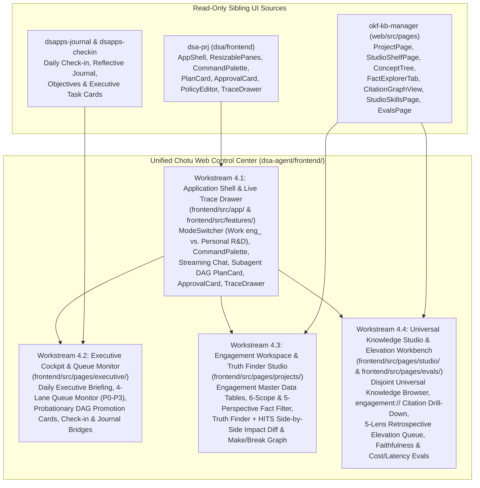
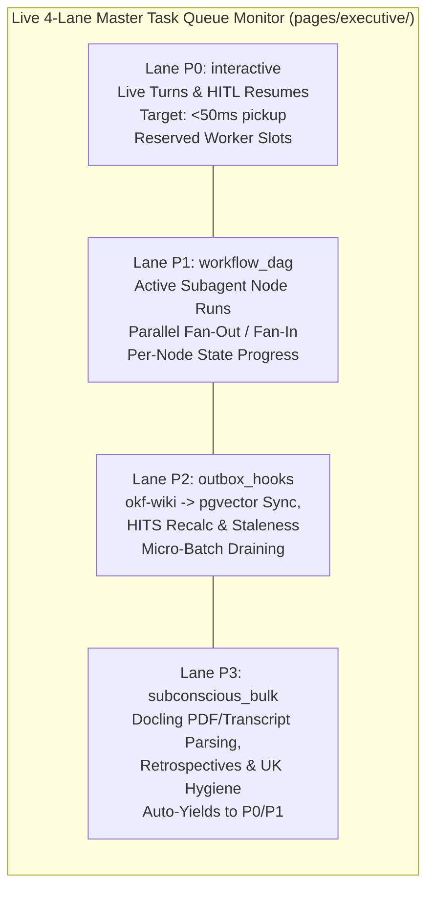
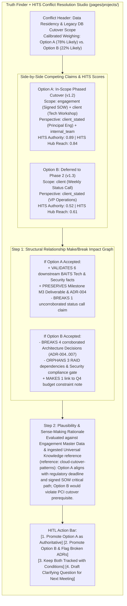
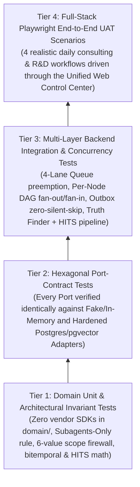

# Slice Group 4 Overall Plan: Unified Chotu Web Control Center (`frontend/`) & End-to-End Verification

- **Parent Blueprint**: [`chotu_architecture_plan.md`](file:///home/nox/Developer/ds2/dsa-agent/docs/planning/chotu_architecture_plan.md)
- **Foundational Retrospectives**:
  - [Identity & The "Chotu Corp" Operating Model](file:///home/nox/Developer/ds2/dsa-agent/brain-logs/conversation-retrospectives/2026-10-27-01-identity-and-chotu-corp-operating-model.md)
  - [Versioned Knowledge, Multi-Perspective Reality & The Truth Finder + HITS Engine](file:///home/nox/Developer/ds2/dsa-agent/brain-logs/conversation-retrospectives/2026-10-27-06-versioned-knowledge-truth-finder-and-hits-weighing.md)
  - [Real-World Consulting Scale, Hardened Postgres + `pgvector` Infrastructure & Master Task Queues](file:///home/nox/Developer/ds2/dsa-agent/brain-logs/conversation-retrospectives/2026-10-27-07-real-world-scale-postgres-hardening-and-master-queues.md)
- **Target Scope**: `frontend/` (React 19 + TypeScript + Vite + Tailwind v4 + `shadcn/ui`) and the full End-to-End Verification Suite (`backend/tests/` + `frontend/e2e/`).

---

## 1. Why Slice Group 4 Unifies Three Existing UIs Into One Cohesive Operator Cockpit

By the time we reach Slice Group 4, the backend engine of Chotu Corp is already up and running. The 9-layer hexagonal microkernel (`backend/platform/`), the hardened PostgreSQL 16+ cluster with `pgvector` HNSW indexes and the 4-Lane Priority Master Task Queue, the Versioned Knowledge and Truth Finder + HITS engine, and the full roster of BAITS consulting subagents and skills (`backend/inventory/`) are all wired together.

However, a backend that processes ten multi-perspective meetings and twenty dense documents a day is only half the battle if the human operator still has to jump between three or four disconnected browser tabs just to steer it.

Right now, across our sibling repositories, we already have working, well-crafted UI pieces that each solve one slice of the operator's day:
- **[`dsa-prj`](file:///home/nox/Developer/ds2/dsa-prj)** (`dsa/frontend`) gives us a clean React 19 application shell (`AppShell`, `ResizablePanes`, `CommandPalette`), a live chat stream, `PlanCard` and `ApprovalCard` components for human-in-the-loop governance, a `PolicyEditor`, and a `TraceDrawer` that inspects OpenTelemetry execution spans.
- **[`okf-kb-manager`](file:///home/nox/Developer/ds2/okf-kb-manager)** (`web/src/pages/`) gives us a mature knowledge curation workbench: project workspaces (`ProjectPage`), a Universal Knowledge shelf (`StudioShelfPage`), a hierarchical `ConceptTree`, an atomic `FactExplorerTab`, an interactive `CitationGraphView`, a skill browser (`StudioSkillsPage`), and retrieval evaluation dashboards (`EvalsPage`).
- **[`dsapps-journal`](file:///home/nox/Developer/ds2/dsapps-journal)** and **[`dsapps-checkin`](file:///home/nox/Developer/ds2/dsapps-checkin)** give us the operator's personal executive rhythm: daily check-ins, journal reflections, objective tracking, and focused task management.

When these interfaces live in separate apps, the operator is forced to play human clipboard. You read a morning briefing or log a daily objective in one app, switch to another window to ask an agent to synthesize a meeting transcript, jump to a third UI to inspect which `okf-wiki/` concepts were updated, and still have nowhere visual to resolve a mid-engagement claim conflict or check whether a bulk PDF ingestion job in Lane P3 is backed up behind a live DAG run.

Slice Group 4 eliminates that fragmentation. Instead of inventing a brand-new frontend from scratch, we harvest the proven React 19 + TypeScript + Vite + Tailwind v4 + `shadcn/ui` components from those three sources and fuse them—alongside purpose-built views for Engagement Master Data, the 4-Lane Queue Monitor, and the Truth Finder + HITS Impact Diff Studio—into a single, cohesive **Chotu Web Control Center (`frontend/`)**.



The table below maps how each harvested source and new capability lands inside `dsa-agent/frontend/`:

| Workstream | Target Path in `dsa-agent` | Harvested Foundation | New Chotu-Specific Capabilities Added in Slice 4 |
| :--- | :--- | :--- | :--- |
| **4.1 App Shell & Trace Drawer** | `frontend/src/app/` & `frontend/src/features/` | `dsa-prj` (`AppShell`, `ResizablePanes`, `CommandPalette`, `PlanCard`, `ApprovalCard`, `PolicyEditor`, `TraceDrawer`) | Hard **Mode & Scope Switcher** (`Work: eng_<slug>` vs. `Personal R&D`), live per-node `WorkflowNodeRun` DAG progress in `PlanCard`, and `turn -> workflow_node -> subagent -> tool` span hierarchy in `TraceDrawer`. |
| **4.2 Executive Cockpit** | `frontend/src/pages/executive/` | `dsapps-checkin` & `dsapps-journal` views + `dsa-prj` dashboard primitives | Subconscious **Daily Executive Briefing** card, real-time **4-Lane Master Task Queue Monitor** (`P0`–`P3` + outbox health), and **Probationary Workflow Promotion** cards (`CANDIDATE -> ESTABLISHED`). |
| **4.3 Engagement Workspace** | `frontend/src/pages/projects/` | `okf-kb-manager` (`ProjectPage`, `FactExplorerTab`, `ConceptTree`) | **Engagement Master Data Explorer** (Stakeholders, Systems, Capabilities, Decisions, Metrics, Deliverables, RAID), 6-value `scope:` & 5-value `perspective:` filters, and **Truth Finder + HITS Conflict Resolution Cards**. |
| **4.4 Universal Knowledge Studio & Evals** | `frontend/src/pages/studio/` & `frontend/src/pages/evals/` | `okf-kb-manager` (`StudioShelfPage`, `CitationGraphView`, `StudioSkillsPage`, `EvalsPage`) | Disjoint `universal.*` shelf browsing, two-stage `engagement://<engagement_id>#^<anchor>` provenance drill-down, **5-Lens Retrospective Elevation Workbench**, and Small-to-Big retrieval trace analytics. |
| **4.5 End-to-End Verification** | `backend/tests/` & `frontend/e2e/` | `dsa-prj` test discipline (`slice-delivery.md`, `hexagonal.md`) | Full 4-tier verification pyramid signing off realistic daily consulting and R&D workflows from raw transcript drop to Universal Knowledge elevation. |

---

## 2. Workstream 4.1 — The Application Shell, Command Palette & Live Execution Trace Drawer (Harvested from `dsa-prj`)

When the operator opens the Chotu Web Control Center, the frame around every page must do two things effortlessly: keep the current operating scope unmistakable at all times, and make Chotu's multi-agent orchestration completely transparent without cluttering the workspace. We achieve this by harvesting the shell architecture from [`dsa-prj`](file:///home/nox/Developer/ds2/dsa-prj) into `frontend/src/app/` and `frontend/src/features/` and extending it for Chotu's multi-scope, subagent-only architecture.

### Layout, Resizable Panes & The Mode Switcher
The outer frame (`AppShell` + `ResizablePanes`) divides the viewport into three collapsible, drag-resizable zones:
1. **Left Navigation & Scope Rail**: Houses the primary navigation across the Executive Cockpit (`executive/`), active Engagement Workspaces (`projects/`), the Universal Knowledge Studio (`studio/`), Evaluations (`evals/`), and Platform Settings (`settings/`).
2. **Center Primary Workbench**: Renders the active page—whether that is an engagement's Master Data and Truth Finder studio, the Universal Knowledge citation graph, or the CEO's morning briefing.
3. **Right Conscious Orchestrator & Trace Dock**: A persistent, resizable split pane where you collaborate live with `lead/chotu` and pop open the `TraceDrawer` whenever you want to inspect what is happening under the hood.

At the very top of the shell sits the **`ModeSwitcher`**, supported everywhere by the **`CommandPalette` (`Cmd+K` / `Ctrl+K`)**. Because a central rule of Chotu is hard schema and filesystem isolation between client engagements (`eng_<slug>`), Personal Mode R&D (`personal.*`), and Universal Knowledge (`universal.*`), the UI never leaves the active scope ambiguous. Switching from `Work Mode -> Engagement: acme-cloud-migration` to `Personal Mode -> R&D Sandbox` via `ModeSwitcher` or `Cmd+K` immediately updates the visual workspace badge, scopes the right-hand chat session, and binds all API queries to that exact dataset so you never accidentally mix client-confidential notes with personal experiments or another client's project.

### Live Conversation Streaming, `PlanCard` (Per-Node DAG Progress) & `ApprovalCard`
In the right-hand Conscious Orchestrator pane, chatting with Chotu feels instant because live turns enter the `P0 interactive` lane with reserved worker slots (`<50ms` pickup). Because `lead/chotu` obeys the **Subagents-Only Invariant**—never calling raw tools directly—every non-trivial turn either dispatches an `ESTABLISHED` workflow or composes a `CANDIDATE` Subagent DAG via `DynamicWorkflowComposer`.

We adapt `dsa-prj`'s **`PlanCard`** component so that instead of rendering a flat list of integer steps, it renders the live **Per-Node DAG State Machine (`WorkflowRun` + `WorkflowNodeRun`)** streamed over WebSockets/SSE:
- You see the upfront `WorkClassification` badge right at the top of the card (for example, `intent: architecture_synthesis | mode: work | engagement: eng_acme | pillars: [Business, Technology, Security] | path: ESTABLISHED`).
- Below the badge, `PlanCard` displays the directed graph of subagent nodes—including parallel fan-out branches (such as `business-architect` $\parallel$ `technology-architect` $\parallel$ `security-architect`) and fan-in synthesis nodes (`csa-scribe`).
- Each node badge transitions live through its database-backed states: `PENDING` $\rightarrow$ `READY` $\rightarrow$ `QUEUED` $\rightarrow$ `RUNNING` $\rightarrow$ `AWAITING_APPROVAL` $\rightarrow$ `COMPLETED` (or `FAILED`), with clickable links to the immutable `NodeOutput` artifacts produced by each specialist subagent.

Whenever a node hits a human-in-the-loop gate—such as onboarding an external app, executing a guarded tool outside normal policy, or promoting a high-impact knowledge change—the stream renders an inline **`ApprovalCard`** (harvested from `dsa-prj` and wired to `ApprovalBus`). Approving or rejecting with feedback on the card immediately dispatches a `P0 interactive` resume signal that transitions the paused `WorkflowNodeRun` out of `AWAITING_APPROVAL` without restarting the rest of the DAG. Adjacent to this, the **`PolicyEditor`** (also surfaced under `pages/settings/`) lets you inspect and tune the declarative allowlists, workspace path jails, and citeability firewall rules enforced at the runtime chokepoints.

### The `TraceDrawer`: Two Chokepoints Made Visible
Every agent invocation in Chotu passes through `AgentRuntime.invoke()`, and every tool call passes through `ToolRegistry.invoke()`. Clicking any turn or DAG node opens the **`TraceDrawer`**, which renders the full OpenTelemetry span tree:

```text
turn (origin: USER, hop_depth: 0, classification: System-1 ESTABLISHED)
 └── workflow_node (node_id: tech_arch_review, lane: P1 workflow_dag)
      ├── hook: pre_subagent_dispatch (ContextPacket + BAITS skill injection)
      ├── subagent: chotu://agent/architects/technology-architect@1.0.0
      │    ├── tool: chotu://tool/knowledge/okf_pgvector_search@1.0.0 (Small-to-Big recall, 18ms)
      │    └── tool: chotu://tool/builtin/vault_read@1.0.0 (jailed to workspaces/acme/okf-wiki/)
      └── hook: post_subagent_complete (6-value scope citeability firewall + [[concept#^fact]] check)
```

For each span, `TraceDrawer` shows latency, token consumption, model tier used by the Brain router, exact `ServiceLocatorPort` resolution stage (Stage 1 Exact URI vs. Stage 2 Faceted Filter vs. Stage 3 Hybrid Ranker), and any blocking or async observer hooks triggered along the way.

---

## 3. Workstream 4.2 — Executive Cockpit & 4-Lane Queue Monitor (`pages/executive/`)

As Chairman & CEO of Chotu Corp, you need a single morning landing page that answers three questions in under thirty seconds: *What did my Subconscious Mind discover overnight? Is the background ingestion and workflow machinery healthy across my engagements? And what are my priorities, check-ins, and pending executive decisions for today?*

Workstream 4.2 builds `frontend/src/pages/executive/` to serve as that CEO dashboard.

### 1. The Daily Executive Briefing Card
At the top of the Executive Cockpit sits the **Daily Executive Briefing**, generated on the third tier of the Subconscious Mind's cadence. Rather than dumping raw logs, this card presents a structured, conversational briefing synthesized across your active engagements and personal R&D projects:
- **Overnight Ingestion & Synthesis Summary**: How many transcripts, slide decks, and specifications were parsed since yesterday, which `okf-wiki/` concept pages were created or marked stale in `.csa/synthesis-status.md`, and which BAITS pillars moved forward.
- **High-Priority Conflict & Blind-Spot Alerts**: Any newly detected multi-perspective contradictions surfaced by Truth Finder + HITS that affect upcoming meetings or deliverables, with direct one-click deep links to the conflict cards in the relevant engagement workspace.
- **Cross-Engagement Pattern Signals**: Reminders where an active engagement challenge matches an elevated learning in Universal Knowledge (`universal.*`) that has not yet been pulled into the local engagement scope.

### 2. Live 4-Lane Master Task Queue Monitor & Outbox Health
Because a typical day involves ~10 multi-perspective meetings and ~20 complex documents alongside live interactive orchestration, the operator must never be left guessing whether background jobs are stuck or silently failing. Directly beside the briefing card, the **4-Lane Master Task Queue Monitor** visualizes the real-time state of the PostgreSQL `core.master_task_queue` and transactional ingestion outbox:



For each of the four lanes (`P0 interactive`, `P1 workflow_dag`, `P2 outbox_hooks`, and `P3 subconscious_bulk`), the monitor displays:
- **Queue Depth & Throughput**: Pending tasks, currently leased `RUNNING` tasks, completed tasks per minute, and p95 pickup latency.
- **Worker Pool & Preemption Status**: Active worker heartbeats, lease expirations, and visual confirmation when `P3 subconscious_bulk` yields worker capacity to incoming `P0` or `P1` work.
- **Transactional Outbox & Zero-Silent-Skip Ledger**: Live verification that every file dropped into `raw/` or updated in `okf-wiki/` is tracked by SHA-256 hash. If an external embedding model or Docling sidecar experiences transient downtime, you see the exact retry count and backoff timer (or dead-letter alert with a "Replay Now" button) rather than suffering silent data loss.

### 3. Probationary Workflow Promotion Cards (`CANDIDATE -> ESTABLISHED`)
Whenever Chotu encounters a novel request (`System-2 Deliberative Path`) and dynamically composes a new Subagent DAG, it saves that workflow template as a `CANDIDATE` in `WorkflowRegistry`. Once a `CANDIDATE` workflow achieves **3 consecutive verified successes** (or whenever you want to inspect newly grown workflows and capability-misses), the Executive Cockpit surfaces a **Probationary Workflow Promotion Card**. You can inspect the DAG topology, review its average cost, latency, and verification pass rate across those burn-in runs, and click **Promote to ESTABLISHED** so future requests with the same classification execute immediately on the zero-planning-overhead `System-1 Fast Path`.

### 4. Integrated Check-In, Reflective Journal & Objectives (`dsapps-checkin` & `dsapps-journal` Bridges)
Finally, the lower half of the Executive Cockpit integrates the UI views harvested from [`dsapps-checkin`](file:///home/nox/Developer/ds2/dsapps-checkin) and [`dsapps-journal`](file:///home/nox/Developer/ds2/dsapps-journal), backed at runtime by `ExternalAppAdapter` through `ServiceLocatorPort` (`chotu://app/personal/checkin` and `chotu://app/personal/journal`). You can complete your morning check-in, log personal or work reflections, review daily objectives, and convert action items from meeting transcripts directly into tracked tasks without ever leaving the cockpit.

---

## 4. Workstream 4.3 — Engagement Project Workspace, Master Data & Truth Finder + HITS Impact Diff Studio (`pages/projects/`)

When you switch into a specific client engagement (`eng_<slug>`), `frontend/src/pages/projects/` transforms the center workbench into a purpose-built **Consulting Engagement Control Room**. We start from the `ProjectPage`, `ConceptTree`, and `FactExplorerTab` foundations in [`okf-kb-manager`](file:///home/nox/Developer/ds2/okf-kb-manager) and expand them to handle the three hardest realities of daily consulting: structured **Engagement Master Data**, **multi-perspective claims**, and **mid-engagement conflict weighing**.

### 1. Engagement Master Data Explorer
In a real 6-to-12-month engagement, knowledge isn't just unstructured prose—it revolves around canonical project entities that get updated after every meeting. The **Engagement Master Data Explorer** provides dedicated, filterable, inline-editable relational tables backed by `eng_<slug>.*` for:
- **Accounts & Stakeholders**: Names, roles, departments, influence levels, and every claim they have stated across meetings (`perspective: client_stated`).
- **Systems & Capabilities**: The client's application, data, technology, and security inventory mapped to BAITS pillars and capability-bundles (`bvf/`, `raid/`).
- **Decisions (ADRs) & Deliverables**: Versioned architectural decisions (`v0.1 -> v0.2 -> v1.0`), SOW milestones, and target deliverables with live staleness indicators from `.csa/synthesis-status.md`.
- **Metrics & RAID Register**: Business KPIs, technical SLAs, Risks, Assumptions, Issues, and Dependencies.

Crucially, every row in these Master Data tables is bi-directionally linked to its supporting `okf-wiki/` concept pages and atomic facts (`[[concept#^f-id]]`). Clicking any system, decision, or RAID item immediately highlights the exact meeting transcripts and specification paragraphs that justify it.

### 2. Multi-Perspective Fact & BAITS Synthesis Explorer
Across ten meetings a day, who said something—and under what citeability boundary—matters just as much as what was said. In the enhanced `FactExplorerTab` and BAITS Synthesis views (`baits-business.md`, `baits-application.md`, `baits-information.md`, `baits-technology.md`, `baits-security.md`), the operator has instant multi-select facet bars for:
- **The 6-Value `scope:` Axis**: `engagement` (SOW/charter) · `client` · `internal` · `reference` · `prior-project` · `deliverable` (visually flagging which claims are safe to cite in client-facing deliverables vs. internal-only notes).
- **The 5-Value `perspective:` Axis**: `client_stated` (with stakeholder role/department sub-tags) · `internal_team` · `personal_take` · `work_research` · `personal_rd`.
- **Bitemporal Version Timeline**: A scrubber showing both `observed_at` (when the statement was made in reality) and `ingested_at` (when Chotu recorded it), allowing you to inspect how an architecture or requirement evolved from Week 1 discovery to Week 6 sign-off.

### 3. Truth Finder + HITS Conflict Resolution Cards
When two or more claims in `eng_<slug>` disagree—for instance, when a client's VP states in a status call that legacy database migration is out of scope, contradicting both the signed Week 2 SOW and the Principal Engineer's technical workshop notes—Chotu never overwrites the older record and never halts your workflow with a dumb blocker. Instead, both claims remain active and the workspace surfaces an interactive **Truth Finder + HITS Conflict Resolution Card**:



As shown in the diagram above, each Conflict Resolution Card walks you through the exact 2-step weighing pipeline from our architecture:
1. **HITS Authority & Hub Badges**: Shows side-by-side why each claim carries its structural weight (authority of a signed SOW vs. an ad-hoc call, corroboration count, and hub reach across BAITS pillars).
2. **Interactive Step 1 Make/Break Impact Graph**: Visually highlights which downstream BAITS synthesis paragraphs, Master Data records (Systems, Decisions, Deliverables, RAID items), and cross-pillar links each option **validates/makes** (in green) versus **contradicts/breaks** (in red).
3. **Step 2 Plausibility & Sense-Making Rationale**: Explains in plain prose why one option makes more architectural and organizational sense given the client's constraints and any reference standards pulled from Universal Knowledge (`scope: reference`).
4. **One-Click HITL Resolution Bar**: Gives you four surgical actions: promote Option A, promote Option B (which automatically queues staleness updates for any broken downstream artifacts), keep both claims tracked in parallel with explicit conditions, or generate a targeted clarifying question and add it to the agenda for your next stakeholder meeting.

---

## 5. Workstream 4.4 — Universal Knowledge Studio & Retrospective Elevation Workbench (`pages/studio/` & `pages/evals/`)

While `pages/projects/` enforces closed-world engagement isolation (`eng_<slug>`) so client data never leaks across boundaries, the operator also acts as custodian of Chotu Corp's long-term institutional memory: the **Disjoint Universal Knowledge Service (`universal.*` + `CHOTU_VAULT_PATH`)**. Workstream 4.4 adapts `StudioShelfPage`, `ConceptTree`, `FactExplorerTab`, `CitationGraphView`, `StudioSkillsPage`, and `EvalsPage` from [`okf-kb-manager`](file:///home/nox/Developer/ds2/okf-kb-manager) into `frontend/src/pages/studio/` and `frontend/src/pages/evals/`.

### 1. Browsing the Disjoint Universal Knowledge Fabric & `Discover -> Select -> Ingest`
In `StudioShelfPage`, you can browse your universal domain shelves (industry patterns, reference architectures, BAITS frameworks, methodology playbooks, and sanitized cross-engagement learnings) through the hierarchical `ConceptTree` and interactive `CitationGraphView`.

When you are working inside an active engagement and ask a question that the local engagement cannot answer on its own—or when you browse the Universal Knowledge Studio directly—you can trigger the controlled **`Discover -> Select -> Ingest`** workflow right from the UI:
- Search `universal.*` using Small-to-Big hybrid recall (atomic facts `^f-id` + parent `## <Pillar>` sections).
- Preview the candidate universal concepts and facts alongside their provenance.
- Select the relevant items and click **Ingest into Active Engagement (`eng_<slug>`)**, which copies and tags those records into the local engagement dataset as `scope: reference` or `scope: prior-project` so the engagement remains 100% self-contained and reproducible.

### 2. Two-Stage Provenance Drill-Down (`engagement://<engagement_id>#^<anchor>`)
Every insight elevated from a past project into Universal Knowledge carries a permanent correlation citation key: `engagement://<engagement_id>#^<anchor>`. In `CitationGraphView` and `FactExplorerTab`, clicking an `engagement://` citation badge performs a **two-stage drill-down**:
- **Stage 1 (Universal Summary Card)**: Displays the sanitized, reusable rule or pattern stored in `universal.*`, along with when it was elevated and which lens produced it.
- **Stage 2 (Authorized Historical Dataset Peek)**: With an explicit click, opens a read-only drawer into the historical `eng_<engagement_id>` dataset at the exact `^<anchor>` (showing the original architecture decision, metric, or retrospective finding from 6–12 months ago) without polluting your current engagement's context window.

### 3. The 5-Lens Retrospective Elevation Workbench
When an engagement hits a major milestone or closes, Chotu's `retro_elevator_agent` queues an **Engagement Closure Retrospective** in `P3 subconscious_bulk`. Before any learning is written permanently into `universal.*`, it lands in the **Retrospective Elevation Workbench** inside `pages/studio/` organized across the **5 Retrospective Lenses**:
1. **Achievements & Path Taken** (sanitized architectural patterns, winning deliverables, and reusable blueprints).
2. **Methodology Efficacy** (where BAITS synthesis, capability-bundles like `bvf/` or `raid/`, or specific workflows excelled or needed adaptation).
3. **People, Process, Tech, Tools & Techniques (PPTTT)** (stakeholder communication patterns, estimation calibration, and technical stack lessons).
4. **Counterfactuals & Day-1 Anti-Repeat Rules** ("If we started a similar engagement tomorrow, what would we do differently on Day 1?").
5. **Harvested Research & Reference Standards** (domain research conducted during the engagement that belongs in the permanent reference library).

For each candidate learning card, the workbench runs an automated sanitation check (highlighting any residual client PII or proprietary nouns that should be generalized), displays the exact `engagement://<engagement_id>#^<anchor>` links, and lets you edit, approve, or reject the elevation in one click.

### 4. Skills/Bundles Registry & Retrieval / Cost Evaluation Panels (`pages/evals/`)
Rounding out Workstream 4.4:
- **`StudioSkillsPage`** provides a unified visual catalog of all registered capabilities (`chotu://<kind>/<namespace>/<name>@<version>`), including operationalized `SKILL.md` playbooks, `bvf/` and `raid/` capability-bundles, internal tools, and onboarded external apps (`dsapps-*`), plus a live view of the **Capability-Miss Ledger** so you can see where Chotu needed to build or compose new capabilities.
- **`EvalsPage`** (`frontend/src/pages/evals/`) tracks Small-to-Big retrieval effectiveness (`RetrievalTrace` weights), citation faithfulness and completeness judge scores, Laya classifier confidence distributions, and LLM token cost and latency broken down by Brain tier, department, and priority lane.

---

## 6. Workstream 4.5 — End-to-End Verification Suite (Unit, Port-Contract, Integration & Playwright UAT)

Because Chotu is designed for high-velocity daily production use, Slice Group 4 does not stop when the React components render on screen. Workstream 4.5 implements the complete, four-tier verification pyramid across `backend/tests/` and `frontend/e2e/`, governed by the engineering discipline rules in [`RULES.md`](file:///home/nox/Developer/ds2/dsa-agent/RULES.md) and [`chotu_architecture_plan.md`](file:///home/nox/Developer/ds2/dsa-agent/docs/planning/chotu_architecture_plan.md).



### Tier 1 & Tier 2: Domain Unit Tests & Hexagonal Port-Contract Suite
- **Zero-Vendor-in-Domain & Subagents-Only Guards**: Automated CI checks verify that no file under `backend/platform/*/domain/` imports vendor SDKs (`fastapi`, `sqlalchemy`, `litellm`, `psycopg`, `openai`, etc.) and that `lead/chotu` cannot invoke `ToolRegistry.invoke()` directly.
- **Port-Contract Tests for Every Port**: Every abstract port (`LLMPort`, `TaskQueuePort`, `WorkflowStorePort`, `ServiceDiscoveryPort`, `ServiceLocatorPort`, `HookRegistryPort`, `KnowledgeIndexPort`, `TruthFinderPort`, `ApprovalBusPort`, `ObservabilityPort`) runs the exact same parametrized contract test suite against both its fast in-memory test double and its production PostgreSQL 16+ / `pgvector` adapter.

### Tier 3: Backend Integration & Scale Concurrency Suite
Runs against a live containerized PostgreSQL 16+ + `pgvector` instance to verify the operational guarantees from Slice Groups 1–3:
- **4-Lane Queue Preemption & Lease Recovery**: Floods `P3 subconscious_bulk` with 20 concurrent document ingestion jobs, fires a `P0 interactive` user turn and a `P1 workflow_dag` parallel fan-out, and asserts that `P0` starts in `<50ms` while `P3` yields capacity cleanly and recovers from simulated worker crashes via stale-lease reclamation.
- **Transactional Outbox Zero-Silent-Skip**: Simulates transient embedding sidecar failures during `okf-wiki/` updates, verifying that outbox rows backoff, retry, and project 100% of atomic facts (`^f-id`) and `## <Pillar>` sections into `pgvector` HNSW + FTS without dropping a single record.
- **Origin-Tagged Hook Recursion Fence**: Verifies that `origin: USER` (`hop_depth == 0`) triggers async observer hooks in `P2 outbox_hooks`, while `origin: HOOK` or `SUBCONSCIOUS` never triggers infinite workflow loops.

### Tier 4: Full-Stack Playwright End-to-End UAT Scenarios (`frontend/e2e/`)
Finally, our Playwright E2E suite drives the compiled React 19 `frontend/` portal against the live FastAPI + Postgres backend across **four realistic daily operator scenarios**:

| UAT Scenario | What the Playwright Suite Executes in the UI | End-to-End Assertions Signed Off |
| :--- | :--- | :--- |
| **Scenario 1: Multi-Perspective Transcript Ingestion & Master Data Binding** | Switches `ModeSwitcher` to `Work: eng_acme`, drops two meeting transcripts (`client_stated` VP call + `internal_team` architecture huddle) and a PDF spec into the project workspace, and watches the **4-Lane Queue Monitor** in `pages/executive/`. | Verifies `P3` extraction $\rightarrow$ `P2` `okf-wiki/` + `pgvector` indexing, confirms new Systems, Stakeholders, and RAID items appear in the **Engagement Master Data Explorer**, and verifies multi-perspective fact filtering (`scope:` & `perspective:`). |
| **Scenario 2: Truth Finder + HITS Conflict Weighing & HITL Resolution** | Opens `pages/projects/` where the two ingested transcripts disagree on legacy database cutover scope, inspects the **Truth Finder + HITS Conflict Resolution Card**, explores the **Step 1 Make/Break Impact Graph** and **Step 2 Plausibility Rationale**, and clicks **Promote Option A**. | Verifies that neither claim was auto-overwritten on ingest, confirms HITS Authority/Hub scores and Make/Break counts render accurately, and verifies that promoting Option A updates the authoritative synthesis while preserving Option B's bitemporal lineage. |
| **Scenario 3: Parallel BAITS Synthesis DAG, `PlanCard` & `TraceDrawer` Inspection** | Uses `CommandPalette` (`Cmd+K`) to request a cross-pillar BAITS architecture synthesis, watches `PlanCard` stream parallel `WorkflowNodeRun` execution (`business-architect` $\parallel$ `technology-architect` $\parallel$ `security-architect` $\rightarrow$ `csa-scribe`), approves a gated step via `ApprovalCard`, and opens `TraceDrawer`. | Confirms `lead/chotu` delegates exclusively to subagents, verifies immutable per-node outputs without race conditions, validates the 6-value `scope:` citeability firewall on the final deliverable, and asserts the full `turn -> workflow_node -> subagent -> tool` span hierarchy in `TraceDrawer`. |
| **Scenario 4: Engagement Closure Retrospective & Universal Knowledge Elevation** | Triggers an Engagement Closure Retrospective on `eng_acme`, switches to `pages/studio/`, reviews the **5-Lens Retrospective Elevation Workbench**, approves a sanitized architecture pattern for elevation, and then switches to a second engagement (`eng_beta`) to run `Discover -> Select -> Ingest`. | Verifies that `eng_beta` cannot see `eng_acme`'s raw client facts, confirms the elevated pattern is discoverable in `universal.*` with its `engagement://eng_acme#^<anchor>` citation, and proves two-stage provenance drill-down and local ingestion (`scope: prior-project`). |

---

## 7. Slice Group 4 Delivery Checklist & Sign-Off Gates

Before Slice Group 4 is marked complete, all five workstreams must pass the following concrete verification gates via the root `Makefile`:

1. **`make lint` & `make typecheck`**: `ruff` + `mypy --strict` across `backend/` and `eslint` + `tsc --noEmit` across `frontend/` pass with zero warnings or errors.
2. **`make check-architecture`**: Automated grep/AST guards verify zero vendor imports in `domain/`, zero `inventory/` imports inside `platform/`, and strict adherence to the `AgentRuntime.invoke` / `ToolRegistry.invoke` chokepoints.
3. **`make test-unit` & `make test-contracts`**: 100% pass rate on all domain unit tests and hexagonal port-contract tests.
4. **`make test-integration`**: 100% pass rate on PostgreSQL 16+ / `pgvector` schema isolation (`core.*`, `universal.*`, `personal.*`, `eng_<slug>.*`), 4-lane queue preemption, outbox durability, and Truth Finder + HITS weighing tests.
5. **`make test-e2e`**: All four Playwright UAT scenarios pass against the unified React 19 Web Control Center (`frontend/`).
