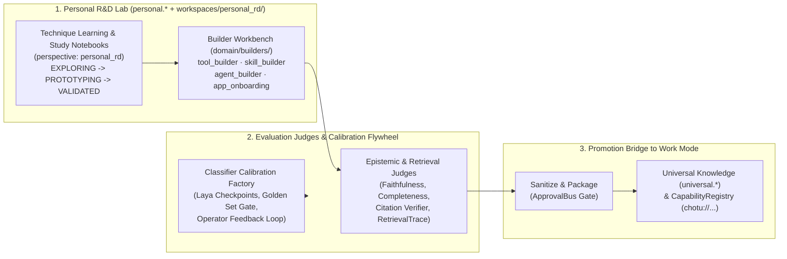

# Slice Group 5 Overall Plan: Personal R&D Mode, Technique Learning, Self-Extension Builders, Evaluation Judges & Continuous Learning Loop

> **Queue Position**: Slice Group 5 of 5 (Self-Extension, Personal R&D & Continuous Calibration)  
> **Parent Blueprint**: [`chotu_architecture_plan.md`](file:///home/nox/Developer/ds2/dsa-agent/docs/planning/chotu_architecture_plan.md) · **Planning Index**: [`docs/planning/README.md`](file:///home/nox/Developer/ds2/dsa-agent/docs/planning/README.md) · **Literate TDD Execution Plan**: [`docs/planning/tdd-plans/slice-05-tdd-plan.md`](file:///home/nox/Developer/ds2/dsa-agent/docs/planning/tdd-plans/slice-05-tdd-plan.md) · **Brainstorming Context**: [`brain-logs/README.md`](file:///home/nox/Developer/ds2/dsa-agent/brain-logs/README.md)

---

## 1. Why Personal R&D Mode & Continuous Self-Improvement Deserve Their Own Dedicated Slice Group

During our brainstorming on knowledge boundaries and daily consulting scale (captured in [Retrospective #5](file:///home/nox/Developer/ds2/dsa-agent/brain-logs/conversation-retrospectives/2026-10-27-05-knowledge-fabric-engagement-datasets-and-elevation.md) and [Retrospective #7](file:///home/nox/Developer/ds2/dsa-agent/brain-logs/conversation-retrospectives/2026-10-27-07-real-world-scale-postgres-hardening-and-master-queues.md)), a crucial distinction surfaced. After mapping out how client engagements, BAITS synthesis, and Universal Knowledge work in **Work Mode**, the operator paused and drew a clear line:

> *"All of this is for 'work' mode. In personal mode, I need to learn techniques that 'might' help me with work, design tools for myself, and so on."*

If we treat Personal R&D Mode, self-extending builders (`tool_builder`, `skill_builder`, `agent_builder`), retrieval/epistemic evaluation judges, and classifier calibration as minor afterthoughts tucked into the corners of Slices 3 and 4, two things go wrong:
1. **Experimental ideas pollute production knowledge**: When you are reading an emerging arXiv paper on Sunday morning, testing a half-baked prompting technique, or sketching a personal CLI tool, you do not want those unverified notes leaking into an active client engagement (`eng_<slug>.*`) or masquerading as proven methodology inside the Universal Knowledge Fabric (`universal.*`).
2. **Chotu stays static instead of compounding in capability**: The entire promise of "Chotu Corp" is that Chotu is a **self-extending enterprise**. When the operator studies a new technique in Personal Mode, prototypes a tool or skill on a sandbox bench, verifies it with objective evaluation judges, and promotes it, Chotu permanently levels up — and that newly promoted capability becomes discoverable by Work Mode engagements the very next day.

Slice Group 5 brings together the complete **R&D, Self-Extension, Evaluation, and Calibration loop**: a dedicated Personal R&D laboratory (`personal.*` + `workspaces/personal_rd/`), a governed builder workbench (`domain/builders/`), objective faithfulness and completeness judges harvested from [`okf-kb-manager`](file:///home/nox/Developer/ds2/okf-kb-manager/CLAUDE.md), and the active classifier distillation and calibration loop harvested from [`classifier-training`](file:///home/nox/Developer/ds2/classifier-training/CLAUDE.md).

---

## 2. Workstream 5.1 — Personal Technique Learning & Study Notebooks (`personal.*` Schema & `personal_rd` Perspective)

### Why This Matters
When a consultant or architect is on a live client engagement, every note and synthesis has to stay disciplined, defensible, and tied to SOW deliverables. Personal R&D Mode is the exact opposite: it needs to be a low-friction curiosity laboratory where you can drop in 15 research papers on graph retrieval, a GitHub repo for a new encoder, or rough notes on a systems-thinking technique that *might* be useful three months from now.

If Personal R&D uses a completely alien storage format, you lose the power of Chotu's Small-to-Big Librarian and `okf-wiki/` concept linking. Instead, Personal Mode runs on the **exact same hexagonal knowledge machinery** built in Slice Group 2, but strictly isolated inside the **`personal.*` Postgres schema** and **`workspaces/personal_rd/`** directory, with every claim tagged `perspective: personal_rd`.

### What We Will Build in Workstream 5.1
- **The `personal.*` Knowledge & Experiment Schema**:
  - Mirrors the `okf-wiki/` $\rightarrow$ `pgvector` HNSW atomic facts and concept sections structure from Slice Group 2, plus two R&D-specific tables: `personal.technique_studies` and `personal.experiment_runs`.
  - Every note, paper extraction, or hypothesis ingested in Personal Mode is automatically stamped with `perspective: personal_rd` and `scope: internal` so the citeability firewall in Work Mode never accidentally cites an unverified personal experiment as a client or industry fact.
- **Technique Readiness Lifecycle (`EXPLORING` $\rightarrow$ `PROTOTYPING` $\rightarrow$ `VALIDATED` $\rightarrow$ `PROMOTED_TO_UNIVERSAL` | `ARCHIVED`)**:
  - When the operator studies a new technique (for example, *"HITS Authority Weighing for Architecture ADR Conflicts"* or *"Laya Encoder Confidence Calibration"*), Chotu organizes the study around a structured **Technique Notebook** inside `workspaces/personal_rd/techniques/<slug>/`:
    1. **`EXPLORING`**: Raw ingested papers, transcripts, repo summaries, and "what problem does this solve?" notes.
    2. **`PROTOTYPING`**: Hands-on sandbox scripts, sample datasets, and trial runs testing whether the technique actually works in practice.
    3. **`VALIDATED`**: Empirical benchmark results (latency, cost, accuracy/faithfulness score) proving the technique beats our current baseline.
    4. **`PROMOTED_TO_UNIVERSAL`**: Packaged and elevated into `universal.*` or `~/.chotu/` for Work Mode use.

---

## 3. Workstream 5.2 — Personal Tool, Skill & Capability-Bundle Design Bench (`domain/builders/` + Sandbox Verification)

### Why This Matters
In Personal Mode (and whenever a capability miss occurs in Work Mode), the operator doesn't just read about techniques — they build **new tools, new `SKILL.md` playbooks, new specialist subagents, and bridges to external `dsapps-*` applications**.

However, letting an LLM agent write Python tool code or a new subagent manifest directly into the live runtime registry without isolation is a reliability nightmare: one syntax error or infinite loop could destabilize the active harness. As established in [`code-structure.md`](file:///home/nox/Developer/ds2/dsa-prj/docs/standards/code-structure.md), user-grown capabilities under `~/.chotu/` must follow the exact same folder anatomy (`manifest.yaml` + implementation + `skills/` + `README.md` + tests) and pass through the exact same registration gates as shipped inventory.

### What We Will Build in Workstream 5.2
- **The Four Self-Extension Builder Subagents (`backend/inventory/agents/domain/builders/`)**:
  1. **`tool_builder` (`chotu://agent/builders/tool_builder@1.0.0`)**: Scaffolds a new internal tool (`manifest.yaml` with JSON Schema I/O contract, typed Python handler, and unit test suite) inside an isolated git worktree/sandbox jail (`platform/environment/`).
  2. **`skill_builder` (`chotu://agent/builders/skill_builder@1.0.0`)**: Harvests patterns from `csa-*` and `skill-adapter` in [`dsa-companion-config`](file:///home/nox/Developer/ds2/dsa-companion-config) to author or refine operationalized `SKILL.md` playbooks and multi-artifact capability bundles (`packs/<bundle_slug>/`), complete with trigger signatures and output rubrics.
  3. **`agent_builder` (`chotu://agent/builders/agent_builder@1.0.0`)**: Composes a new specialist subagent definition (`manifest.yaml`, system prompt, allowed `chotu://tool/...` whitelist, BAITS pillar tags, and canned-actor contract tests).
  4. **`app_onboarding` (`chotu://agent/builders/app_onboarding@1.0.0`)**: Onboards an independent external application (`dsapps-*` over MCP, REST/OpenAPI, or CLI) by probing its health/schema endpoints, generating a `chotu://app/<namespace>/<name>@<version>` manifest, and verifying round-trip invocation through `ExternalAppAdapter`.
- **The Sandbox Verification & Graduation Gate**:
  - Every builder subagent works inside a temporary sandbox directory (`workspaces/personal_rd/sandbox/<build_id>/`).
  - Before a built tool, skill, or agent can be presented to the operator for approval, the builder pipeline automatically runs:
    1. `ruff check` and `mypy --strict` on the generated Python files.
    2. `check_hexagonal_boundaries.py` to confirm zero forbidden imports.
    3. `pytest` on the generated unit and contract tests inside the jailed environment.
  - Only when all three checks are green does Chotu emit an `ApprovalRequest` on the `ApprovalBus` showing the operator the manifest diff, test results, and security scope. Upon approval, the artifact is installed into `~/.chotu/{tools,skills,agents,packs}/` and hot-registered into `ServiceDiscoveryPort`.

---

## 4. Workstream 5.3 — Epistemic & Retrieval Evaluation Judges & Closed-Loop `RetrievalTrace` Scoring

### Why This Matters
How do we know whether a new retrieval technique tested in Personal Mode, a newly synthesized BAITS section in Work Mode, or a candidate Subagent DAG is actually producing defensible, high-signal answers? In [`okf-kb-manager`](file:///home/nox/Developer/ds2/okf-kb-manager/CLAUDE.md), we proved that you cannot trust an LLM's self-reported confidence; you need separate, deterministic and rubric-driven **Evaluation Judges** that verify citation grounding, faithfulness to retrieved facts, and completeness against the user's question.

Even better, when we combine those evaluation scores with the **`RetrievalTrace` ledger** (`core.retrieval_traces`), Chotu closes the feedback loop: skills, tools, and knowledge concepts that consistently produce faithful, operator-approved outputs gain higher reliability weights in `ServiceLocatorPort` and the Small-to-Big Librarian, while noisy or low-scoring artifacts are flagged for hygiene or retirement.

### What We Will Build in Workstream 5.3
- **Harvesting the Three Epistemic Judges from [`okf-kb-manager`](file:///home/nox/Developer/ds2/okf-kb-manager/CLAUDE.md) (`backend/platform/knowledge/` & `backend/inventory/agents/domain/kb/`)**:
  1. **Deterministic Citation & Scope Firewall Verifier**: Runs as a fast `post_subagent` hook and eval check. Parses every `[[concept#^f-id]]` and `engagement://<id>#^<anchor>` citation in a synthesis block, verifies that the anchor exists in the canonical `okf-wiki/` store, and confirms that no `internal` or `personal_rd` claim leaked into a `client` or `deliverable` output.
  2. **Faithfulness Judge (`FaithfulnessJudgePort`)**: Evaluates whether every substantive claim in a generated response is strictly entailed by the cited `ContextPacket` facts (catching subtle hallucinations or unsupported extrapolations) and triggers a bounded corrective retry loop (adapted from `okf-kb-manager` ADR-0009) if faithfulness falls below threshold.
  3. **Completeness & BAITS Coverage Judge (`CompletenessJudgePort`)**: Evaluates whether the synthesis addressed all dimensions of the query and required BAITS pillars, identifying specific missing perspectives or unanswered questions.
- **Closed-Loop `RetrievalTrace` Effectiveness Ledger (`core.retrieval_traces`)**:
  - Every turn records which `chotu://` capabilities, `SKILL.md` playbooks, and `okf-wiki/` concepts/facts were retrieved into the `ContextPacket`, whether they were actually cited in the final output, the Faithfulness/Completeness judge scores, and any explicit operator thumbs-up/edit/rejection signal.
  - An async `P2 outbox_hooks` observer aggregates these traces to update the `historical_reliability_score` used by Stage 3 of `ServiceDiscoveryPort` and the concept utility weights in `platform/memory/`.

---

## 5. Workstream 5.4 — Classifier Calibration & Active Learning Loop (Harvested from `classifier-training`)

### Why This Matters
In Slice Group 1 and Slice Group 3, Chotu relies heavily on fast, upfront classification:
- `WorkClassifierPort` routes every incoming message or file drop (`intent`, `mode: work | personal`, `engagement_slug`, `departments[]`, `baits_pillars[]`, `complexity`, `risk_level`).
- The Ingestion & Epistemic classifiers tag claims with the **6-value `scope:`** (`engagement`, `client`, `internal`, `reference`, `prior-project`, `deliverable`) and **5-value `perspective:`** (`client_stated`, `internal_team`, `personal_take`, `work_research`, `personal_rd`).

As [`classifier-training`](file:///home/nox/Developer/ds2/classifier-training/docs/superpowers/specs/2026-10-03-laya-checkpoint-factory-design.md) explains so well, using a heavyweight autoregressive LLM decoder for every single small taxonomy decision is 100x too expensive, slow, and prone to out-of-vocabulary label drift. Conversely, a small encoder checkpoint ([Laya](https://github.com/NandhaKishorM/laya) ModernBERT/mmBERT) makes structurally valid choices across a fixed YAML taxonomy in ~33ms with calibrated probabilities — provided we have a disciplined **distillation and golden-set calibration flywheel**.

### What We Will Build in Workstream 5.4
- **Harvesting the Taxonomy & Laya Checkpoint Contracts from [`classifier-training`](file:///home/nox/Developer/ds2/classifier-training/CLAUDE.md)**:
  - Single-source-of-truth YAML taxonomies under `backend/inventory/agents/internal/classifiers/taxonomies/` covering Chotu's core routing and epistemic decisions (`work_intent.yaml`, `baits_pillars.yaml`, `epistemic_scope.yaml`, `epistemic_perspective.yaml`, plus domain taxonomies `ai-engineering.yaml`, `strategy.yaml`, `org-frameworks.yaml`).
  - **`LayaClassifierAdapter` behind `WorkClassifierPort`**: Loads versioned, provenance-stamped checkpoints (`run.json` + calibrated confidence thresholds). When confidence exceeds the calibrated gate, System-1 routing proceeds in milliseconds with zero LLM token cost; when confidence falls below the gate, it escalates cleanly to System-2 teacher inference.
- **Operator Correction Capture & Golden-Set Distillation Flywheel**:
  - Whenever the operator overrides a classification in the UI or CLI (for example, changing a claim's perspective from `client_stated` to `internal_team`, or switching a turn from `work` to `personal` mode) — or when System-2 handles a low-confidence turn — Chotu logs the labeled example into `core.classifier_feedback_ledger`.
  - In Personal R&D Mode (or scheduled `P3 subconscious_bulk` maintenance), the operator can export accumulated corrections into the **Golden Set**, run the distillation/calibration gate, and promote a new checkpoint symlink only if it beats the current champion on the human-verified golden set.

---

## 6. Workstream 5.5 — The Bridge from Personal R&D to Work Mode ("Technique & Tool Promotion")

### Why This Matters
Isolation between `personal.*` and `eng_<slug>.*` protects client work from half-baked experiments, but there must be a clean, intentional bridge when a personal experiment **succeeds**. Suppose the operator spends two weekends in Personal Mode studying a new "Wardley Map Value-Chain Extraction" technique, validates it on public case studies, and builds a `wardley-extract` skill bundle. How does that capability cross over so BAITS architects can use it in Work Mode?

Just as client engagements never talk directly to other client engagements (they elevate sanitized insights into Universal Knowledge via the Elevation Technique), **Personal R&D never mutates a client engagement directly**. Instead, validated personal techniques and tools are **promoted into Universal Knowledge (`universal.*`) and the Capability Registry (`~/.chotu/` / `backend/inventory/`)**.

### What We Will Build in Workstream 5.5
- **The Personal-to-Universal Technique Promotion Workflow (`TechniquePromoter`)**:
  1. **Readiness & Quality Gate Check**: Verifies that the technique study in `personal.technique_studies` has reached `VALIDATED` status and that any associated `SKILL.md`, capability-bundle (`packs/`), or `chotu://tool/...` passes all sandbox tests and epistemic evaluation thresholds.
  2. **Sanitization & Reference Packaging**: Strips personal scratch notes and packages the distilled methodology guide, reference concepts, and benchmark evidence into an OKF-conformant reference bundle stamped with provenance `personal_rd://<study_id>#^<anchor>`.
  3. **HITL Promotion via `ApprovalBus`**: Presents the promotion card to the operator. Once approved:
     - The methodology concepts and facts are indexed into **`universal.*`** (`CHOTU_VAULT_PATH`).
     - Any accompanying tool, skill, or capability-bundle is registered in `CapabilityRegistry` with `mode_visibility: ["personal", "work"]`.
  4. **Downstream Consumption in Work Mode**: The next time a Work Mode engagement asks, *"Do we have a technique or bundle for value-chain mapping?"*, the Universal Knowledge **Discover $\rightarrow$ Select $\rightarrow$ Ingest** flow and `ServiceDiscoveryPort` surface the newly promoted capability immediately.

---

## 7. Authoritative Harvest Map for Slice Group 5

| Source Repository | Harvested Assets | Target Location in `dsa-agent` |
| :--- | :--- | :--- |
| **[`classifier-training`](file:///home/nox/Developer/ds2/classifier-training/CLAUDE.md)** | Single-source YAML taxonomy contracts (`taxonomies/*.yaml`), Laya checkpoint loader & `run.json` provenance verification, confidence-threshold gating, and golden-set promotion gate logic | `backend/platform/brain/adapters/laya_classifier_adapter.py`, `backend/platform/orchestration/`, & `backend/inventory/agents/internal/classifiers/` |
| **[`okf-kb-manager`](file:///home/nox/Developer/ds2/okf-kb-manager/CLAUDE.md)** | Faithfulness Judge, Completeness Judge, bounded corrective citation loop (ADR-0009), citation graph verifier, and `EvalsPage` telemetry views | `backend/platform/knowledge/`, `backend/inventory/agents/domain/kb/`, & `frontend/src/pages/evals/` |
| **[`dsa-prj`](file:///home/nox/Developer/ds2/dsa-prj/docs/standards/code-structure.md)** | `domain/builders/{agent_builder,tool_builder,skill_builder,connector_builder}` patterns and `~/.ds-assistant/` $\rightarrow$ `~/.chotu/` runtime registration parity | `backend/inventory/agents/domain/builders/` & `backend/platform/multiagent/` |
| **[`dsa-companion-config`](file:///home/nox/Developer/ds2/dsa-companion-config/README.md)** | `skill-adapter` playbook and `frameworks/bundles/` packaging conventions | `backend/inventory/skills/skill-adapter/` & `backend/inventory/packs/` |

---

## 8. Verification & "Definition of Done" for Slice Group 5

Slice Group 5 is complete when the following end-to-end checks pass:

1. **Strict Personal Mode Isolation (`personal.*` & `perspective: personal_rd`)**:
   - Ingesting a paper or experiment in Personal Mode persists all facts and embeddings exclusively in `personal.*` and `workspaces/personal_rd/` with `perspective: personal_rd`.
   - Automated boundary test proves that a Work Mode engagement (`eng_<slug>`) running Small-to-Big retrieval or Universal Knowledge discovery **never** retrieves unpromoted `personal.*` records.
2. **Governed Self-Extension Builder Bench**:
   - End-to-end test where `tool_builder` and `skill_builder` scaffold a new tool and `SKILL.md` inside a jailed sandbox worktree, execute automated `ruff`, `mypy --strict`, `check_hexagonal_boundaries.py`, and `pytest` verification, pause at `ApprovalBus`, and upon approval register the live `chotu://` capability in `ServiceDiscoveryPort`.
3. **Epistemic Judges & Closed-Loop `RetrievalTrace` Feedback**:
   - Unit and integration tests proving that the Citation Verifier rejects fabricated `[[concept#^fact]]` anchors or `scope:` firewall violations, that `FaithfulnessJudgePort` and `CompletenessJudgePort` score synthesis outputs accurately, and that `core.retrieval_traces` updates capability reliability weights in `ServiceDiscoveryPort`.
4. **Laya Classifier Calibration & Golden-Set Gate**:
   - Contract and integration tests verifying that `WorkClassifierPort` and the epistemic scope/perspective classifiers load YAML taxonomies, enforce calibrated confidence thresholds (fast System-1 path vs. System-2 escalation), record operator corrections to `core.classifier_feedback_ledger`, and enforce the golden-set promotion gate.
5. **Personal-to-Universal Promotion Bridge**:
   - Integration test proving that a `VALIDATED` technique and skill built in `personal.*` can be promoted via `TechniquePromoter` (with `ApprovalBus` confirmation) into `universal.*` and `CapabilityRegistry`, and subsequently discovered and ingested by an active Work Mode engagement (`eng_<slug>`).
